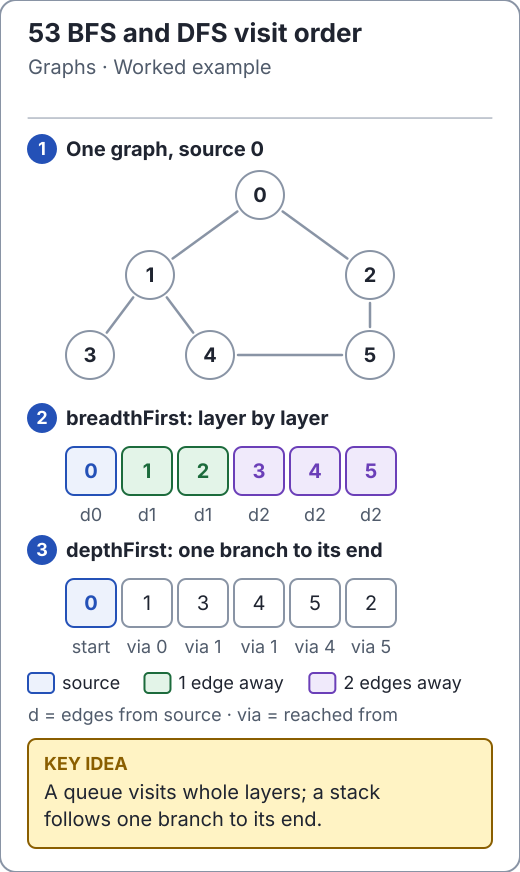
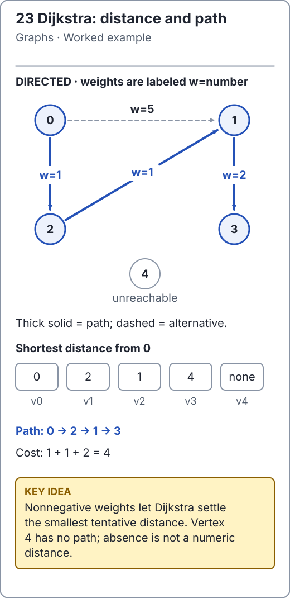

# Graph traversal: schedule each vertex deliberately

Traversal explores reachability while avoiding repeated work on cycles. [`GraphAlgorithms`](../../src/main/java/io/github/ichillous/dsa/graphs/GraphAlgorithms.java) provides BFS, iterative DFS, unweighted shortest paths, components, topological ordering and weighted algorithms. Results are immutable snapshots.

| At a glance | |
| --- | --- |
| **Use it when** | You need what is reachable, the fewest edges to a target, connected components or a dependency order. |
| **Avoid it when** | Edges carry costs that matter: BFS counts edges, not weights, so use Dijkstra or another weighted method. |
| **Cost** | BFS, DFS, unweighted shortest path, components and topological order O(V + E); Dijkstra O(V + E log(E + 1)). |
| **In this repo** | [`GraphAlgorithms`](../../src/main/java/io/github/ichillous/dsa/graphs/GraphAlgorithms.java): `breadthFirst`, `depthFirst`, `shortestPath`, `connectedComponents`, `topologicalSort`, `dijkstra` |
| **In the JDK** | no direct equivalent traversal; `ArrayDeque` serves as the BFS queue or the DFS stack |

## BFS: discover before enqueueing

BFS uses a FIFO queue. Mark a vertex when it is discovered and enqueued, so multiple neighbors cannot queue it repeatedly. The queue processes distance layers in increasing edge count.

```text
       0              BFS layers: {0}, {1,2}, {3,4}
      / \
     1   2            isolated vertex: 5
     |   |
     3---4
```

```java
import io.github.ichillous.dsa.graphs.Graph;
import io.github.ichillous.dsa.graphs.GraphAlgorithms;
import java.util.List;

Graph graph = Graph.undirected(6);
graph.addEdge(0, 1).addEdge(0, 2).addEdge(1, 3).addEdge(2, 4).addEdge(3, 4);
assert GraphAlgorithms.breadthFirst(graph, 0).equals(List.of(0, 1, 2, 3, 4));
assert GraphAlgorithms.shortestPath(graph, 0, 4).equals(List.of(0, 2, 4));
assert GraphAlgorithms.shortestPath(graph, 0, 5).isEmpty();
assert GraphAlgorithms.shortestPath(graph, 2, 2).equals(List.of(2));
```

The predecessor assigned on first discovery records a shortest path. Reversing the chain from target to source reconstructs an endpoint-inclusive result. Unreachable targets return an empty list; source-to-source returns one vertex.

## DFS: preserve unfinished neighbor scans

DFS follows one branch before returning to alternatives. The maintained implementation uses explicit frames with neighbor iterators, reproducing recursive insertion-order traversal without recursive Java calls. Simply pushing every neighbor can produce a different order.

```java
import io.github.ichillous.dsa.graphs.Graph;
import io.github.ichillous.dsa.graphs.GraphAlgorithms;
import java.util.List;

Graph graph = Graph.undirected(6);
graph.addEdge(0, 1).addEdge(0, 2).addEdge(1, 3).addEdge(2, 4).addEdge(3, 4);
assert GraphAlgorithms.depthFirst(graph, 0).equals(List.of(0, 1, 3, 4, 2));
assert GraphAlgorithms.connectedComponents(graph).equals(List.of(List.of(0, 1, 2, 3, 4), List.of(5)));
```

<!-- visual:generated bfs-vs-dfs-order | The same graph and source: breadthFirst visits whole layers, depthFirst follows one branch to its end. -->
<picture><source media="(prefers-color-scheme: dark)" srcset="../../docs/visuals/assets/bfs-vs-dfs-order-dark.svg"></picture>

**Figure 59.** The same graph and source: breadthFirst visits whole layers, depthFirst follows one branch to its end. [Visual index and step-throughs](../../docs/visuals/README.md).
<!-- /visual:generated -->

BFS and DFS both cost O(V + E) time; they do not optimize the same output. DFS paths need not have minimum edge count. Connected components starts another traversal for each unseen vertex, including isolated vertices; it accepts only undirected graphs.

## Weighted paths change the next-candidate rule

<!-- visual:generated dijkstra-path -->
<picture><source media="(prefers-color-scheme: dark)" srcset="../../docs/visuals/assets/dijkstra-path-dark.svg"></picture>

**Figure 23.** Compare weighted routes from source 0 and distinguish unreachable vertex 4. [Visual index and step-throughs](../../docs/visuals/README.md).
<!-- /visual:generated -->

BFS cannot minimize arbitrary weights. Dijkstra uses a priority queue of tentative distances, ignores superseded entries, and requires every weight to be nonnegative.

```java
import io.github.ichillous.dsa.graphs.GraphAlgorithms;
import io.github.ichillous.dsa.graphs.WeightedGraph;
import java.util.List;

WeightedGraph graph = WeightedGraph.directed(5);
graph.addEdge(0, 1, 5).addEdge(0, 2, 1).addEdge(2, 1, 1).addEdge(1, 3, 2);
var paths = GraphAlgorithms.dijkstra(graph, 0);
assert paths.distanceTo(3).orElseThrow() == 4;
assert paths.pathTo(3).equals(List.of(0, 2, 1, 3));
assert paths.distanceTo(4).isEmpty();
```

A distance of `Long.MAX_VALUE` is representable; absence uses `OptionalLong.empty()`. Overflowing detours are ignored, but an unrepresentable reachable shortest distance throws. Dijkstra costs O(V + E log(E + 1)) here because the lazy heap can contain O(E) entries. Traversal and weighted-path working space is O(V + E), including adjacency snapshots.

A topological order answers a different question: repeatedly remove directed vertices of indegree zero. Failing to remove all vertices proves a directed cycle. A cycle is acceptable for reachability but prevents a prerequisite order.

## In real Java

`ArrayDeque` is the usual JDK structure for both traversal frontiers: `add` and `remove` make it a FIFO queue, `push` and `pop` make it a LIFO stack, and it rejects `null` elements. A stack does not make a correct DFS by itself, though: pushing every neighbor at once visits the last-pushed neighbor first and changes the order that `depthFirst` guarantees.

```java
import io.github.ichillous.dsa.graphs.Graph;
import io.github.ichillous.dsa.graphs.GraphAlgorithms;
import java.util.ArrayDeque;
import java.util.ArrayList;
import java.util.Deque;
import java.util.List;

Graph graph = Graph.undirected(6);
graph.addEdge(0, 1).addEdge(0, 2).addEdge(1, 3).addEdge(2, 4).addEdge(3, 4);

boolean[] seen = new boolean[6];
List<Integer> pushAll = new ArrayList<>();
Deque<Integer> stack = new ArrayDeque<>();
stack.push(0);
while (!stack.isEmpty()) {
    int vertex = stack.pop();
    if (seen[vertex]) {
        continue;
    }
    seen[vertex] = true;
    pushAll.add(vertex);
    for (int neighbor : graph.neighbors(vertex)) {
        if (!seen[neighbor]) {
            stack.push(neighbor);
        }
    }
}
assert pushAll.equals(List.of(0, 2, 4, 3, 1));                        // last neighbor first
assert GraphAlgorithms.depthFirst(graph, 0).equals(List.of(0, 1, 3, 4, 2)); // insertion order
```

Both orders are valid depth-first traversals of the graph; the point is that the library's order is specified (insertion-ordered neighbors) and the shortcut's is not.

## Common mistakes

1. **Marking BFS vertices only when dequeued.** On `0 -> 1, 0 -> 2, 1 -> 3, 2 -> 3`, vertex 3 is enqueued by both 1 and 2. The invariant "each vertex enters the queue at most once" is broken, and work and parents are duplicated.
2. **Pushing all neighbors for DFS.** On the graph above, the shortcut visits `[0, 2, 4, 3, 1]` while `depthFirst` returns `[0, 1, 3, 4, 2]`. DFS must resume the nearest unfinished neighbor scan, which needs an iterator per frame.
3. **Using BFS paths for weighted costs.** With `0 -> 1` of weight 10, `0 -> 2` of weight 1 and `2 -> 1` of weight 1, BFS returns the one-edge path costing 10, while the cheapest route `0, 2, 1` costs 2. BFS minimizes edge count, not total weight.

## Practice

1. Explain the duplicate work caused by marking BFS vertices only when dequeued.
2. Give a weighted graph where a one-edge path costs more than a two-edge path.
3. Verify paths by checking endpoints, consecutive edges and distance, rather than requiring one arbitrary tie choice. Compare weighted distances to Floyd–Warshall on tiny graphs.

## Check yourself

<details>
<summary>What do `breadthFirst(graph, 5)` and `shortestPath(graph, 0, 5)` return when vertex 5 is isolated?</summary>

`breadthFirst(graph, 5)` returns `[5]`, the source alone. `shortestPath(graph, 0, 5)` returns an empty list because 5 is unreachable from 0.

</details>

<details>
<summary>Why must BFS mark a vertex when it is enqueued rather than when it is dequeued?</summary>

Marking at enqueue guarantees each vertex enters the queue once and that its first discovery is along a shortest path. Marking at dequeue lets several parents enqueue the same vertex.

</details>

<details>
<summary>A graph has a directed cycle. Can `topologicalSort` return a partial order?</summary>

No. It throws `IllegalArgumentException` rather than return a misleading partial ordering; `GraphStructureAlgorithms.directedCycle` returns a cycle as evidence.

</details>

Check the [worked solutions](../../docs/solutions.md) and the focused [BFS](../../algorithms/graph/bfs.md) / [DFS](../../algorithms/graph/dfs.md) lessons.
