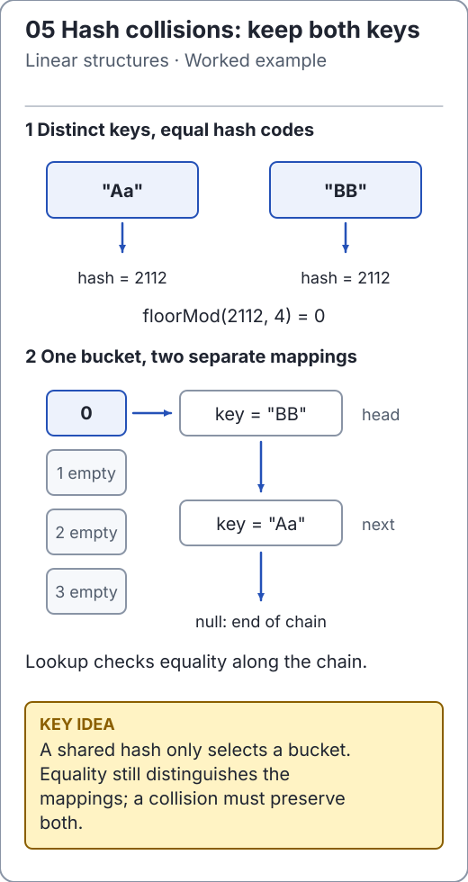

# Collision resolution: never confuse a bucket with a key

Collisions occur whenever different keys select the same bucket. A correct implementation must preserve all mappings and terminate an absent-key search. This repository maintains [separate chaining](../../src/main/java/io/github/ichillous/dsa/collections/ChainedHashMap.java); open addressing is maintained too: [`OpenAddressingHashMap`](../../src/main/java/io/github/ichillous/dsa/collections/OpenAddressingHashMap.java) uses linear probing with backward-shift deletion, and the [open-addressing lesson](open-addressing.md) traces it. The probing comparison below stays a design comparison.

| At&nbsp;a&nbsp;glance | |
| --- | --- |
| **Use&nbsp;it&nbsp;when** | You are choosing or reviewing how a hash table resolves two keys that select the same bucket or slot. |
| **Avoid&nbsp;it&nbsp;when** | You only need a working map; use `java.util.HashMap` and leave collision handling to it. |
| **Cost** | Chaining: expected O(1 + load) per search, O(n) worst case. Probing: expected O(1) while the load stays bounded; clusters and deletion need care. |
| **In&nbsp;this&nbsp;repo** | [`ChainedHashMap`](../../src/main/java/io/github/ichillous/dsa/collections/ChainedHashMap.java) (chaining), [`OpenAddressingHashMap`](../../src/main/java/io/github/ichillous/dsa/collections/OpenAddressingHashMap.java) (linear probing) |
| **In&nbsp;the&nbsp;JDK** | `java.util.HashMap` (see [In real Java](#in-real-java)) |

## Chaining: search one bucket's list

<!-- visual:generated hash-chaining -->
<picture><source media="(prefers-color-scheme: dark)" srcset="../../docs/visuals/assets/hash-chaining-dark.svg"></picture>

**Figure 05.** Equal hash codes select one bucket; key equality still decides a match. [Visual index and step-throughs](../../docs/visuals/README.md).
<!-- /visual:generated -->

```text
put Aa=1, BB=2       both have the same String hash

bucket -> [BB, 2] -> [Aa, 1] -> null

remove Aa           preserve BB and terminate at null
bucket -> [BB, 2] -> null
```

The bucket list invariant is that each equality-equivalent key appears once. `put` searches for replacement first; otherwise it inserts a new mapping. Removing a chain head updates the bucket head; removing a later node updates its predecessor's next link.

```java
import io.github.ichillous.dsa.collections.ChainedHashMap;

ChainedHashMap<String, Integer> map = new ChainedHashMap<>(2);
map.put("Aa", 1);
map.put("BB", 2);
Integer old = map.put("Aa", 3);
Integer removed = map.remove("BB");
assert old == 1 && removed == 2;
assert map.get("Aa") == 3;
assert !map.containsKey("BB");
assert map.remove("absent") == null;
assert map.size() == 1;
```

With uniform distribution and load `α = n / buckets`, expected search work is O(1 + α). Maintaining α below a threshold gives expected O(1); a single chain of length n still gives O(n) worst case. Doubling and rehashing makes insertion expected amortized O(1). Stored space is O(n + capacity).

## Open addressing: preserve the probe path

An open-addressed table stores mappings in array slots and follows a repeatable probe sequence on collisions. Search must use exactly the same sequence as insertion.

| Strategy | Probe idea | Important condition |
| --- | --- | --- |
| Linear | Advance one slot, wrapping around | Bound probes by capacity; clustering can grow |
| Quadratic | Advance using a quadratic offset | Not every capacity/load combination guarantees a free slot is reachable |
| Double hashing | Advance by a second hash-derived step | Step and capacity must be coprime to visit every slot |

For capacity 8 and step 2, the sequence from bucket 0 is `0, 2, 4, 6, 0, ...`; the odd slots are never visited. A table can therefore have free space and still loop forever if the implementation assumes it will eventually find a free slot. A positive step alone is insufficient.

Deletion needs special care. If a collision sends key B past key A, clearing A's slot to “never used” can make a later search stop before reaching B. A tombstone or a correct cluster-repair strategy distinguishes deleted slots from slots that end the search.

## Why resizing is not just copying

Whether chaining or probing is used, bucket positions depend on capacity. A new array with a different capacity requires rehashing entries. Copying the old slots into the same indices can make lookups follow a new route and miss them.

The maintained chained map avoids tombstones and supports arbitrary positive initial bucket counts. It validates null keys and uses `floorMod` for every hash, including `Integer.MIN_VALUE`. These choices simplify invariants without promising collision-free behavior.

## In real Java

`java.util.HashMap` resolves collisions for you and keeps every colliding key reachable. Its specification promises constant time only when the hash function "disperses the elements properly among the buckets"; a bad `hashCode` does not break correctness, only speed. OpenJDK implementation note: a bin holding many colliding keys may be stored as a tree.

```java
import java.util.HashMap;
import java.util.Map;

record SameHash(int id) {
    @Override
    public int hashCode() {
        return 7; // legal, but every key collides
    }
}

Map<SameHash, Integer> map = new HashMap<>();
for (int i = 0; i < 100; i++) {
    map.put(new SameHash(i), i);
}
for (int i = 0; i < 100; i += 2) {
    assert map.remove(new SameHash(i)) == i;
}
assert map.size() == 50;
assert map.get(new SameHash(3)) == 3;
assert map.get(new SameHash(4)) == null && !map.containsKey(new SameHash(4));
```

## Common mistakes

**Clearing the slot on delete in a probing table.** In a table of 8 slots, `A` and `B` both have home slot 5, so `B` sits in slot 6. Setting slot 5 to empty on `remove(A)` makes `get(B)` stop at the empty home slot and report absent. This breaks the invariant that there is no empty slot between a key's home slot and the key.

**A probe step that shares a factor with the capacity.** With capacity 8 and step 2 from bucket 0, the sequence is `0, 2, 4, 6, 0, ...` and never reaches an odd slot. An insert into a table whose even slots are full loops forever even though odd slots are free; the step must be coprime to the capacity.

**Copying slots to the same indices on resize.** In `OpenAddressingHashMap` the string key `"B"` has home slot 6 in an 8-slot table and home slot 12 in a 16-slot table. If a resize copied it to index 6 of the new table, `get("B")` would start at slot 12, see an empty slot and report absent. This breaks the invariant that a key sits on the probe path from its current home slot; re-insert every key into the new table.

## Check yourself

<details>
<summary>Why must a search for an absent key terminate in a probing table?</summary>

The table keeps at least one empty slot (the repository map caps its load at 2/3), and a probe that reaches an empty slot stops. Without that bound, a full table would make an absent-key search loop.

</details>

<details>
<summary>What does chaining do on deletion that linear probing cannot do by itself?</summary>

It unlinks a single node and no other key is affected. Probing keeps keys on shared paths, so removing one key can strand later keys unless a tombstone or backward shift repairs the cluster.

</details>

<details>
<summary>Why can a chained table have a load factor above 1 but a probing table cannot?</summary>

Chains can hold any number of entries per bucket, so load only measures average chain length. A probing table stores at most one entry per slot, so the load cannot exceed 1 and must stay well below it for probe lengths to stay short.

</details>

## Practice

1. Trace removal at the head, middle and tail of a three-entry collision chain.
2. Explain why a full probing table must terminate an absent lookup even when no empty slot exists.
3. Extend OpenAddressingHashMapTest with full-table growth, wraparound and deletion followed by lookup, then design tests for a double-hashing variant, including non-coprime steps.

Check the [worked solutions](../../docs/solutions.md) for the chain and probe-path invariants. The [solution finder](../../docs/solution-finder.md#1-look-up-by-key) compares this technique with its alternatives.
