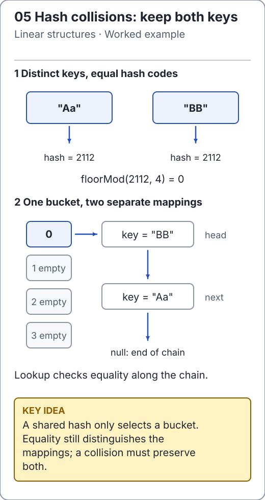

# Collision resolution: never confuse a bucket with a key

Collisions occur whenever different keys select the same bucket. A correct implementation must preserve all mappings and terminate an absent-key search. This repository maintains [separate chaining](../../src/main/java/io/github/ichillous/dsa/collections/ChainedHashMap.java); open addressing below is a design comparison, not a second untested implementation.

<!-- visual:generated -->
<picture><source media="(prefers-color-scheme: dark)" srcset="../../docs/visuals/assets/hash-chaining-dark.svg"></picture>

**Figure 05.** Equal hash codes select one bucket; key equality still decides a match. [Visual index and step-throughs](../../docs/visuals/README.md).
<!-- /visual:generated -->

## Chaining: search one bucket's list

```text
put Aa=1, BB=2       both have the same String hash

bucket -> [BB, 2] -> [Aa, 1] -> null

remove Aa           preserve BB and terminate at null
bucket -> [BB, 2] -> null
```

The bucket list invariant is that each equality-equivalent key appears once. `put` searches for replacement first; otherwise it inserts a new mapping. Removing a chain head updates the bucket head; removing a later node updates its predecessor's next link.

```java
import io.github.ichillous.dsa.collections.ChainedHashMap;

ChainedHashMap<String, Integer> map = new ChainedHashMap<>(2);
map.put("Aa", 1);
map.put("BB", 2);
Integer old = map.put("Aa", 3);
Integer removed = map.remove("BB");
assert old == 1 && removed == 2;
assert map.get("Aa") == 3;
assert !map.containsKey("BB");
assert map.remove("absent") == null;
assert map.size() == 1;
```

With uniform distribution and load `α = n / buckets`, expected search work is O(1 + α). Maintaining α below a threshold gives expected O(1); a single chain of length n still gives O(n) worst case. Doubling and rehashing makes insertion expected amortized O(1). Stored space is O(n + capacity).

## Open addressing: preserve the probe path

An open-addressed table stores mappings in array slots and follows a repeatable probe sequence on collisions. Search must use exactly the same sequence as insertion.

| Strategy | Probe idea | Important condition |
| --- | --- | --- |
| Linear | Advance one slot, wrapping around | Bound probes by capacity; clustering can grow |
| Quadratic | Advance using a quadratic offset | Not every capacity/load combination guarantees a free slot is reachable |
| Double hashing | Advance by a second hash-derived step | Step and capacity must be coprime to visit every slot |

For capacity 8 and step 2, the sequence from bucket 0 is `0, 2, 4, 6, 0, ...`; the odd slots are never visited. A table can therefore have free space and still loop forever if the implementation assumes it will eventually find a free slot. A positive step alone is insufficient.

Deletion needs special care. If a collision sends key B past key A, clearing A's slot to “never used” can make a later search stop before reaching B. A tombstone or a correct cluster-repair strategy distinguishes deleted slots from slots that end the search.

## Why resizing is not just copying

Whether chaining or probing is used, bucket positions depend on capacity. A new array with a different capacity requires rehashing entries. Copying the old slots into the same indices can make lookups follow a new route and miss them.

The maintained chained map avoids tombstones and supports arbitrary positive initial bucket counts. It validates null keys and uses `floorMod` for every hash, including `Integer.MIN_VALUE`. These choices simplify invariants without promising collision-free behavior.

## Practice

1. Trace removal at the head, middle and tail of a three-entry collision chain.
2. Explain why a full probing table must terminate an absent lookup even when no empty slot exists.
3. Design tests for an open-addressing extension before implementing it: full tables, wraparound, deletion followed by lookup, and non-coprime double-hash steps.

Check the [worked solutions](../../docs/solutions.md) for the chain and probe-path invariants.
