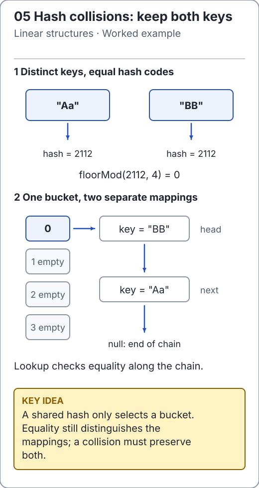

# Hash functions and key contracts

A hash code is a routing hint, not a unique identifier. Two equal keys must have equal hash codes; different keys may also have equal hash codes. The table must still compare keys for equality after locating a bucket.

For a positive capacity `m`, [`ChainedHashMap`](../../src/main/java/io/github/ichillous/dsa/collections/ChainedHashMap.java) uses `Math.floorMod(hashCode, m)`, producing an index in `[0, m)` even for negative hashes.

```java
int capacity = 7;
int hash = Integer.MIN_VALUE;
int bucket = Math.floorMod(hash, capacity);
assert bucket >= 0 && bucket < capacity;
assert Math.abs(Integer.MIN_VALUE) < 0; // abs cannot represent +2^31 as int.
```

`Math.abs(hash) % capacity` can therefore produce a negative index. Java's `%` is a remainder operator and also permits negative results; `floorMod` expresses the bucket-index contract directly.

<!-- visual:generated -->
<picture><source media="(prefers-color-scheme: dark)" srcset="../../docs/visuals/assets/hash-chaining-dark.svg"></picture>

**Figure 05.** Equal hash codes select one bucket; key equality still decides a match. [Visual index and step-throughs](../../docs/visuals/README.md).
<!-- /visual:generated -->

## Observe a real collision

```java
import io.github.ichillous.dsa.collections.ChainedHashMap;

String first = "Aa";
String second = "BB";
assert !first.equals(second);
assert first.hashCode() == second.hashCode();
ChainedHashMap<String, Integer> map = new ChainedHashMap<>();
map.put(first, 10);
map.put(second, 20);
assert map.get(first) == 10 && map.get(second) == 20;
assert map.size() == 2;
```

A table that treats hash equality as key equality would overwrite the first value. Better hash distribution reduces the average chain length, but does not eliminate the need for collision resolution.

## Equality, stability and cost

The key type determines both `equals` and `hashCode`. If two objects are logically equal, both methods must agree on that equivalence. If equality uses several fields, the hash should reflect the same logical identity. A hash function that always returns zero is legal but makes every lookup search the same bucket.

Keys must keep hash/equality-relevant state stable while present. For example, storing a mutable list as a key and then adding to it changes its content-based hash. A later lookup may search a different bucket even when given the very same object.

The standard O(1) expected hash-table claim assumes computing the hash and comparing a key are O(1). If the key is a long sequence and hashing scans it, include that scan. The table's bookkeeping cannot make an arbitrary user-defined hash function constant time.

## Load is not distribution

Load factor is `entries / buckets`. Keeping it bounded limits average occupancy under good distribution. It cannot repair a key type that maps all values to the same hash. Doubling capacity changes the bucket calculation, so mappings must be redistributed.

## Practice

1. Calculate buckets for hash codes `-1`, `0`, `1`, `Integer.MIN_VALUE` at capacity 7.
2. Explain why unequal objects may share a hash, but equal objects may not have different hashes.
3. Extend collision tests with a key type returning a constant hash, then a minimum-integer hash. Check updates and removal after resizing, not only insertion.

See [collision resolution](collision-resolution.md) and the [worked solutions](../../docs/solutions.md).
