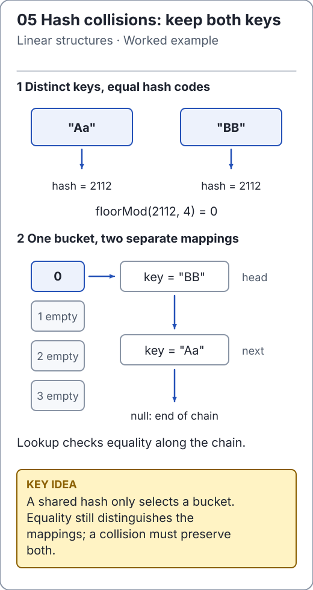
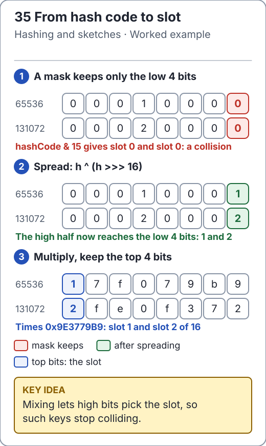

# Hash functions and key contracts

A hash code is a routing hint, not a unique identifier. Two equal keys must have equal hash codes; different keys may also have equal hash codes. The table must still compare keys for equality after locating a bucket.

| At a glance | |
| --- | --- |
| **Use it when** | You define a key type, or need to understand how a hash code becomes a bucket or slot index. |
| **Avoid it when** | You would be tempted to treat a hash code as an identity, to hash mutable state, or to rely on a specific hash value across JDK versions. |
| **Cost** | Computing the hash costs the key's own `hashCode` (O(length) for a string); the index arithmetic is O(1). The table's O(1) expected bound assumes both are constant. |
| **In this repo** | Bucket index by `floorMod`: [`ChainedHashMap`](../../src/main/java/io/github/ichillous/dsa/collections/ChainedHashMap.java); spread then multiply: [`OpenAddressingHashMap`](../../src/main/java/io/github/ichillous/dsa/collections/OpenAddressingHashMap.java) |
| **In the JDK** | `Object.hashCode`, `Objects.hash`, `Arrays.hashCode`, records (derived `hashCode`) |

For a positive capacity `m`, [`ChainedHashMap`](../../src/main/java/io/github/ichillous/dsa/collections/ChainedHashMap.java) uses `Math.floorMod(hashCode, m)`, producing an index in `[0, m)` even for negative hashes.

```java
int capacity = 7;
int hash = Integer.MIN_VALUE;
int bucket = Math.floorMod(hash, capacity);
assert bucket >= 0 && bucket < capacity;
assert Math.abs(Integer.MIN_VALUE) < 0; // abs cannot represent +2^31 as int.
```

`Math.abs(hash) % capacity` can therefore produce a negative index. Java's `%` is a remainder operator and also permits negative results; `floorMod` expresses the bucket-index contract directly.

## Observe a real collision

<!-- visual:generated hash-chaining -->
<picture><source media="(prefers-color-scheme: dark)" srcset="../../docs/visuals/assets/hash-chaining-dark.svg"></picture>

**Figure 05.** Equal hash codes select one bucket; key equality still decides a match. [Visual index and step-throughs](../../docs/visuals/README.md).
<!-- /visual:generated -->

```java
import io.github.ichillous.dsa.collections.ChainedHashMap;

String first = "Aa";
String second = "BB";
assert !first.equals(second);
assert first.hashCode() == second.hashCode();
ChainedHashMap<String, Integer> map = new ChainedHashMap<>();
map.put(first, 10);
map.put(second, 20);
assert map.get(first) == 10 && map.get(second) == 20;
assert map.size() == 2;
```

A table that treats hash equality as key equality would overwrite the first value. Better hash distribution reduces the average chain length, but does not eliminate the need for collision resolution.

## Mixing: why the low bits are not enough

A table whose length is a power of two can pick a slot by masking, `hash & (length - 1)`, which keeps only the low bits. Keys that differ only in their high bits, such as the integers 65536 and 131072 (hash codes `0x00010000` and `0x00020000`), then collide in every table of 16 slots. [`OpenAddressingHashMap`](../../src/main/java/io/github/ichillous/dsa/collections/OpenAddressingHashMap.java) avoids this by mixing first: it computes `h ^ (h >>> 16)`, multiplies by `0x9E3779B9` and keeps the top bits, so the high half influences the slot.

<!-- visual:generated hash-index-spread -->
<picture><source media="(prefers-color-scheme: dark)" srcset="../../docs/visuals/assets/hash-index-spread-dark.svg"></picture>

**Figure 27.** Integer keys 65536 and 131072 have hash codes 0x00010000 and 0x00020000, whose low four bits are both 0, so a plain mask sends both to slot 0. Spreading with h ^ (h >>> 16) and multiplying by 0x9E3779B9 gives slots 1 and 2 of 16. [Visual index and step-throughs](../../docs/visuals/README.md).
<!-- /visual:generated -->

```java
import io.github.ichillous.dsa.collections.OpenAddressingHashMap;

int first = 65536;
int second = 131072;
assert (first & 15) == 0 && (second & 15) == 0; // a plain mask sends both to slot 0
int slotOfFirst = ((first ^ (first >>> 16)) * 0x9E3779B9) >>> 28; // top 4 bits: 16 slots
int slotOfSecond = ((second ^ (second >>> 16)) * 0x9E3779B9) >>> 28;
assert slotOfFirst == 1 && slotOfSecond == 2;
OpenAddressingHashMap<Integer, String> map = new OpenAddressingHashMap<>(16);
map.put(first, "a");
map.put(second, "b");
assert map.get(first).equals("a") && map.get(second).equals("b");
```

OpenJDK implementation note: `java.util.HashMap` also xors the high half of the hash into the low half before masking, but that is not part of the `Map` contract.

## Equality, stability and cost

The key type determines both `equals` and `hashCode`. If two objects are logically equal, both methods must agree on that equivalence. If equality uses several fields, the hash should reflect the same logical identity. A hash function that always returns zero is legal but makes every lookup search the same bucket.

Keys must keep hash/equality-relevant state stable while present. For example, storing a mutable list as a key and then adding to it changes its content-based hash. A later lookup may search a different bucket even when given the very same object.

The standard O(1) expected hash-table claim assumes computing the hash and comparing a key are O(1). If the key is a long sequence and hashing scans it, include that scan. The table's bookkeeping cannot make an arbitrary user-defined hash function constant time.

## Load is not distribution

Load factor is `entries / buckets`. Keeping it bounded limits average occupancy under good distribution. It cannot repair a key type that maps all values to the same hash. Doubling capacity changes the bucket calculation, so mappings must be redistributed.

## In real Java

Do not write hash functions by hand when the JDK derives them. A `record` gets `equals` and `hashCode` derived from all of its components, `Objects.hash(a, b)` hashes values as if they were placed in an array and hashed with `Arrays.hashCode`, and `List.hashCode` is defined by a fixed formula. Those three agree here, and a record works as a map key with no extra code.

```java
import java.util.Arrays;
import java.util.HashSet;
import java.util.List;
import java.util.Objects;
import java.util.Set;

record Point(int x, int y) {}

Set<Point> seen = new HashSet<>();
seen.add(new Point(1, 2));
assert seen.contains(new Point(1, 2)); // equal records are interchangeable keys
assert new Point(1, 2).hashCode() == new Point(1, 2).hashCode();
assert Objects.hash(1, 2) == Arrays.hashCode(new Object[] {1, 2});
assert Objects.hash(1, 2) == List.of(1, 2).hashCode();
assert Objects.hash(1, 2) == 994; // 31 * (31 * 1 + 1) + 2, the List.hashCode formula
```

## Common mistakes

**Overriding `equals` without `hashCode`.** Two `Id(7)` objects that are `equals` but inherit the identity hash code usually land in different buckets, so `set.contains(new Id(7))` can report false for a value that was added. This breaks the contract that equal objects have equal hash codes; override both or use a record.

**Using `Math.abs(hash) % capacity`.** For `hash = Integer.MIN_VALUE` and capacity 7, `Math.abs` still returns `Integer.MIN_VALUE`, and the remainder is `-2`, an index outside `[0, 7)`. The invariant that every index lies in `[0, capacity)` fails; use `Math.floorMod`.

**Hashing a constant or a low-entropy field.** If 1000 keys all return hash code 42, every key lands in one bucket and each lookup walks a chain of up to 1000 entries. The load factor stays small while the cost per operation becomes O(n), so bounded load is not the same as spread.

## Check yourself

<details>
<summary>Two keys are unequal but have the same hash code. Does the table lose one of them?</summary>

No. The hash only selects a bucket or probe start; the table then compares keys with `equals`, so both mappings are kept in the same bucket or on the same probe path. A collision costs time, not correctness.

</details>

<details>
<summary>Why did <code>OpenAddressingHashMap</code> not simply use <code>hash &amp; (length - 1)</code>?</summary>

Masking keeps only the low bits, so keys that differ only in high bits, such as 65536 and 131072, would all share slot 0 in a 16-slot table. Mixing with `h ^ (h >>> 16)` and a multiply lets the high bits reach the slot.

</details>

<details>
<summary>What is wrong with using a mutable list as a key and appending to it after <code>put</code>?</summary>

Its content-based hash changes, so the entry stays in the bucket chosen by the old hash while lookups search the bucket of the new one. The mapping is still stored but unreachable through that key.

</details>

## Practice

1. Calculate buckets for hash codes `-1`, `0`, `1`, `Integer.MIN_VALUE` at capacity 7.
2. Explain why unequal objects may share a hash, but equal objects may not have different hashes.
3. Extend collision tests with a key type returning a constant hash, then a minimum-integer hash. Check updates and removal after resizing, not only insertion.

See [collision resolution](collision-resolution.md) and the [worked solutions](../../docs/solutions.md).
