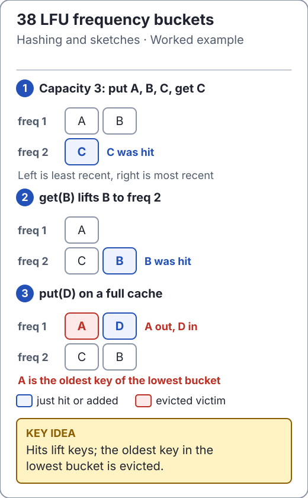

# LFU cache: evict the least used, break ties by recency

| At&nbsp;a&nbsp;glance | |
| --- | --- |
| **Use&nbsp;it&nbsp;when** | A few keys are used far more often than the rest and a one-time scan over cold keys must not flush them. |
| **Avoid&nbsp;it&nbsp;when** | The popular set drifts over time (counts never decay), or recency is the right policy; use an access-order `LinkedHashMap` for LRU. |
| **Cost** | Expected O(1) `get`, `remove` and `frequency`; expected amortized O(1) `put`; O(capacity) space. |
| **In&nbsp;this&nbsp;repo** | [`LfuCache`](../../src/main/java/io/github/ichillous/dsa/collections/LfuCache.java) |
| **In&nbsp;the&nbsp;JDK** | No direct equivalent; `LinkedHashMap` in access order covers LRU only. |

A least-frequently-used cache keeps a fixed number of entries and, when a new key arrives at capacity, discards the entry that has been used the fewest times. [`LfuCache`](../../src/main/java/io/github/ichillous/dsa/collections/LfuCache.java) breaks frequency ties by evicting the least recently used of the tied entries. It offers the same surface as [`LruCache`](../../src/main/java/io/github/ichillous/dsa/collections/LruCache.java), which is explained in the [hash tables overview](overview.md#composition-an-lru-cache), plus a `frequency(key)` query that does not count as a use.

Preconditions: capacity is positive, keys and values are non-null, and keys keep stable `equals`/`hashCode` while cached. A `null` result from `get`, `put` or `remove` means absence. The class is not thread safe, because even `get` changes the cache.

## LRU versus LFU

- **LRU** ranks entries by how recently they were used. It adapts quickly when the working set shifts, but a one-time scan over many cold keys flushes everything hot. LFU is scan resistant: a key touched once has frequency 1 and is the first to go.
- **LFU** ranks entries by how often they were used. It protects genuinely popular keys, but its memory is long. An entry that was hot last week can keep a high count and stay while newer, genuinely useful keys keep losing to it. That is stale popularity.

Neither policy is better in general. Pick by the access pattern you expect, and measure on a real trace.

## The invariant

Every cached key has exactly one node. A node with frequency `f` is in bucket `f`, and each bucket is a doubly linked list ordered from least to most recently used. Empty buckets are discarded. `minFrequency` is the lowest frequency of a non-empty bucket whenever the cache is full, so the eviction victim is always the head of bucket `minFrequency`.

A hit moves a node from bucket `f` to the tail of bucket `f + 1`. If bucket `f` was the minimum and became empty, the minimum becomes `f + 1`. A new key always lands in bucket 1 and resets the minimum to 1. No operation scans the buckets.

## A bucket trace

<!-- visual:generated lfu-buckets -->
<picture><source media="(prefers-color-scheme: dark)" srcset="../../docs/visuals/assets/lfu-buckets-dark.svg"></picture>

**Figure 38.** A capacity-3 LfuCache after put A, B, C and get C holds A and B in bucket 1 and C in bucket 2. get(B) moves B to the end of bucket 2, and put(D) then evicts A, the oldest key of bucket 1. [Visual index and step-throughs](../../docs/visuals/README.md).
<!-- /visual:generated -->

Capacity 2. Each bucket is shown as `f: [least recent ... most recent]`.

```text
put(1, a)    1:[1]
put(2, b)    1:[1, 2]
get(1)       1:[2]  2:[1]            min = 1
put(3, c)    full: evict head of bucket 1 (key 2)
             1:[3]  2:[1]            min = 1
get(3)       2:[1, 3]                bucket 1 emptied, min = 2
put(4, d)    full: evict head of bucket 2 (key 1, used less recently than 3)
             1:[4]  2:[3]            min = 1
```

## Executable example

```java
import io.github.ichillous.dsa.collections.LfuCache;

LfuCache<Integer, String> cache = new LfuCache<>(2);
cache.put(1, "a");
cache.put(2, "b");
String hit = cache.get(1);
cache.put(3, "c"); // Evicts key 2: frequency 1 versus 2.
assert hit.equals("a");
assert cache.get(2) == null && cache.frequency(2) == 0;
cache.get(3);
assert cache.frequency(1) == 2 && cache.frequency(3) == 2;
cache.put(4, "d"); // Tie at frequency 2; key 1 is the least recently used.
assert cache.get(1) == null;
assert cache.get(3).equals("c") && cache.get(4).equals("d");
assert cache.frequency(3) == 3;
assert cache.put(3, "z").equals("c") && cache.frequency(3) == 4;
assert cache.size() == 2;
```

## Costs

| Operation | Time | Space |
| --- | --- | --- |
| `get`, `put`, `remove`, `frequency` | Expected O(1), assuming O(1) key hashing and equality; `put` is amortized for hash-table resizing | O(capacity) for entries, buckets and retained table capacity |
| `clear` | O(capacity) | Retains the key table for reuse |

Frequencies saturate at `Integer.MAX_VALUE` instead of overflowing. Eviction and removal forget history, so a key that returns starts at frequency 1.

## Pitfalls

Counts never decay. With capacity 2, call `get` on key `A` a thousand times, then stop using it. Alternate new keys `B`, `C`, `D`: each new key is the lowest-frequency entry at the next insertion and is evicted by the following one, while `A` stays forever. A cache that must forget old popularity needs aging (for example periodic halving of counts), which this class deliberately omits.

When every other entry has a higher count, a new key is the next victim unless it is hit before the next insertion, so a burst of one-off keys cycles through a single slot; otherwise older frequency-1 entries go first.

## When to use the JDK instead

If recency is the right policy, use `LinkedHashMap` in access order and override `removeEldestEntry`; it needs far less code and is well tested. The JDK has no LFU, so use this class (or a vetted library such as a production cache with TinyLFU admission) when frequency matters. For concurrent use, wrap this class with external locking or use a concurrent cache library.

## Check yourself

<details>
<summary>With capacity 2, <code>put(1)</code>, <code>put(2)</code>, <code>get(1)</code>, <code>put(3)</code>: which key is evicted and why?</summary>

Key 2. Key 1 has frequency 2 after the hit and key 2 still has frequency 1, so key 2 heads the lowest non-empty bucket.

</details>

<details>
<summary>Two keys both have frequency 2. Which one is evicted?</summary>

The one used less recently: each bucket runs from least to most recently used and eviction takes the head of the lowest bucket. Frequency decides first and recency only breaks ties.

</details>

<details>
<summary>A key is evicted and later inserted again. What is its frequency?</summary>

Frequency 1. An evicted or removed key forgets its history, so a reinserted key starts in bucket 1 like any new key.

</details>

## Practice

1. Trace capacity 3 with `put A, put B, put C, get A, get B, put D, get D, put E` and list the evicted keys.
2. Explain why `minFrequency` can be reset to 1 on every insertion without breaking the eviction rule.
3. Write a test comparing `LfuCache` against a list ordered by (frequency, last-use tick) under a fixed seed, and include removals and `clear`.

See also the [catalog](../../docs/catalog.md), the [complexity guide](../../docs/complexity.md) and the [worked solutions](../../docs/solutions.md). The [solution finder](../../docs/solution-finder.md#8-caching-and-eviction) compares this technique with its alternatives.
