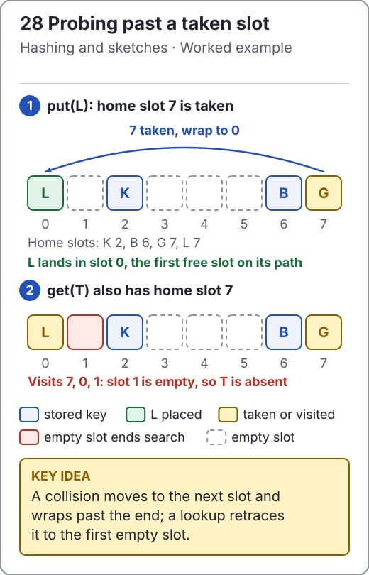
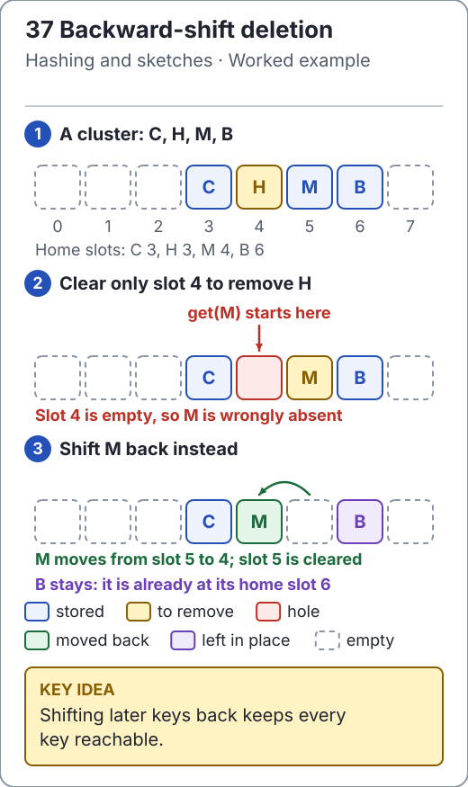

# Open addressing: linear probing with backward-shift deletion

Use an open-addressed table when you want a hash map with no per-entry nodes: mappings live directly in two arrays and a collision moves to a nearby slot. The maintained [OpenAddressingHashMap](../../src/main/java/io/github/ichillous/dsa/collections/OpenAddressingHashMap.java) mirrors [ChainedHashMap](../../src/main/java/io/github/ichillous/dsa/collections/ChainedHashMap.java): keys and values are non-null, `put` and `remove` return the previous value, and null means absent. Read [collision resolution](collision-resolution.md) first for the chaining side of the comparison.

| At a glance | |
| --- | --- |
| **Use it when** | You want a hash map with no per-entry nodes, many small entries, and neighboring slots that share cache lines. |
| **Avoid it when** | Hash codes are poor or adversarial (one long cluster), or you need to keep references to entries. A constant `hashCode` makes every operation O(n). |
| **Cost** | Expected O(1) `get` and `remove`, expected amortized O(1) `put`, while the load stays at most 2/3; O(n) worst case; O(capacity) space. |
| **In this repo** | [`OpenAddressingHashMap`](../../src/main/java/io/github/ichillous/dsa/collections/OpenAddressingHashMap.java) |
| **In the JDK** | No general-purpose equivalent: `HashMap` chains collisions. `IdentityHashMap` is a reference-equality map (see [In real Java](#in-real-java)). |

## Chaining versus probing

| Question | Separate chaining | Linear probing |
| --- | --- | --- |
| Where does a colliding key go? | Into its bucket's linked list | Into the next free slot, wrapping at the end |
| Extra memory | One node per entry | None per entry; the table itself must stay at most 2/3 full |
| Load factor above 1 | Allowed; chains lengthen | Impossible; the table must grow first |
| Cache behavior | Pointer chasing | Neighboring slots, usually the same cache lines |
| Deletion | Unlink one node | Must repair the cluster (below) |
| Sensitive to | Long chains from bad hashes | Long clusters, which also merge with neighbors |

## The invariant

The table length is a power of two. A key's home slot is the Fibonacci hash of `h ^ (h >>> 16)`: multiply by `0x9E3779B9` and keep the top bits. The first step spreads high bits into low bits, and the multiply scrambles patterns such as sequential integers.

**Every key is stored on its probe path: starting at its home slot and moving forward, there is no empty slot between the home slot and the key.** A lookup walks from the home slot and may stop at the first empty slot, because an empty slot proves the key was never placed beyond it. The class keeps the load at most 2/3, so an empty slot always exists and an absent-key search always terminates.

<!-- visual:generated open-addressing-probe -->
<picture><source media="(prefers-color-scheme: dark)" srcset="../../docs/visuals/assets/open-addressing-probe-dark.svg"></picture>

**Figure 36.** In an 8-slot table holding K, B and G, put(L) finds home slot 7 taken by G, wraps to slot 0 and stores L there; get(T), also homed at 7, visits slots 7, 0 and 1 and stops at the empty slot 1. [Visual index and step-throughs](../../docs/visuals/README.md).
<!-- /visual:generated -->

## Load factor and expected probes

With load `α = n / capacity` and well-distributed hashes, Knuth's classic analysis of linear probing gives these expected probe counts:

| Search | Expected probes | At α = 1/2 | At α = 2/3 |
| --- | --- | --- | --- |
| Successful | about ½(1 + 1/(1−α)) | 1.5 | 2 |
| Unsuccessful | about ½(1 + 1/(1−α)²) | 2.5 | 5 |

The unsuccessful figure grows quadratically as α approaches 1, which is why the table resizes when a `put` would push the load above 2/3 rather than waiting until it is full. Doubling the table re-inserts every mapping, because home slots depend on the table length; copying slots to the same indices would break the invariant.

## Backward-shift deletion trace

<!-- visual:generated backward-shift-delete -->
<picture><source media="(prefers-color-scheme: dark)" srcset="../../docs/visuals/assets/backward-shift-delete-dark.svg"></picture>

**Figure 37.** In the cluster C, H, M, B at slots 3 to 6, clearing only H's slot 4 would hide M, which is stored at slot 5 but starts its search at slot 4. Backward-shift deletion moves M to slot 4, clears slot 5 and leaves B at its home slot 6. [Visual index and step-throughs](../../docs/visuals/README.md).
<!-- /visual:generated -->

Capacity 8. Each entry is written `key(home)`. Suppose `A` and `B` both hash to slot 5, `C` to slot 6, `D` to slot 7 and `E` to slot 1. Insertion order A, B, C, D, E gives a cluster that wraps past the end of the table:

```text
slot:   0     1     2   3   4   5     6     7
        D(7)  E(1)  .   .   .   A(5)  B(5)  C(6)
```

`B` is pushed to slot 6, which `C` wanted, so `C` lands in slot 7; that was `D`'s home, so `D` wraps to slot 0. Now `remove(A)`. The hole starts at slot 5 and the scan walks forward until an empty slot. An entry may fill the hole unless its home slot lies cyclically after the hole and at or before the entry's own slot:

```text
hole=5  look at slot 6: B(5)  home 5 is not after the hole    -> move B to 5, hole=6
hole=6  look at slot 7: C(6)  home 6 is not after the hole    -> move C to 6, hole=7
hole=7  look at slot 0: D(7)  home 7 is not after the hole    -> move D to 7, hole=0
hole=0  look at slot 1: E(1)  home 1 is after the hole        -> stays put
        look at slot 2: empty                                 -> stop; clear slot 0

slot:   0   1     2   3   4   5     6     7
        .   E(1)  .   .   .   B(5)  C(6)  D(7)
```

Every remaining key is again reachable from its home slot with no gap, and `E` was correctly left alone: moving it to slot 0 would put it before its home slot, where lookups would never find it.

## Executable example

```java
import io.github.ichillous.dsa.collections.OpenAddressingHashMap;

record Key(int id) {
    @Override
    public int hashCode() {
        return 42; // every key shares one home slot: one long cluster
    }
}

OpenAddressingHashMap<Key, String> map = new OpenAddressingHashMap<>(16); // 6 keys stay under the 2/3 limit: no resize
for (int i = 0; i < 6; i++) {
    assert map.put(new Key(i), "v" + i) == null;
}
assert map.size() == 6;
assert map.remove(new Key(0)).equals("v0"); // the cluster head
assert map.remove(new Key(3)).equals("v3"); // a key in the middle
assert map.remove(new Key(3)) == null;
for (int i : new int[] {1, 2, 4, 5}) {
    assert map.get(new Key(i)).equals("v" + i);
}
assert !map.containsKey(new Key(0));
assert map.put(new Key(1), "new").equals("v1");
assert map.size() == 4;
```

## Why tombstones degrade

The common alternative marks a removed slot as a tombstone: lookups skip it, inserts may reuse it. This keeps the invariant but pays elsewhere:

- A miss must walk past every tombstone in its cluster until a never-used slot, so repeated insert/remove churn makes unsuccessful searches slower even though `size()` stays small.
- The table can fill with tombstones. The load that bounds probe lengths must count them, so the map needs a periodic rehash that has nothing to do with live entries.
- Removing and re-adding different keys leaves residue that depends on history, which is harder to test and reason about.

Backward shifting pays the repair cost once, inside `remove`, which scans to the end of the cluster: O(cluster length). Afterward the table has no residue, and probe lengths depend only on the live keys.

## Costs

| Operation | Time | Auxiliary space |
| --- | --- | --- |
| `get`, `containsKey`, `remove` | O(1) expected; O(n) worst | O(1) |
| `put` | O(1) expected amortized; O(n) worst | O(1) except a resize, which needs O(capacity) temporary space |
| `clear` | O(capacity) | O(1) |
| Storage | O(capacity), and capacity is at least 1.5n because the load stays at most 2/3 | none per entry |

Worst cases appear when many keys share a home slot or a cluster: a constant `hashCode` makes the whole table one cluster. User `equals` and `hashCode` are assumed O(1).

## Pitfall: clearing the slot only

The tempting `remove` sets the found slot to empty and stops. With the trace above, clearing slot 5 leaves `B` in slot 6 with home 5. A later `get(B)` starts at slot 5, sees it empty and reports absent, although `B` is stored. In the executable example the table has 16 slots and never resizes, so the six keys occupy consecutive slots starting at their shared home slot, and `Key(0)` is the cluster head. If `remove(new Key(0))` only cleared its slot, `map.get(new Key(1))` would start at that now-empty home slot and report absent.

## In real Java

Use `HashMap` unless you have measured a reason not to. OpenJDK's `java.util.IdentityHashMap` is documented as a linear-probe table, but it answers a different question: its Javadoc says it uses reference-equality in place of object-equality when comparing keys (`==` instead of `equals`), so two equal but distinct strings are two keys. The Javadoc also calls it not a general-purpose `Map`, because it intentionally violates the `Map` contract. Use it only for object-graph bookkeeping, never for value-like keys.

```java
import java.util.HashMap;
import java.util.IdentityHashMap;
import java.util.Map;

String first = new String("key");
String second = new String("key");
assert first.equals(second) && first != second;
Map<String, Integer> byReference = new IdentityHashMap<>();
byReference.put(first, 1);
byReference.put(second, 2);
assert byReference.size() == 2; // distinct objects are distinct keys
Map<String, Integer> byEquality = new HashMap<>();
byEquality.put(first, 1);
byEquality.put(second, 2);
assert byEquality.size() == 1 && byEquality.get("key") == 2; // equal keys replace each other
```

## OpenJDK implementation note

`java.util.IdentityHashMap`, which compares keys by reference, is documented in OpenJDK as a simple linear-probe hash table that stores keys and values in one array, alternating key and value. That is an implementation note about OpenJDK's class, not a guarantee of the `Map` contract, and other JDKs are free to differ. `HashMap` and `ChainedHashMap`, by contrast, chain collisions.

## Common mistakes

**Clearing only the removed slot.** See the pitfall above: with `A` and `B` both homed at slot 5, clearing slot 5 hides `B` in slot 6. The invariant that no empty slot lies between a key's home slot and the key is broken.

**Shifting an entry that must stay.** In the backward-shift trace, `E` has home slot 1 and sits at slot 1. Moving it into the hole at slot 0 would place it before its home slot, where no lookup starts. The shift rule must move an entry only when its home is not cyclically after the hole.

**Letting the table fill.** A table of 8 slots holding 8 keys has no empty slot, so `get` of an absent key walks forever. This is why the map resizes when the load would pass 2/3 and never allows a full table.

## Check yourself

<details>
<summary>Why can a lookup stop at the first empty slot?</summary>

The invariant says every stored key has no empty slot between its home slot and itself. So if the walk from the home slot reaches an empty slot before finding the key, the key is not stored.

</details>

<details>
<summary>In the trace where <code>A</code> is removed, why does <code>E(1)</code> not move into slot 0?</summary>

Its home slot 1 lies cyclically after the hole at slot 0, so moving it to slot 0 would put it before its home slot where lookups never look. Only entries whose home is at or before the hole may fill it.

</details>

<details>
<summary>What is the cost of tombstones that backward shifting avoids?</summary>

Tombstones stay in the table, so misses must walk past them and churn can fill the table with deleted markers that force rehashing. Backward shifting repairs the cluster once, inside <code>remove</code>, and leaves no residue.

</details>

## Practice

1. Capacity 8, entries `A(3)`, `B(3)`, `C(4)`, `D(3)` inserted in that order. Write the slots, then trace `remove(B)` and say which entries move.
2. Compute the expected probe count for an unsuccessful search at α = 3/4 and α = 0.9, and explain why the resize threshold is 2/3 rather than 0.9.
3. Write a test that inserts and removes 10,000 different keys while the size never exceeds 5, then checks that every lookup still ends quickly. Explain why a tombstone design would need extra rehash logic for the same test.

See the [catalog](../../docs/catalog.md) for the API and tests, and the [complexity guide](../../docs/complexity.md) for the cost table. The [solution finder](../../docs/solution-finder.md#1-look-up-by-key) compares this technique with its alternatives.
