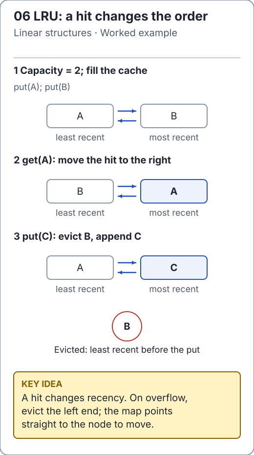

# Hash tables: separate equality from position

A hash table maps keys to values by using a hash code to select a bucket, then checking equality within that bucket. Use it for membership, counting, indexing or caching when key order is not required.

| At a glance | |
| --- | --- |
| **Use it when** | You look entries up by key and need no ordering: membership, counting, indexing, caching. |
| **Avoid it when** | You need sorted iteration, nearest-key queries or a hard worst-case bound; use an ordered tree. Also avoid it for keys whose hash or equality state changes while stored. |
| **Cost** | Expected O(1) `get`, `put` and `remove` with well-distributed hashes (insertion is amortized because of resizing); O(n) worst case; O(n + capacity) space. |
| **In this repo** | [`ChainedHashMap`](../../src/main/java/io/github/ichillous/dsa/collections/ChainedHashMap.java), [`LruCache`](../../src/main/java/io/github/ichillous/dsa/collections/LruCache.java) |
| **In the JDK** | `java.util.HashMap` (see [In real Java](#in-real-java)) |

[`ChainedHashMap`](../../src/main/java/io/github/ichillous/dsa/collections/ChainedHashMap.java) uses separate chaining and a maximum load factor of 0.75. It rejects null keys and values, so a null lookup result means the key is absent. A replacement returns the old value without changing the mapping count.

```java
import io.github.ichillous.dsa.collections.ChainedHashMap;

ChainedHashMap<String, Integer> counts = new ChainedHashMap<>(2);
counts.put("pear", 1);
Integer previous = counts.put("pear", 2);
counts.put("apple", 5);
assert previous == 1;
assert counts.size() == 2;
assert counts.get("pear") == 2;
assert counts.get("missing") == null;
```

## The invariant and the resize

Every key is stored in the bucket selected by its current hash and current capacity. Every bucket chain contains at most one mapping for an equality-equivalent key.

```text
bucket 0 -> [key A, value] -> [key C, value] -> null
bucket 1 -> null
bucket 2 -> [key B, value] -> null
```

Changing capacity changes bucket indices. Resizing therefore visits every mapping and places it into a new bucket; copying only the old bucket heads would not reestablish the invariant.

## Composition: an LRU cache

A cache also needs a rule for what to discard. [`LruCache`](../../src/main/java/io/github/ichillous/dsa/collections/LruCache.java) combines a hash map with a doubly linked list. A successful get or update promotes the entry to most recent; adding beyond capacity evicts the least recent entry.

<!-- visual:generated lru-recency | An LRU cache combines hashed lookup with an ordered recency list; a successful lookup changes the next eviction. -->
<picture><source media="(prefers-color-scheme: dark)" srcset="../../docs/visuals/assets/lru-recency-dark.svg"></picture>

**Figure 06.** An LRU cache combines hashed lookup with an ordered recency list; a successful lookup changes the next eviction. [Visual index and step-throughs](../../docs/visuals/README.md).
<!-- /visual:generated -->

```java
import io.github.ichillous.dsa.collections.LruCache;

LruCache<String, Integer> cache = new LruCache<>(2);
cache.put("A", 1);
cache.put("B", 2);
Integer hit = cache.get("A"); // Recency is now B, A.
cache.put("C", 3); // Evicts B.
assert hit == 1;
assert cache.get("B") == null;
assert cache.get("A") == 1 && cache.get("C") == 3;
assert cache.size() == 2;
```

The map gives direct access to a node; the list lets the cache move that known node or evict an endpoint in O(1). LRU is a policy about **recency**, not insertion order or frequency. A fixed capacity must be positive, and the cache rejects nulls.

## Other maintained implementations

- [`OpenAddressingHashMap`](../../src/main/java/io/github/ichillous/dsa/collections/OpenAddressingHashMap.java) stores keys and values directly in power-of-two arrays, probes linearly, keeps its load at most 2/3 and deletes by backward shifting instead of tombstones. See the [open-addressing lesson](open-addressing.md).
- [`LfuCache`](../../src/main/java/io/github/ichillous/dsa/collections/LfuCache.java) evicts the entry with the lowest use count, breaking ties by recency, in expected O(1) `get` and `remove` and expected amortized O(1) `put`. See the [LFU lesson](lfu-cache.md), which contrasts it with LRU.

## In real Java

In production code use `java.util.HashMap`; the classes here exist to show the mechanism. Their null policy is stricter: `HashMap` permits one null key and null values, so a `null` result from `get` does not by itself prove the key is absent. `containsKey` does, and `merge` is the idiomatic way to count.

```java
import java.util.HashMap;
import java.util.Map;

Map<String, Integer> counts = new HashMap<>();
for (String word : new String[] {"to", "be", "or", "not", "to", "be"}) {
    counts.merge(word, 1, Integer::sum); // insert 1, or add 1 to the existing count
}
assert counts.get("to") == 2 && counts.get("or") == 1;
counts.put("ghost", null); // allowed by HashMap, rejected by ChainedHashMap
assert counts.get("ghost") == null && counts.containsKey("ghost");
assert counts.get("absent") == null && !counts.containsKey("absent");
```

## Costs and common mistakes

With well-distributed hashes, lookup/removal is O(1) expected and insertion is O(1) expected amortized. Adversarial collisions can make an operation O(n); a resize is O(n). Stored map space is O(n + capacity). LRU operations are expected O(1) under the underlying hash-map assumptions and store O(capacity) entries.

A key must retain stable equality and hash behavior while stored. Mutating a field used by its hash can strand the entry in the wrong bucket. Hash tables do not provide sorted iteration; use an ordered tree when ordering is part of the requirement.

### Common mistakes

**Mutating a key after inserting it.** Store the list `[1]` as a key in a 16-bucket `ChainedHashMap`, then add `2` to that same list. The hash changes from 32 to 994, so the map now searches bucket 2 instead of bucket 0 and the entry is stranded. This breaks the invariant that every key sits in the bucket of its current hash.

```java
import io.github.ichillous.dsa.collections.ChainedHashMap;
import java.util.ArrayList;
import java.util.List;

List<Integer> key = new ArrayList<>(List.of(1));
ChainedHashMap<List<Integer>, String> map = new ChainedHashMap<>(16);
map.put(key, "v");
key.add(2); // the hash of the stored key changes in place
assert map.size() == 1;
assert map.get(key) == null && !map.containsKey(key);
```

**Treating equal hash codes as equal keys.** `"Aa"` and `"BB"` share one hash code. A table that compared only hashes would let `put("BB", 2)` overwrite `put("Aa", 1)` and end with size 1, breaking the invariant that each equality-equivalent key appears once and distinct keys keep distinct mappings.

**Expecting an order.** Insert `3, 1, 2` and read the keys back expecting `1, 2, 3` or `3, 1, 2`. A hash table's only invariant is the bucket rule, so iteration order is an accident of hashes and capacity and may change after a resize.

## Check yourself

<details>
<summary>Why does a successful <code>get</code> on an LRU cache count as a mutation?</summary>

It promotes the entry to most recent, which relinks the recency list and changes which key the next insertion evicts. Two threads calling `get` concurrently can therefore corrupt the list unless access is synchronized.

</details>

<details>
<summary>Why must a resize visit every mapping instead of copying the old bucket heads?</summary>

A key's bucket index depends on the capacity: after doubling, a key at index `i` belongs at `i` or `i + old capacity`, and with well-spread hash codes about half of them move. Chains copied as they were would hold keys that the new indices never search.

</details>

<details>
<summary>After <code>put("pear", 1)</code> and then <code>put("pear", 2)</code>, what are the second call's result and the size?</summary>

The second call returns the old value 1, and the size stays 1 because a replacement does not add a mapping.

</details>

## Practice

1. Explain why a replacement must not increment size.
2. Trace cache capacity 2 with `put A, put B, get A, put C`, then repeat with `put A` as an update.
3. Compare random map operations with `HashMap` under the same null policy; compare LRU behavior with an access-order `LinkedHashMap` model.

Continue with [hash functions](functions.md), [collision resolution](collision-resolution.md) and the [worked solutions](../../docs/solutions.md). The [solution finder](../../docs/solution-finder.md#8-caching-and-eviction) compares this technique with its alternatives.
