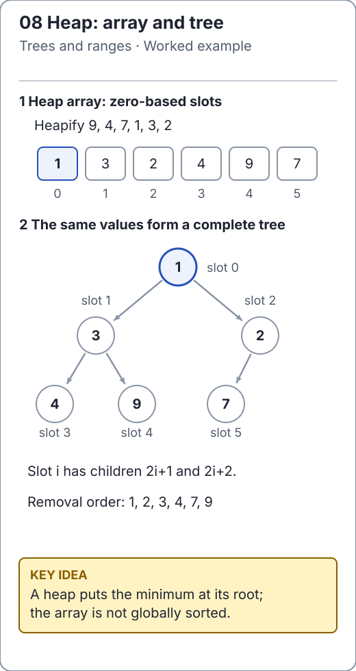
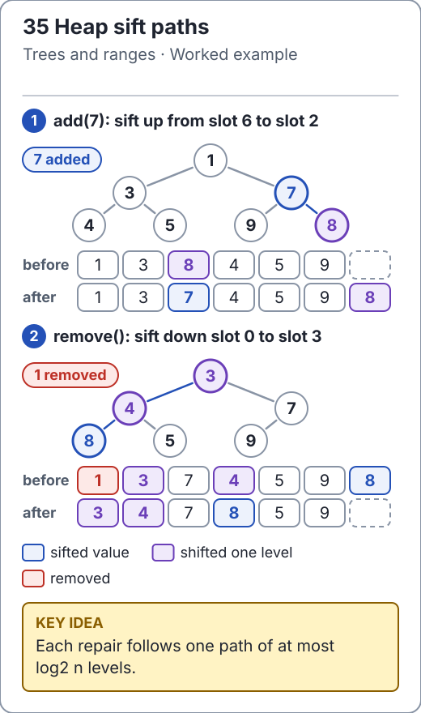

# Heap operations: restore order along one path

Read [`BinaryMinHeap`](../../src/main/java/io/github/ichillous/dsa/structures/BinaryMinHeap.java) alongside this trace. A complete-tree array has height O(log n), so repairing one root-to-leaf or leaf-to-root path gives logarithmic priority operations.

| At a glance | |
| --- | --- |
| **Use it when** | You need to understand or review how a binary heap restores order after add, remove and bulk construction. |
| **Avoid it when** | You only need a priority queue as a tool; use `PriorityQueue` and skip the mechanics. |
| **Cost** | Add and remove O(log n); build from n values O(n); sifts use O(1) extra workspace. |
| **In this repo** | [`BinaryMinHeap`](../../src/main/java/io/github/ichillous/dsa/structures/BinaryMinHeap.java) |
| **In the JDK** | `java.util.PriorityQueue` |

## Bottom-up construction

<!-- visual:generated heap-anatomy -->
<picture><source media="(prefers-color-scheme: dark)" srcset="../../docs/visuals/assets/heap-anatomy-dark.svg"></picture>

**Figure 08.** Bottom-up heapify turns 9,4,7,1,3,2 into the array 1,3,2,4,9,7. The matching complete binary tree labels every zero-based array slot and keeps every parent no greater than its children. [Visual index and step-throughs](../../docs/visuals/README.md).
<!-- /visual:generated -->

Starting with `[9, 4, 7, 1, 3, 2]`, the last internal node is at `n / 2 - 1 = 2`. Leaves are already heaps. Process internal nodes from right to left:

```text
start            [9, 4, 7, 1, 3, 2]
sift index 2     [9, 4, 2, 1, 3, 7]
sift index 1     [9, 1, 2, 4, 3, 7]
sift index 0     [1, 3, 2, 4, 9, 7]
```

When a node is processed, both child subtrees are already heaps. Sifting its value downward therefore establishes the invariant for the entire subtree rooted there.

Although one sift can cost O(log n), most nodes are near the leaves and move only a short distance. Summing work by subtree height gives O(n) construction. Inserting each value separately instead gives O(n log n) worst-case construction.

```java
import io.github.ichillous.dsa.structures.BinaryMinHeap;
import java.util.ArrayList;
import java.util.List;

BinaryMinHeap<Integer> heap = new BinaryMinHeap<>(List.of(9, 4, 7, 1, 3, 2));
List<Integer> sorted = new ArrayList<>();
while (!heap.isEmpty()) sorted.add(heap.remove());
assert sorted.equals(List.of(1, 2, 3, 4, 7, 9));
assert heap.isEmpty();
```

## Insert: sift up

Append at the next free array position to preserve completeness. While the new value is smaller than its parent, exchange them and continue upward. Comparing with arbitrary earlier array entries would not follow the tree and could damage another subtree.

```java
import io.github.ichillous.dsa.structures.BinaryMinHeap;
import java.util.List;

BinaryMinHeap<Integer> heap = new BinaryMinHeap<>(List.of(4, 9, 6));
heap.add(2);
heap.add(2);
assert heap.size() == 5;
assert heap.remove() == 2;
assert heap.remove() == 2;
assert heap.peek() == 4;
```

## Remove: choose the smaller child

Replace the root with the final array value and remove that last slot. At each step, compare the replacement with the **smaller** child. If it is already no larger, stop; otherwise swap and continue.

For heap `[1, 3, 2, 4, 9, 7]`, removing 1 first creates `[7, 3, 2, 4, 9]`. Swapping 7 with smaller child 2 produces `[2, 3, 7, 4, 9]`. Swapping with 3 instead would leave root 3 above child 2, violating min-heap order.

The singleton case needs no sift: removing its final slot leaves an empty heap. Peek and remove then throw the documented empty-state exception, rather than returning a numeric sentinel that could also be a real value.

The arrays in the next figure are the conceptual layout that the sift rules produce; `BinaryMinHeap` keeps its array private, so the tests check the removal order instead.

<!-- visual:generated heap-sift-paths -->
<picture><source media="(prefers-color-scheme: dark)" srcset="../../docs/visuals/assets/heap-sift-paths-dark.svg"></picture>

**Figure 41.** In the min heap 1, 3, 8, 4, 5, 9, add(7) appends at slot 6 and swaps up one level to slot 2, giving 1, 3, 7, 4, 5, 9, 8. remove() then takes out 1, moves 8 to the root and sifts it down two levels to slot 3, giving 3, 4, 7, 8, 5, 9. [Visual index and step-throughs](../../docs/visuals/README.md).
<!-- /visual:generated -->

## Cost and ownership

Bottom-up build uses O(n) time and O(n) copied storage. Peek is O(1); removal is O(log n). Insert is O(log n) amortized but may copy O(n) references during growth. Sift operations themselves use O(1) additional workspace. The heap keeps natural-order duplicates; order-equivalent objects do not have stable removal ties.

## In real Java

`java.util.PriorityQueue` is the production heap. Besides `poll`, it can remove one specific element with `remove(Object)`, which removes a single instance and returns whether one was present. The Javadoc's implementation note states linear time for `remove(Object)` and `contains(Object)`, so use them rarely; repeated `poll` stays logarithmic. The queue still yields the remaining values in order afterwards.

```java
import java.util.ArrayList;
import java.util.List;
import java.util.PriorityQueue;

PriorityQueue<Integer> queue = new PriorityQueue<>(List.of(9, 4, 7, 1, 3, 2));
assert queue.remove(7);
assert !queue.remove(8);
assert queue.contains(9) && !queue.contains(7);
List<Integer> order = new ArrayList<>();
while (!queue.isEmpty()) {
    order.add(queue.poll());
}
assert order.equals(List.of(1, 2, 3, 4, 9));
```

## Common mistakes

1. **Heapifying left to right.** Sifting down indices 0, 1, 2 in that order on `[9, 4, 7, 1, 3, 2]` gives `[4, 1, 2, 9, 3, 7]`: root 4 sits above child 1. Sifting index 0 first runs while its subtrees are not yet heaps, which breaks the precondition that both child subtrees are heaps.
2. **Forgetting to drop the last slot on removal.** Removing the root of `[1, 3, 2]` by copying the last value to the root but keeping size 3 gives `[2, 3, 2]`: the value 2 is now stored twice. This breaks the invariant that the heap holds exactly the values that were added and not yet removed.
3. **Returning a sentinel for an empty heap.** If `peek` on an empty heap returned `0`, a heap that really contains `0` would look the same as an empty one. The repository heap throws `NoSuchElementException`, and `PriorityQueue` returns `null` because it forbids `null` elements.

## Check yourself

<details>
<summary>Why does sift-down compare the replacement with the smaller child?</summary>

The child moved up becomes the parent of the other child, so it must be the smaller of the two. Moving the larger child up would put it above a smaller sibling and violate the min-heap order.

</details>

<details>
<summary>In `[1, 3, 8, 4, 5, 9]`, which slot does `add(7)` end in, and which value moves down?</summary>

The new 7 starts in slot 6, whose parent is slot 2 holding 8. Since 7 is smaller, they swap; slot 2's parent is 1, which is not larger, so 7 stops in slot 2 and 8 moves down to slot 6.

</details>

<details>
<summary>Why is bottom-up construction O(n) but n separate adds O(n log n) in the worst case?</summary>

Bottom-up sifts each internal node down by at most its height, and most nodes are near the leaves. Each add may sift up the full height, and n adds can each climb about log2 n levels when values arrive in descending order.

</details>

## Practice

1. Trace a sift-down that follows two levels, then one that stops immediately.
2. Verify that modifying the constructor's input collection does not mutate the heap.
3. Create an independent heap-order validator over a small reference array, then compare complete removal sequences with `Arrays.sort` or `PriorityQueue`.

See the [worked solutions](../../docs/solutions.md) for heapify's summation and boundary cases.
