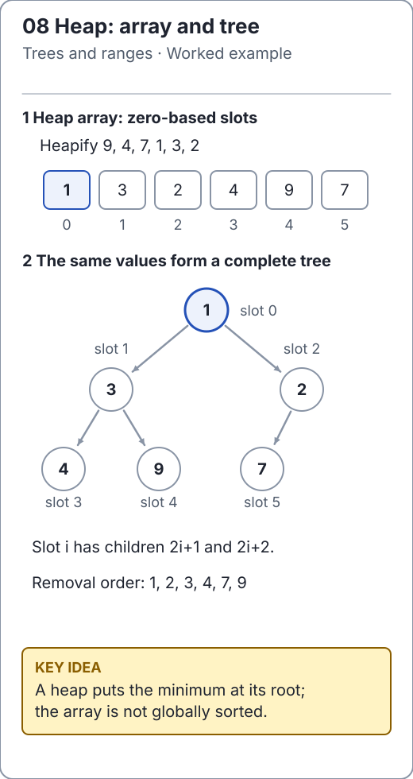

# Heap operations: restore order along one path

Read [`BinaryMinHeap`](../../src/main/java/io/github/ichillous/dsa/structures/BinaryMinHeap.java) alongside this trace. A complete-tree array has height O(log n), so repairing one root-to-leaf or leaf-to-root path gives logarithmic priority operations.

<!-- visual:generated -->
<picture><source media="(prefers-color-scheme: dark)" srcset="../../docs/visuals/assets/heap-anatomy-dark.svg"></picture>

**Figure 08.** Bottom-up heapify turns 9,4,7,1,3,2 into the array 1,3,2,4,9,7. The matching complete binary tree labels every zero-based array slot and keeps every parent no greater than its children. [Visual index and step-throughs](../../docs/visuals/README.md).
<!-- /visual:generated -->

## Bottom-up construction

Starting with `[9, 4, 7, 1, 3, 2]`, the last internal node is at `n / 2 - 1 = 2`. Leaves are already heaps. Process internal nodes from right to left:

```text
start            [9, 4, 7, 1, 3, 2]
sift index 2     [9, 4, 2, 1, 3, 7]
sift index 1     [9, 1, 2, 4, 3, 7]
sift index 0     [1, 3, 2, 4, 9, 7]
```

When a node is processed, both child subtrees are already heaps. Sifting its value downward therefore establishes the invariant for the entire subtree rooted there.

Although one sift can cost O(log n), most nodes are near the leaves and move only a short distance. Summing work by subtree height gives O(n) construction. Inserting each value separately instead gives O(n log n) worst-case construction.

```java
import io.github.ichillous.dsa.structures.BinaryMinHeap;
import java.util.ArrayList;
import java.util.List;

BinaryMinHeap<Integer> heap = new BinaryMinHeap<>(List.of(9, 4, 7, 1, 3, 2));
List<Integer> sorted = new ArrayList<>();
while (!heap.isEmpty()) sorted.add(heap.remove());
assert sorted.equals(List.of(1, 2, 3, 4, 7, 9));
assert heap.isEmpty();
```

## Insert: sift up

Append at the next free array position to preserve completeness. While the new value is smaller than its parent, exchange them and continue upward. Comparing with arbitrary earlier array entries would not follow the tree and could damage another subtree.

```java
import io.github.ichillous.dsa.structures.BinaryMinHeap;
import java.util.List;

BinaryMinHeap<Integer> heap = new BinaryMinHeap<>(List.of(4, 9, 6));
heap.add(2);
heap.add(2);
assert heap.size() == 5;
assert heap.remove() == 2;
assert heap.remove() == 2;
assert heap.peek() == 4;
```

## Remove: choose the smaller child

Replace the root with the final array value and remove that last slot. At each step, compare the replacement with the **smaller** child. If it is already no larger, stop; otherwise swap and continue.

For heap `[1, 3, 2, 4, 9, 7]`, removing 1 first creates `[7, 3, 2, 4, 9]`. Swapping 7 with smaller child 2 produces `[2, 3, 7, 4, 9]`. Swapping with 3 instead would leave root 3 above child 2, violating min-heap order.

The singleton case needs no sift: removing its final slot leaves an empty heap. Peek and remove then throw the documented empty-state exception, rather than returning a numeric sentinel that could also be a real value.

## Cost and ownership

Bottom-up build uses O(n) time and O(n) copied storage. Peek is O(1); removal is O(log n). Insert is O(log n) amortized but may copy O(n) references during growth. Sift operations themselves use O(1) additional workspace. The heap keeps natural-order duplicates; order-equivalent objects do not have stable removal ties.

## Practice

1. Trace a sift-down that follows two levels, then one that stops immediately.
2. Verify that modifying the constructor's input collection does not mutate the heap.
3. Create an independent heap-order validator over a small reference array, then compare complete removal sequences with `Arrays.sort` or `PriorityQueue`.

See the [worked solutions](../../docs/solutions.md) for heapify's summation and boundary cases.
