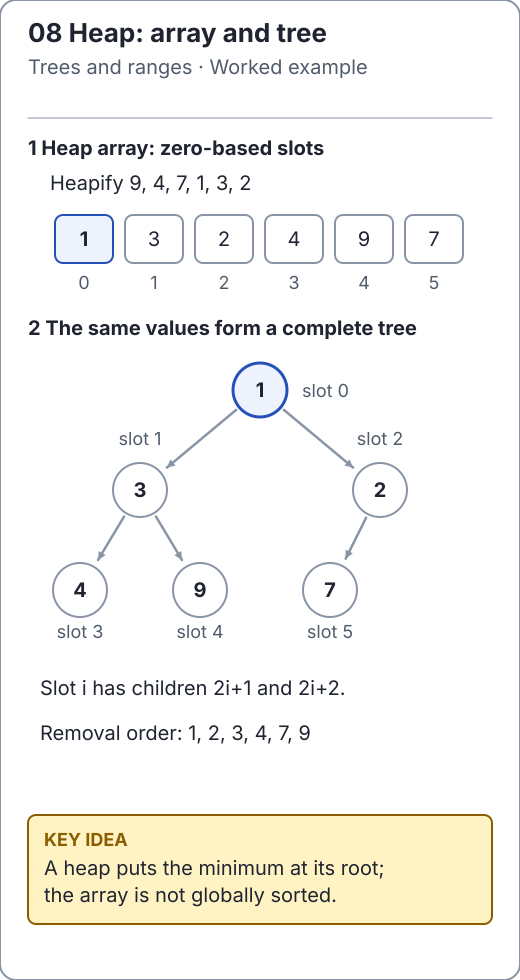

# Binary heaps: a partial order is enough

A binary min heap keeps the smallest value at its root. Every parent compares no greater than its children, but siblings and separate subtrees need not be ordered relative to each other. This is enough to repeatedly select the minimum without sorting the whole collection.

| At&nbsp;a&nbsp;glance | |
| --- | --- |
| **Use&nbsp;it&nbsp;when** | You repeatedly need the smallest (or largest) of a changing collection: scheduling, event simulation, Dijkstra, the best `k` of a stream. |
| **Avoid&nbsp;it&nbsp;when** | You need sorted iteration, searching for an arbitrary value, or ranks; a heap orders only parent against child. |
| **Cost** | Peek O(1); add and remove O(log n); build from n values O(n); space O(n). |
| **In&nbsp;this&nbsp;repo** | [`BinaryMinHeap`](../../src/main/java/io/github/ichillous/dsa/structures/BinaryMinHeap.java) |
| **In&nbsp;the&nbsp;JDK** | `java.util.PriorityQueue` |

```text
        1             array: [1, 3, 2, 4, 9, 7]
      /   \
     3     2          children of index i:
    / \   /             2*i + 1, 2*i + 2
   4   9 7            parent of i > 0:
                          (i - 1) / 2
```

The shape is complete: every level except possibly the last is full, and the last fills from the left. That shape permits an array representation with no node links. It also bounds height by O(log n).

[`BinaryMinHeap`](../../src/main/java/io/github/ichillous/dsa/structures/BinaryMinHeap.java) uses natural ordering, retains duplicate values and rejects nulls. Empty peek/removal throws `NoSuchElementException`. Its collection constructor makes a defensive copy and heapifies bottom up.

```java
import io.github.ichillous.dsa.structures.BinaryMinHeap;
import java.util.ArrayList;
import java.util.List;

List<Integer> input = new ArrayList<>(List.of(9, 4, 7, 1, 3, 2));
BinaryMinHeap<Integer> heap = new BinaryMinHeap<>(input);
input.clear();
assert heap.size() == 6;
assert heap.peek() == 1;
heap.add(0);
assert heap.remove() == 0;
assert heap.remove() == 1;
assert heap.peek() == 2;
```

<!-- visual:generated heap-anatomy -->
<picture><source media="(prefers-color-scheme: dark)" srcset="../../docs/visuals/assets/heap-anatomy-dark.svg"></picture>

**Figure 08.** Bottom-up heapify turns 9,4,7,1,3,2 into the array 1,3,2,4,9,7. The matching complete binary tree labels every zero-based array slot and keeps every parent no greater than its children. [Visual index and step-throughs](../../docs/visuals/README.md).
<!-- /visual:generated -->

## Repair only one path

For the exact slots and swaps of one insertion and one removal, see [heap operations](operations.md).

Insertion appends at the next complete-tree position, then sifts the new value upward while it is smaller than its parent. Removal replaces the root with the last value, shortens the array, then sifts downward through the smaller child.

The invariant before each sift step is that only the current position can violate heap order. Swapping with the appropriate parent or child moves that possible violation along one path; all untouched subtrees remain valid heaps.

## Heap versus BST

A BST orders every left descendant below its ancestor and every right descendant above it. A heap only compares parents with children. Searching for an arbitrary value in a heap may require O(n) work, because neither subtree can be discarded from a root comparison. This library's heap deliberately exposes priority operations rather than pretending to be a sorted set.

| Operation | Cost |
| --- | --- |
| Peek minimum | O(1) |
| Remove minimum | O(log n) |
| Insert | O(log n) amortized; O(n) if array growth occurs |
| Build from n values | O(n) bottom-up heapification |
| Stored space | O(n) relative to retained peak capacity |

Repeated removal emits sorted values, but merely inspecting the backing array would not. In-place heapsort additionally changes which end is active; it is an algorithm built from heap ideas, not this same mutable min-heap API.

## In real Java

Use `java.util.PriorityQueue` in production code: it accepts a `Comparator`, and it is the class the rest of the JDK expects. Its empty-queue behavior differs from this repository's heap. `peek` and `poll` return `null` on an empty queue, which is unambiguous because the queue rejects `null` elements. `remove()` with no argument throws `NoSuchElementException`, like the repository heap.

```java
import java.util.NoSuchElementException;
import java.util.PriorityQueue;

PriorityQueue<Integer> queue = new PriorityQueue<>();
assert queue.peek() == null && queue.poll() == null;
boolean threw = false;
try {
    queue.remove();
} catch (NoSuchElementException expected) {
    threw = true;
}
assert threw;
boolean rejectedNull = false;
try {
    queue.add(null);
} catch (NullPointerException expected) {
    rejectedNull = true;
}
assert rejectedNull;
queue.add(5);
queue.add(1);
queue.add(3);
assert queue.peek() == 1 && queue.size() == 3;
```

## Common mistakes

1. **Sifting toward the larger child.** A replacement `7` at the root of `[7, 3, 2]`: swapping with child `3` puts `3` above `2`. This breaks the invariant that every parent is no greater than its children.
2. **Reading the array as sorted.** In `[1, 3, 2, 4, 9, 7]` slot 1 holds 3 and slot 2 holds 2. Scanning the backing array in index order does not give ascending order; only repeated removal does. The invariant orders each parent against its children, not neighbors.
3. **Using the one-based parent formula with zero-based slots.** For slot 2, `i / 2` gives slot 1, but the parent of slot 2 is slot 0, `(i - 1) / 2`. Comparing with the wrong parent breaks the relation between a slot and its children `2*i + 1` and `2*i + 2`, so sifts repair the wrong path.

## Check yourself

<details>
<summary>Why can a heap find its minimum in O(1) but not search for an arbitrary value in O(log n)?</summary>

Order is only guaranteed between a parent and its children, so the root is a lower bound for everything. For any other value, neither subtree can be discarded by one comparison, so a search may visit all n slots.

</details>

<details>
<summary>How many levels can one add or remove touch for a heap of n values?</summary>

At most the height of the complete tree, about log2 n levels, because each sift moves one value along a single root-to-leaf path. That bound is why add and remove are O(log n).

</details>

<details>
<summary>Why does building from n values in one pass take O(n) rather than O(n log n)?</summary>

Bottom-up heapify sifts down from the last internal node to the root. Half the nodes are leaves and need no work, and a node of height h moves at most h levels, so the total work is a sum that is bounded by a constant times n.

</details>

## Practice

1. Verify each parent-child inequality in `[1, 3, 2, 4, 9, 7]`; find an adjacent pair that is out of sorted order.
2. Explain why choosing the larger child during a min-heap sift-down can leave a violation behind.
3. Compare random add/remove/peek sequences with `PriorityQueue`, including duplicate and extreme integer values.

Continue with [heap operations](operations.md), [priority queues](../queues/priority-queues.md) and the [worked solutions](../../docs/solutions.md). The [solution finder](../../docs/solution-finder.md#7-stacks-queues-deques-and-priority) compares this technique with its alternatives.
