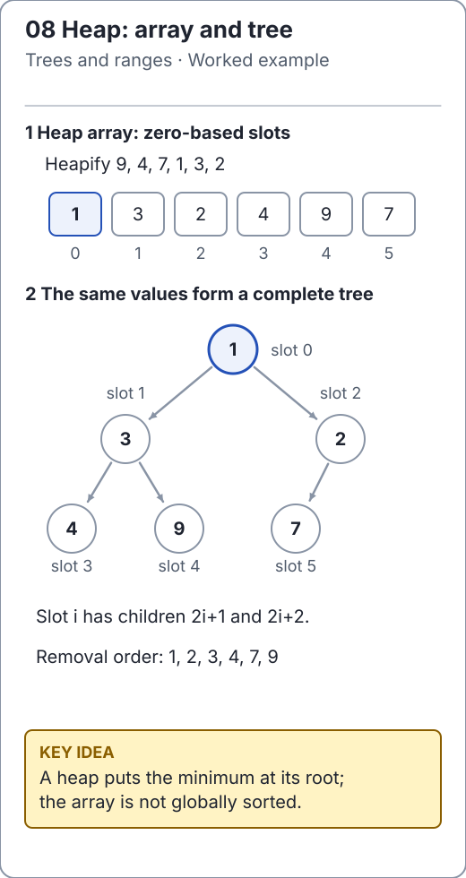

# Binary heaps: a partial order is enough

A binary min heap keeps the smallest value at its root. Every parent compares no greater than its children, but siblings and separate subtrees need not be ordered relative to each other. This is enough to repeatedly select the minimum without sorting the whole collection.

```text
        1             array: [1, 3, 2, 4, 9, 7]
      /   \
     3     2          children of index i:
    / \   /             2*i + 1, 2*i + 2
   4   9 7            parent of i > 0:
                          (i - 1) / 2
```

The shape is complete: every level except possibly the last is full, and the last fills from the left. That shape permits an array representation with no node links. It also bounds height by O(log n).

[`BinaryMinHeap`](../../src/main/java/io/github/ichillous/dsa/structures/BinaryMinHeap.java) uses natural ordering, retains duplicate values and rejects nulls. Empty peek/removal throws `NoSuchElementException`. Its collection constructor makes a defensive copy and heapifies bottom up.

```java
import io.github.ichillous.dsa.structures.BinaryMinHeap;
import java.util.ArrayList;
import java.util.List;

List<Integer> input = new ArrayList<>(List.of(9, 4, 7, 1, 3, 2));
BinaryMinHeap<Integer> heap = new BinaryMinHeap<>(input);
input.clear();
assert heap.size() == 6;
assert heap.peek() == 1;
heap.add(0);
assert heap.remove() == 0;
assert heap.remove() == 1;
assert heap.peek() == 2;
```

<!-- visual:generated -->
<picture><source media="(prefers-color-scheme: dark)" srcset="../../docs/visuals/assets/heap-anatomy-dark.svg"></picture>

**Figure 08.** Bottom-up heapify turns 9,4,7,1,3,2 into the array 1,3,2,4,9,7. The matching complete binary tree labels every zero-based array slot and keeps every parent no greater than its children. [Visual index and step-throughs](../../docs/visuals/README.md).
<!-- /visual:generated -->

## Repair only one path

Insertion appends at the next complete-tree position, then sifts the new value upward while it is smaller than its parent. Removal replaces the root with the last value, shortens the array, then sifts downward through the smaller child.

The invariant before each sift step is that only the current position can violate heap order. Swapping with the appropriate parent or child moves that possible violation along one path; all untouched subtrees remain valid heaps.

## Heap versus BST

A BST orders every left descendant below its ancestor and every right descendant above it. A heap only compares parents with children. Searching for an arbitrary value in a heap may require O(n) work, because neither subtree can be discarded from a root comparison. This library's heap deliberately exposes priority operations rather than pretending to be a sorted set.

| Operation | Cost |
| --- | --- |
| Peek minimum | O(1) |
| Remove minimum | O(log n) |
| Insert | O(log n) amortized; O(n) if array growth occurs |
| Build from n values | O(n) bottom-up heapification |
| Stored space | O(n) relative to retained peak capacity |

Repeated removal emits sorted values, but merely inspecting the backing array would not. In-place heapsort additionally changes which end is active; it is an algorithm built from heap ideas, not this same mutable min-heap API.

## Practice

1. Verify each parent-child inequality in `[1, 3, 2, 4, 9, 7]`; find an adjacent pair that is out of sorted order.
2. Explain why choosing the larger child during a min-heap sift-down can leave a violation behind.
3. Compare random add/remove/peek sequences with `PriorityQueue`, including duplicate and extreme integer values.

Continue with [heap operations](operations.md), [priority queues](../queues/priority-queues.md) and the [worked solutions](../../docs/solutions.md).
