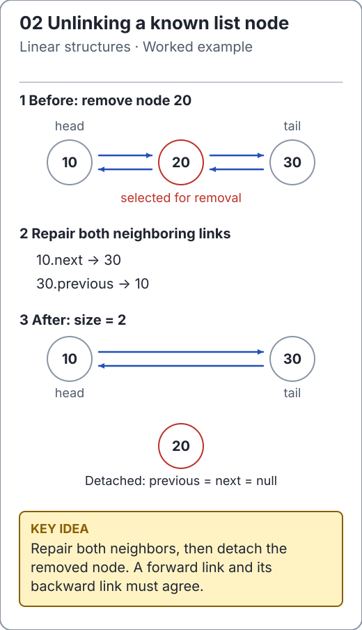

# Doubly linked lists: repair both neighbors

[`DoublyLinkedList`](../../src/main/java/io/github/ichillous/dsa/collections/DoublyLinkedList.java) stores a head, a tail, a size and nodes with two links. Values are non-null, order is stable, and indexed methods validate `[0, size)`. Empty endpoint removals throw `NoSuchElementException`.

<!-- visual:generated -->
<picture><source media="(prefers-color-scheme: dark)" srcset="../../docs/visuals/assets/linked-unlink-dark.svg"></picture>

**Figure 02.** Bypass the middle node in both directions, then clear its links. [Visual index and step-throughs](../../docs/visuals/README.md).
<!-- /visual:generated -->

## The local invariant

If `x.next` is `y`, then `y.previous` must be `x`. The head has no predecessor and the tail has no successor. The empty list has neither endpoint; a one-element list has the same node at both endpoints.

```text
before:  A <-> B <-> C
          \         /
after:     A <-> C

unlink B:
  A.next becomes C
  C.previous becomes A
```

When a neighbor is absent, update the corresponding endpoint instead. Unlinking the only node therefore resets both head and tail. The implementation clears removed links so that an obsolete node does not unnecessarily retain the rest of the sequence.

```java
import io.github.ichillous.dsa.collections.DoublyLinkedList;

DoublyLinkedList<Integer> list = new DoublyLinkedList<>();
list.addLast(10);
list.addLast(20);
list.addLast(30);
int middle = list.remove(1);
int front = list.removeFirst();
int back = list.removeLast();
assert middle == 20 && front == 10 && back == 30;
assert list.isEmpty();
list.addFirst(99);
assert list.get(0) == 99 && list.size() == 1;
```

## Traversal and iterator contracts

Index lookup starts from the nearer endpoint, taking O(min(i, n - 1 - i)) link steps. The implementation does not expose nodes, so `remove(index)` still includes this search. Once the node is found, unlinking is O(1).

```java
import io.github.ichillous.dsa.collections.DoublyLinkedList;
import java.util.ArrayList;
import java.util.List;

DoublyLinkedList<String> list = new DoublyLinkedList<>();
list.addLast("old");
list.addLast("tail");
var iterator = list.iterator();
list.set(0, "new"); // Replacement is not a structural change.
assert iterator.next().equals("new");
List<String> observed = new ArrayList<>();
for (String value : list) observed.add(value);
assert observed.equals(List.of("new", "tail"));
```

Adding, removing or clearing invalidates existing iterators, which fail fast. Iterator `remove` is unsupported. Fail-fast detection is for misuse, not synchronization; these collections are not thread safe.

## Why this matters for an LRU cache

An LRU cache combines a key-to-node hash map with a doubly linked recency list. A lookup obtains the exact node; moving that node to the most-recent end is O(1). Searching this standalone list for a key on each hit would lose the expected O(1) cache operation bound. Read [`LruCache`](../../src/main/java/io/github/ichillous/dsa/collections/LruCache.java) for that composition.

Endpoint updates cost O(1); indexed operations cost O(n) worst case; full iteration and clear cost O(n). Nodes use O(n) stored space and endpoint changes use O(1) workspace.

## Practice

1. Trace deleting the first, last and only node, naming every modified link or endpoint.
2. Add a test that alternates removals from both ends until empty, then reuses the list.
3. Model random operations with `LinkedList`; compare sequence, size and returned values after every operation.

Consult the [worked solutions](../../docs/solutions.md) for unlinking and cache-invariant reasoning.
