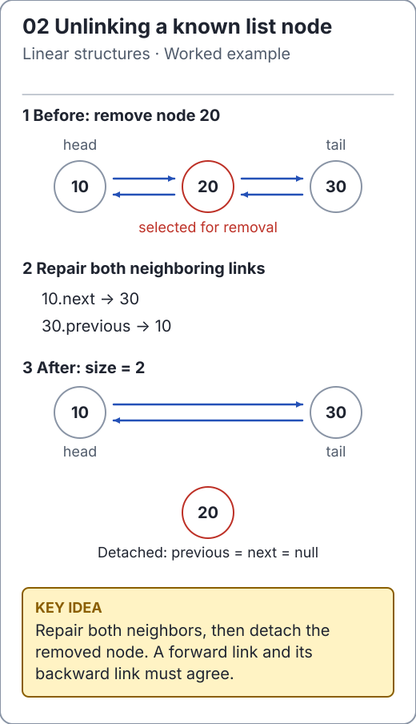
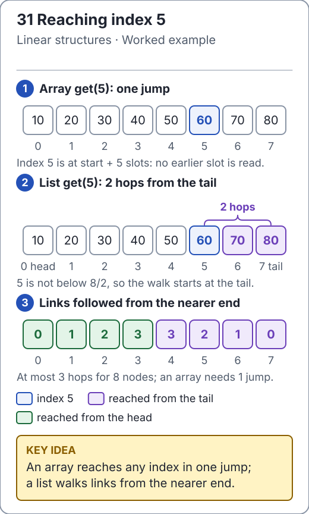

# Doubly linked lists: repair both neighbors

[`DoublyLinkedList`](../../src/main/java/io/github/ichillous/dsa/collections/DoublyLinkedList.java) stores a head, a tail, a size and nodes with two links. Values are non-null, order is stable, and indexed methods validate `[0, size)`. Empty endpoint removals throw `NoSuchElementException`.

| At a glance | |
| --- | --- |
| **Use it when** | You need O(1) changes at both ends or O(1) removal of a node you hold, as in an LRU recency list. |
| **Avoid it when** | You look elements up by index or scan often; use `DynamicArray` or `ArrayDeque` instead. |
| **Cost** | Endpoint add/remove O(1); `get(i)` and `remove(i)` O(min(i, n - 1 - i)) to find, then O(1) to unlink. |
| **In this repo** | [`DoublyLinkedList`](../../src/main/java/io/github/ichillous/dsa/collections/DoublyLinkedList.java) |
| **In the JDK** | `java.util.LinkedList`; for an LRU map, `java.util.LinkedHashMap` in access order. |

<!-- visual:generated linked-unlink -->
<picture><source media="(prefers-color-scheme: dark)" srcset="../../docs/visuals/assets/linked-unlink-dark.svg"></picture>

**Figure 02.** Bypass the middle node in both directions, then clear its links. [Visual index and step-throughs](../../docs/visuals/README.md).
<!-- /visual:generated -->

## The local invariant

If `x.next` is `y`, then `y.previous` must be `x`. The head has no predecessor and the tail has no successor. The empty list has neither endpoint; a one-element list has the same node at both endpoints.

```text
before:  A <-> B <-> C
          \         /
after:     A <-> C

unlink B:
  A.next becomes C
  C.previous becomes A
```

When a neighbor is absent, update the corresponding endpoint instead. Unlinking the only node therefore resets both head and tail. The implementation clears removed links so that an obsolete node does not unnecessarily retain the rest of the sequence.

```java
import io.github.ichillous.dsa.collections.DoublyLinkedList;

DoublyLinkedList<Integer> list = new DoublyLinkedList<>();
list.addLast(10);
list.addLast(20);
list.addLast(30);
int middle = list.remove(1);
int front = list.removeFirst();
int back = list.removeLast();
assert middle == 20 && front == 10 && back == 30;
assert list.isEmpty();
list.addFirst(99);
assert list.get(0) == 99 && list.size() == 1;
```

## Traversal and iterator contracts

<!-- visual:generated array-vs-list-access | The list reaches index 5 from the tail in 2 hops; the array needs one jump for any index. -->
<picture><source media="(prefers-color-scheme: dark)" srcset="../../docs/visuals/assets/array-vs-list-access-dark.svg"></picture>

**Figure 31.** The list reaches index 5 from the tail in 2 hops; the array needs one jump for any index. [Visual index and step-throughs](../../docs/visuals/README.md).
<!-- /visual:generated -->

Index lookup starts from the nearer endpoint, taking O(min(i, n - 1 - i)) link steps. The implementation does not expose nodes, so `remove(index)` still includes this search. Once the node is found, unlinking is O(1).

```java
import io.github.ichillous.dsa.collections.DoublyLinkedList;
import java.util.ArrayList;
import java.util.List;

DoublyLinkedList<String> list = new DoublyLinkedList<>();
list.addLast("old");
list.addLast("tail");
var iterator = list.iterator();
list.set(0, "new"); // Replacement is not a structural change.
assert iterator.next().equals("new");
List<String> observed = new ArrayList<>();
for (String value : list) observed.add(value);
assert observed.equals(List.of("new", "tail"));
```

Adding, removing or clearing invalidates existing iterators, which fail fast. Iterator `remove` is unsupported. Fail-fast detection is for misuse, not synchronization; these collections are not thread safe.

## Why this matters for an LRU cache

An LRU cache combines a key-to-node hash map with a doubly linked recency list. A lookup obtains the exact node; moving that node to the most-recent end is O(1). Searching this standalone list for a key on each hit would lose the expected O(1) cache operation bound. Read [`LruCache`](../../src/main/java/io/github/ichillous/dsa/collections/LruCache.java) for that composition.

Endpoint updates cost O(1); indexed operations cost O(n) worst case; full iteration and clear cost O(n). Nodes use O(n) stored space and endpoint changes use O(1) workspace.

## In real Java

`java.util.LinkedHashMap` combines a hash map with a doubly linked list of its entries. Built with `accessOrder` set to true, iteration runs from the least recently accessed entry to the most recent, and overriding `removeEldestEntry` evicts automatically, which is the LRU cache described above.

```java
import java.util.ArrayList;
import java.util.LinkedHashMap;
import java.util.List;
import java.util.Map;

Map<String, Integer> cache = new LinkedHashMap<>(16, 0.75f, true) {
    @Override
    protected boolean removeEldestEntry(Map.Entry<String, Integer> eldest) {
        return size() > 2;
    }
};
cache.put("a", 1);
cache.put("b", 2);
cache.get("a");     // "a" becomes the most recently used entry.
cache.put("c", 3);  // Over capacity: the eldest entry, "b", is removed.
assert new ArrayList<>(cache.keySet()).equals(List.of("a", "c"));
```

## Common mistakes

1. **Repairing only one direction.** Removing `B` from `A <-> B <-> C` with `A.next = C` alone leaves `C.previous == B`. A backward traversal from the tail then visits the removed node, which breaks the rule that `x.next == y` exactly when `y.previous == x`.
2. **Unlinking an endpoint without moving it.** Removing the head must make `head.next` the new head and clear its `previous`; removing the only node must reset both `head` and `tail`. Otherwise `removeFirst()` on a list of size 0 returns a stale node.
3. **Changing the list during iteration.** Take an iterator over `[a, b]`, call `next()`, then `removeFirst()`: the following `hasNext()` throws `ConcurrentModificationException`, because the modification count no longer matches. Replacing a value with `set` is not structural and does not invalidate the iterator.

## Check yourself

<details>
<summary>After unlinking `B` from `A <-> B <-> C`, which links change and what happens to `B`'s links?</summary>

`A.next` becomes `C` and `C.previous` becomes `A`. `B`'s own `previous` and `next` are cleared so a stale reference to `B` does not retain the rest of the list.

</details>

<details>
<summary>What does `remove(index)` cost for an index in the middle of this list?</summary>

O(n): it walks about n / 2 links to find the node, then unlinking is O(1). The search dominates.

</details>

<details>
<summary>Why does an LRU cache keep a hash map beside the linked list?</summary>

The map finds the exact node for a key in expected O(1), and the doubly linked list then moves it to the recent end in O(1). Searching the list for each hit would be O(n).

</details>

## Practice

1. Trace deleting the first, last and only node, naming every modified link or endpoint.
2. Add a test that alternates removals from both ends until empty, then reuses the list.
3. Model random operations with `LinkedList`; compare sequence, size and returned values after every operation.

Consult the [worked solutions](../../docs/solutions.md) for unlinking and cache-invariant reasoning.
