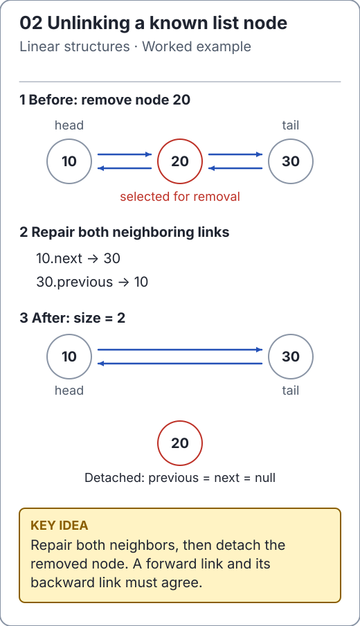

# Linked lists: preserve connections

A linked list stores a sequence in nodes connected by references. It trades cheap array indexing for cheap changes at known nodes or maintained ends. The useful question is **how do you obtain the node?** Finding position `i` is usually the expensive part.

| At a glance | |
| --- | --- |
| **Use it when** | You work at the ends or at nodes you already hold, as in queues, deques and recency lists. |
| **Avoid it when** | You index by position or scan the whole sequence often; an array is both simpler and kinder to the cache. |
| **Cost** | Add or remove at either end O(1); reach an indexed node O(min(i, n - i)) in a doubly linked list. |
| **In this repo** | [`DoublyLinkedList`](../../src/main/java/io/github/ichillous/dsa/collections/DoublyLinkedList.java) |
| **In the JDK** | `java.util.LinkedList` (doubly linked); for queue or stack use, `java.util.ArrayDeque`. |

```text
singly:  head -> A -> B -> C -> null

doubly:  null <- A <-> B <-> C -> null
                ^           ^
               head        tail
```

For a singly linked list, following `next` visits later nodes. A doubly linked node also has `previous`; removing a known interior node can reconnect its two neighbors without searching for the predecessor.

<!-- visual:generated linked-unlink -->
<picture><source media="(prefers-color-scheme: dark)" srcset="../../docs/visuals/assets/linked-unlink-dark.svg"></picture>

**Figure 02.** Bypass the middle node in both directions, then clear its links. [Visual index and step-throughs](../../docs/visuals/README.md).
<!-- /visual:generated -->

## Compare the choices

| Operation | Singly, head and tail known | Doubly, head and tail known |
| --- | --- | --- |
| Add/remove front | O(1) | O(1) |
| Add back | O(1) | O(1) |
| Remove back | O(n), to find predecessor | O(1) |
| Find an indexed node | O(n) | O(n), walking from the nearer end |
| Node storage | Value + next | Value + previous + next |

These are operation counts; node objects and pointer chasing can make a linked list slower than an array for scans. O(1) unlinking does not imply O(1) searching by value or index.

## Run a maintained list

```java
import io.github.ichillous.dsa.collections.DoublyLinkedList;

DoublyLinkedList<String> route = new DoublyLinkedList<>();
route.addLast("B");
route.addFirst("A");
route.addLast("C");
String removed = route.remove(1);
assert removed.equals("B");
assert route.get(0).equals("A") && route.get(1).equals("C");
assert route.size() == 2;
```

[`DoublyLinkedList`](../../src/main/java/io/github/ichillous/dsa/collections/DoublyLinkedList.java) rejects nulls and does not expose mutable nodes. Its empty-state invariant is `head == tail == null`. In a nonempty list, `head.previous == null`, `tail.next == null`, and adjacent references agree in both directions.

The [singly linked lesson](singly.md) explains the one-link variant using a clearly identified JDK example; the [doubly linked lesson](doubly.md) traces the maintained implementation. Applications needing only stack or queue behavior can use the more focused [stack](../stacks/overview.md) or [queue](../queues/overview.md) API.

## In real Java

`java.util.LinkedList` is a doubly linked list that implements both `List` and `Deque`. Its documentation says it permits all elements, including null, and that indexed operations traverse from the beginning or the end, whichever is closer. `ArrayDeque` is documented to prohibit nulls and is "likely to be faster" than `LinkedList` as a queue, so it is the usual choice for pure queue or stack work. The two differ in a way that matters when porting code:

```java
import java.util.ArrayDeque;
import java.util.Deque;
import java.util.LinkedList;

Deque<String> linked = new LinkedList<>();
linked.addLast(null);
assert linked.size() == 1; // LinkedList permits null.
Deque<String> circular = new ArrayDeque<>();
boolean rejected = false;
try {
    circular.addLast(null);
} catch (NullPointerException expected) {
    rejected = true; // ArrayDeque prohibits null.
}
assert rejected && circular.isEmpty();
```

This repository's lists, stacks and queues reject null, like `ArrayDeque`.

## Common mistakes

1. **Updating one direction only.** Unlinking `B` from `A <-> B <-> C` with only `A.next = C` leaves `C.previous` pointing at `B`, so a backward walk from the tail still visits `B`. If `x.next` is `y`, then `y.previous` must be `x`.
2. **Indexing in a loop.** Calling `get(i)` for every `i` of a 100,000-node list walks up to half the list each time, which is quadratic overall. A linked list has no random access; use the iterator for a scan.
3. **Leaving an endpoint stale.** Removing the only node of a one-node list must reset both `head` and `tail`. If `tail` still names the removed node, the next append attaches to a detached node and the list looks empty. The empty list has `head == tail == null`.

## Check yourself

<details>
<summary>Why is a `for (int i = 0; i < n; i++) list.get(i)` scan of a linked list quadratic?</summary>

Each `get(i)` walks min(i, n - 1 - i) links from the nearer end, and those walks sum to about n squared over four. An iterator visits each node once, in O(n).

</details>

<details>
<summary>In a doubly linked list of eight nodes, how does `get(5)` reach its node?</summary>

Index 5 is not below 8 / 2, so the walk starts at the tail and follows 2 `previous` links (7, 6, then 5).

</details>

<details>
<summary>A queue only adds at the back and removes at the front. Which linked-list operations does it need and what do they cost?</summary>

`addLast` and `removeFirst`, both O(1) with maintained head and tail references. It never needs the O(n) indexed operations.

</details>

## Practice

1. Explain why a tail pointer alone does not make singly linked tail removal O(1).
2. Trace removal of the only node and identify both fields that must change.
3. Compare random endpoint and indexed operations against `LinkedList`, checking the result sequence after each change.

Use the [worked solutions](../../docs/solutions.md) to check the invariants, not just the final values.
