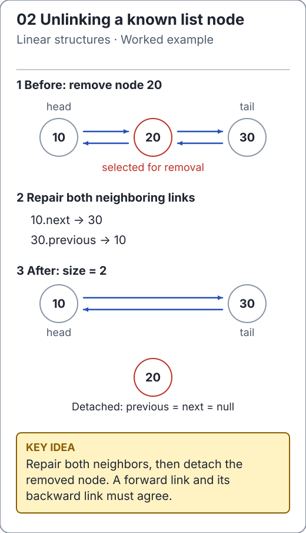

# Linked lists: preserve connections

A linked list stores a sequence in nodes connected by references. It trades cheap array indexing for cheap changes at known nodes or maintained ends. The useful question is **how do you obtain the node?** Finding position `i` is usually the expensive part.

```text
singly:  head -> A -> B -> C -> null

doubly:  null <- A <-> B <-> C -> null
                ^           ^
               head        tail
```

For a singly linked list, following `next` visits later nodes. A doubly linked node also has `previous`; removing a known interior node can reconnect its two neighbors without searching for the predecessor.

<!-- visual:generated -->
<picture><source media="(prefers-color-scheme: dark)" srcset="../../docs/visuals/assets/linked-unlink-dark.svg"></picture>

**Figure 02.** Bypass the middle node in both directions, then clear its links. [Visual index and step-throughs](../../docs/visuals/README.md).
<!-- /visual:generated -->

## Compare the choices

| Operation | Singly, head and tail known | Doubly, head and tail known |
| --- | --- | --- |
| Add/remove front | O(1) | O(1) |
| Add back | O(1) | O(1) |
| Remove back | O(n), to find predecessor | O(1) |
| Find an indexed node | O(n) | O(n), walking from the nearer end |
| Node storage | Value + next | Value + previous + next |

These are operation counts; node objects and pointer chasing can make a linked list slower than an array for scans. O(1) unlinking does not imply O(1) searching by value or index.

## Run a maintained list

```java
import io.github.ichillous.dsa.collections.DoublyLinkedList;

DoublyLinkedList<String> route = new DoublyLinkedList<>();
route.addLast("B");
route.addFirst("A");
route.addLast("C");
String removed = route.remove(1);
assert removed.equals("B");
assert route.get(0).equals("A") && route.get(1).equals("C");
assert route.size() == 2;
```

[`DoublyLinkedList`](../../src/main/java/io/github/ichillous/dsa/collections/DoublyLinkedList.java) rejects nulls and does not expose mutable nodes. Its empty-state invariant is `head == tail == null`. In a nonempty list, `head.previous == null`, `tail.next == null`, and adjacent references agree in both directions.

The [singly linked lesson](singly.md) explains the one-link variant using a clearly identified JDK example; the [doubly linked lesson](doubly.md) traces the maintained implementation. Applications needing only stack or queue behavior can use the more focused [stack](../stacks/overview.md) or [queue](../queues/overview.md) API.

## Practice

1. Explain why a tail pointer alone does not make singly linked tail removal O(1).
2. Trace removal of the only node and identify both fields that must change.
3. Compare random endpoint and indexed operations against `LinkedList`, checking the result sequence after each change.

Use the [worked solutions](../../docs/solutions.md) to check the invariants, not just the final values.
