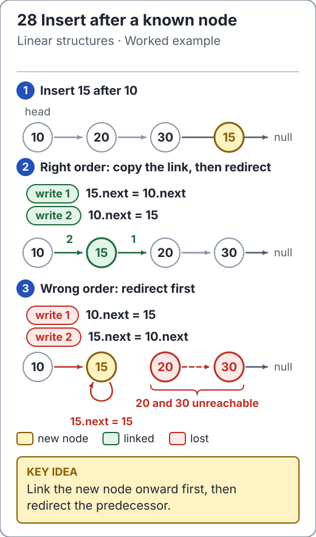

# Singly linked lists: one direction, explicit predecessors

The library does not ship a singly linked list. The executable examples below use `java.util.LinkedList`, which is doubly linked, so the singly linked behavior is shown by the traces and the figure. A singly linked node stores a value and a reference to its successor. The sequence begins at `head` and ends at the first null successor. Maintaining a `tail` makes append O(1), but there is still no backward link.

| At a glance | |
| --- | --- |
| **Use it when** | You only walk forward and edit at the head, or you keep a tail for appends and never remove from the back. |
| **Avoid it when** | You remove from the back, walk backward or index by position; a doubly linked list or an array fits better. |
| **Cost** | Head add/remove O(1); append with a tail O(1); remove the tail or find an indexed node O(n). |
| **In this repo** | No singly linked class; the maintained list is [`DoublyLinkedList`](../../src/main/java/io/github/ichillous/dsa/collections/DoublyLinkedList.java). |
| **In the JDK** | No direct equivalent: `java.util.LinkedList` is doubly linked. |

## Trace removal

```text
before:  head -> A -> B -> C -> null
                         ^
                    remove B

after:   head -> A ------> C -> null
```

To remove `B`, a predecessor reference to `A` must already be available. Replacing `A.next` with `B.next` unlinks `B`. Finding `A` from the head costs O(n) in the worst case. Removing the head is the special case: assign the head's successor as the new head.

The core invariant is that repeated successor traversal visits each live node exactly once and eventually reaches null. A mistaken pointer assignment can create a cycle or disconnect the remaining suffix. With a tail field, removing the last live node must also reset the tail.

## Insert after a known node

Insertion after a node you already hold needs two link writes, and their order matters: the old successor must be copied into the new node before the predecessor is redirected. Written the other way, `new.next = pred.next` reads the link that was just overwritten, so the new node points at itself and the old successor and everything after it become unreachable.

<!-- visual:generated singly-insert-after -->
<picture><source media="(prefers-color-scheme: dark)" srcset="../../docs/visuals/assets/singly-insert-after-dark.svg"></picture>

**Figure 48.** In the chain 10, 20, 30, inserting 15 after 10 takes two link writes: 15.next = 10.next, then 10.next = 15, giving 10, 15, 20, 30. Writing 10.next = 15 first makes 15.next point at 15 itself and leaves 20 and 30 unreachable. [Visual index and step-throughs](../../docs/visuals/README.md).
<!-- /visual:generated -->

```text
right:  new.next = pred.next      pred.next = new
wrong:  pred.next = new           new.next = pred.next   (new.next = new)
```

## Execute the sequence with a JDK deque

This example uses `java.util.LinkedList`, which is **doubly** linked internally. It demonstrates the front/back sequence contract without claiming that the repository supplies a separate singly linked implementation.

```java
import java.util.Deque;
import java.util.LinkedList;

Deque<String> sequence = new LinkedList<>();
sequence.addFirst("B");
sequence.addFirst("A");
sequence.addLast("C");
String first = sequence.removeFirst();
assert first.equals("A");
assert sequence.peekFirst().equals("B");
assert sequence.removeLast().equals("C");
```

For source you can inspect and modify, read [`DoublyLinkedList`](../../src/main/java/io/github/ichillous/dsa/collections/DoublyLinkedList.java). Removing its `previous` links is not sufficient to preserve the same endpoint costs: tail removal must then search for the predecessor.

## In real Java

The JDK's way to insert at a position you already hold is the list iterator, which keeps a cursor between elements. `ListIterator.add` inserts at the cursor without searching, and a later `next()` is unaffected by the insertion.

```java
import java.util.LinkedList;
import java.util.List;
import java.util.ListIterator;

LinkedList<Integer> list = new LinkedList<>(List.of(10, 20, 30));
ListIterator<Integer> cursor = list.listIterator();
assert cursor.next() == 10;
cursor.add(15); // Inserted just after 10, at the cursor.
assert list.equals(List.of(10, 15, 20, 30));
assert cursor.next() == 20; // The element after the insertion is unchanged.
```

## Costs and a common trap

Head insertion/removal and append with a tail pointer are O(1). Indexed search and tail removal are O(n) for a singly linked representation. Stored nodes occupy O(n) space; a single unlink operation needs O(1) workspace.

The “copy the next node into this node” trick does not implement general deletion: it cannot remove a tail and changes the identity of the retained node. It is inappropriate when callers hold node references or nodes carry additional identity-sensitive data.

## Common mistakes

1. **Redirecting the predecessor first.** Inserting `15` after `10` in `10 -> 20 -> 30` with `10.next = 15` before `15.next = 10.next` makes `15` point at itself and strands `20` and `30`. Every live node must be reachable from `head` exactly once.
2. **Forgetting the tail when removing the last node.** Removing `30` with `20.next = null` but not updating `tail` leaves `tail` on the removed node, so the next append attaches to a node nobody can reach. `tail.next` must be null and `tail` must be a live node.
3. **Walking past the end.** On a one-node list, `node.next.next` is a null dereference. A traversal must stop at the first null successor, which is what defines the end of the sequence.

## Check yourself

<details>
<summary>To insert `15` between `10` and `20` while holding node `10`, which write comes first?</summary>

`15.next = 10.next` comes first, so the link to `20` is saved in the new node; then `10.next = 15` redirects the predecessor. The reverse order loses the only reference to `20`.

</details>

<details>
<summary>Why is removing the tail O(n) in a singly linked list even with a tail pointer?</summary>

The new tail is the predecessor of the old one, and no node stores a reference backward, so it must be found by walking from the head.

</details>

<details>
<summary>Which operations are O(1) in a singly linked list that keeps head and tail?</summary>

Adding or removing at the head and adding at the tail. Removing the tail and finding an indexed node are O(n).

</details>

## Practice

1. Draw updates for removing the head, an interior node and the tail from a three-node chain.
2. Explain why the one-node case changes both head and tail.
3. Design a singly linked list with a cycle-detection test before adding it to the library. Compare its observable sequence to a JDK model, and document which endpoint operations are linear.

Check the [worked solutions](../../docs/solutions.md), then study [doubly linked nodes](doubly.md).
