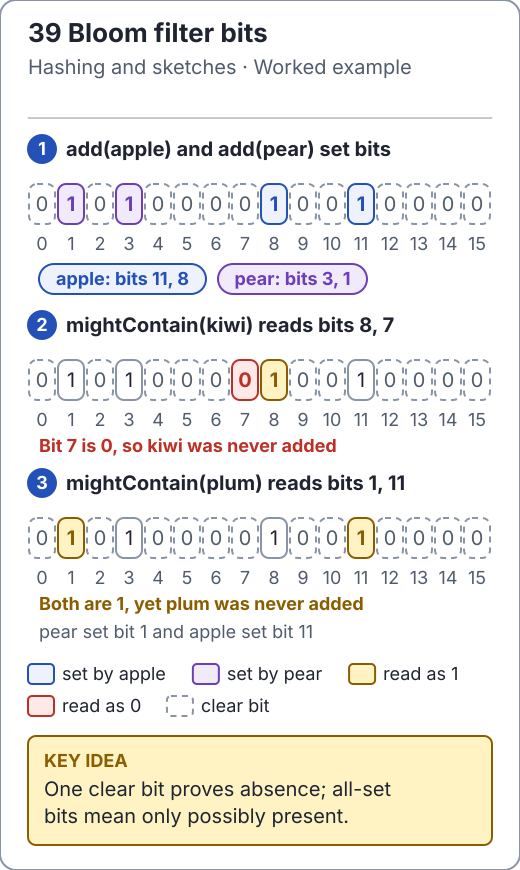
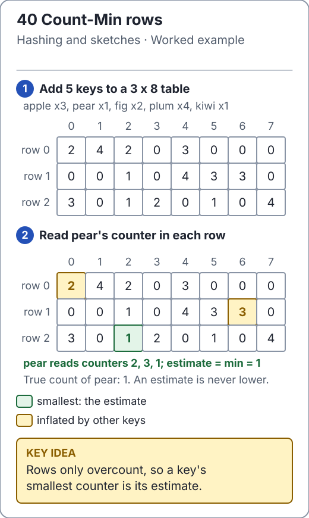

# Probabilistic membership and frequency: Bloom filter and Count-Min sketch

| At&nbsp;a&nbsp;glance | |
| --- | --- |
| **Use&nbsp;it&nbsp;when** | Exact answers cost too much memory and a small one-sided error is acceptable: skip a disk lookup for most absent keys (Bloom filter), or track approximate counts in a huge key space (Count-Min sketch). |
| **Avoid&nbsp;it&nbsp;when** | You need exact answers, deletion, or counts of rare items in a short stream. If the distinct items fit in memory, a `HashSet` or `HashMap` is simpler and exact. |
| **Cost** | O(k) per Bloom operation and O(depth) per sketch operation; space is fixed by the chosen size, not by the number of items. |
| **In&nbsp;this&nbsp;repo** | [`BloomFilter`](../../src/main/java/io/github/ichillous/dsa/structures/BloomFilter.java), [`CountMinSketch`](../../src/main/java/io/github/ichillous/dsa/structures/CountMinSketch.java) |
| **In&nbsp;the&nbsp;JDK** | No direct equivalent; the exact versions are `java.util.HashSet` and `java.util.HashMap#merge` (see [In real Java](#in-real-java)). `java.util.BitSet` is only a bit array, the storage a filter could be built on, not a membership test. |

Use these structures when exact answers cost too much memory and a small,
one-sided, quantifiable error is acceptable. A Bloom filter answers "have I seen
this?" and a Count-Min sketch answers "about how many times have I seen this?",
both in space that does not grow with the size of the elements. Preconditions: the
elements must have a good `hashCode()` and be non-null, an element's `hashCode()`
must not change after it is added (equal elements must have equal hash codes),
and you must accept that the answer is a bound, not a fact.

The maintained sources are
[BloomFilter](../../src/main/java/io/github/ichillous/dsa/structures/BloomFilter.java)
and
[CountMinSketch](../../src/main/java/io/github/ichillous/dsa/structures/CountMinSketch.java),
tested by
[BloomFilterTest](../../src/test/java/io/github/ichillous/dsa/structures/BloomFilterTest.java)
and
[CountMinSketchTest](../../src/test/java/io/github/ichillous/dsa/structures/CountMinSketchTest.java).

## The invariants and the one-sided errors

**Bloom filter.** `add` sets `k` bits chosen by the element; bits are never
cleared. Provided hash codes are stable, if an element was added, all of its `k`
bits are set and `mightContain` returns `true`: there are **no false negatives**. If some bit of a
query is still `0`, no added element can have set it, so `false` is certain. The
only error is a **false positive**: an absent element whose `k` bits were all set
by other elements.

<!-- visual:generated bloom-filter-bits -->
<picture><source media="(prefers-color-scheme: dark)" srcset="../../docs/visuals/assets/bloom-filter-bits-dark.svg"></picture>

**Figure 39.** A 16-bit Bloom filter with two probes per key sets bits 8, 11, 1 and 3 for apple and pear. kiwi reads bits 8 and 7 and bit 7 is clear, a definite miss; plum reads bits 1 and 11, both set, a false positive. [Visual index and step-throughs](../../docs/visuals/README.md).
<!-- /visual:generated -->

**Count-Min sketch.** `add(item, c)` adds `c` to one counter in each of `depth`
rows. A counter holds the true count of its item plus the counts of every other
item that collided into it, so each counter is at least the true count, and so is
their minimum. The only error is an **overestimate**; it never underestimates.
Taking the minimum over independent rows is what makes a large overestimate
unlikely.

<!-- visual:generated count-min-rows -->
<picture><source media="(prefers-color-scheme: dark)" srcset="../../docs/visuals/assets/count-min-rows-dark.svg"></picture>

**Figure 40.** A Count-Min sketch of 3 rows by 8 columns after adding apple 3, pear 1, fig 2, plum 4 and kiwi 1. pear reads counters 2, 3 and 1 in its three rows, and the minimum, 1, is the estimate. [Visual index and step-throughs](../../docs/visuals/README.md).
<!-- /visual:generated -->

Index `i` of a Bloom element comes from two 32-bit halves `h1`, `h2` of a
SplitMix64-mixed `hashCode()`: `floorMod(h1 + i * step, m)` with
`step = 1 + floorMod(h2, m - 1)`. The step is never a multiple of `m`, so the
`k` probes of one element cannot all land on the same bit (using `h2` directly would
collapse them for about one element in `m`). Both structures reject sizes above a
fixed cap (2^30 bits, 2^25 counters) instead of exhausting memory. The Count-Min row hashes are SplitMix64 of
`hashCode ^ rowSeed[i]` with fixed, documented seeds, so every result in this
lesson is reproducible.

## Sizing math with worked numbers

For `n` expected elements and target false-positive rate `p`:

```text
m = ceil(-n * ln p / (ln 2)^2)        bits
k = max(1, round(m / n * ln 2))       indices per element
```

For `n = 1000`, `p = 0.01`: `-1000 * ln 0.01 = 4605.17`, divided by
`(ln 2)^2 = 0.48045` gives `9585.06`, so `m = 9586` bits (about 1.2 KB, 9.6 bits
per element) and `k = round(9.586 * 0.6931) = round(6.64) = 7`.
`estimatedFalsePositiveRate()` evaluates `(1 - e^(-k * insertions / m))^k`, which is
about `0.01` after 1000 distinct insertions.

For a Count-Min sketch with relative error `epsilon` and failure probability
`delta`:

```text
width = ceil(e / epsilon)
depth = max(1, ceil(ln(1 / delta)))
guarantee: estimate(x) <= count(x) + epsilon * total   with probability >= 1 - delta
```

For `epsilon = 0.01`, `delta = 0.01`: `e / 0.01 = 271.83`, so `width = 272`;
`ln 100 = 4.605`, so `depth = 5`. That is `272 * 5 = 1360` counters regardless of
how many distinct items arrive. After 50,000 additions the allowed overestimate is
`0.01 * 50000 = 500`.

## A worked trace

A 16-bit filter with `k = 2`. The class's documented hash rule gives `apple` the bits
`{11, 8}`, `pear` the bits `{3, 1}`, the absent `kiwi` the bits `{8, 7}` and the absent `plum`
the bits `{1, 11}`:

```text
step         bits set          result
add apple    8, 11
add pear     1, 3, 8, 11
query kiwi   bit 8 = 1, bit 7 = 0     mightContain = false  (definitely absent)
query plum   bit 1 = 1, bit 11 = 1    mightContain = true   (false positive: plum was never added)
```

## Executable example

```java
import io.github.ichillous.dsa.structures.BloomFilter;
import io.github.ichillous.dsa.structures.CountMinSketch;

BloomFilter<String> filter = BloomFilter.forExpectedInsertions(1000, 0.01);
assert filter.bitCount() == 9586;
assert filter.hashCount() == 7;
filter.add("apple");
filter.add("apple");
assert filter.mightContain("apple");
assert filter.insertions() == 2;
assert filter.estimatedFalsePositiveRate() < 1e-9;

CountMinSketch<String> sketch = CountMinSketch.withErrorBounds(0.01, 0.01);
assert sketch.width() == 272;
assert sketch.depth() == 5;
sketch.add("apple", 3);
sketch.add("pear");
assert sketch.estimate("apple") >= 3;
assert sketch.estimate("pear") >= 1;
assert sketch.totalCount() == 4;
```

## In real Java

The JDK has no Bloom filter or Count-Min sketch, but it has their exact counterparts, and the exact versions are the right test oracle: a `HashSet` shows what a Bloom filter may get wrong, and `HashMap.merge` shows what a sketch may overcount. In the 16-bit example the filter says `plum` is possibly present while the exact set knows it is not, and no sketch estimate falls below the exact count.

```java
import io.github.ichillous.dsa.structures.BloomFilter;
import io.github.ichillous.dsa.structures.CountMinSketch;
import java.util.HashMap;
import java.util.HashSet;
import java.util.Map;
import java.util.Set;

BloomFilter<String> filter = new BloomFilter<>(16, 2);
Set<String> exact = new HashSet<>();
for (String fruit : new String[] {"apple", "pear"}) {
    filter.add(fruit);
    exact.add(fruit);
}
assert filter.mightContain("apple") && exact.contains("apple"); // never a false negative
assert !filter.mightContain("kiwi") && !exact.contains("kiwi"); // a clear bit proves absence
assert filter.mightContain("plum") && !exact.contains("plum"); // false positive: the exact set disagrees

CountMinSketch<String> sketch = new CountMinSketch<>(8, 3);
Map<String, Long> counts = new HashMap<>();
for (String key : new String[] {"apple", "pear", "apple", "fig", "apple", "plum", "plum"}) {
    sketch.add(key);
    counts.merge(key, 1L, Long::sum);
}
for (Map.Entry<String, Long> entry : counts.entrySet()) {
    assert sketch.estimate(entry.getKey()) >= entry.getValue(); // an estimate never undercounts
}
assert sketch.totalCount() == 7;
```

## Costs

| Operation | Time | Extra space | Error |
| --- | --- | --- | --- |
| `BloomFilter.add`, `mightContain` | O(k) | O(1); storage `ceil(m / 64)` longs | False positives only, about `p` at design load |
| `CountMinSketch.add`, `estimate` | O(depth) | O(1); storage `width * depth` longs | Overestimates only, at most `epsilon * total` with probability `1 - delta` |
| Exact `HashSet` / `HashMap` | Expected O(1) | O(n) elements | None |

Counters use checked arithmetic: an `add` that would overflow a counter or the
total throws `ArithmeticException` and leaves the sketch unchanged.

## Pitfalls and counterexamples

- **No deletion.** Clearing the bits of a removed element can clear bits shared
  with other elements and create false negatives, destroying the central
  guarantee. A plain Bloom filter only grows; rebuild it to forget.
  Counting variants trade space for deletion and are not implemented here.
- **Equal hash codes are indistinguishable.** Only `hashCode()` is used, and
  `"Aa"` and `"BB"` share one, so adding the first makes `mightContain("BB")`
  `true` with certainty. Overfilling is the other failure: past the design `n` the
  false-positive rate climbs quickly.
- **A sketch is not a counter map.** `estimate` of an item never added can be
  positive, and the bound is relative to the total stream length, so it says little
  about rare items in a short stream.

HyperLogLog (approximate distinct counts) and cuckoo filters (approximate
membership with deletion) are related structures that are **not implemented here**.

## Check yourself

<details>
<summary>A Bloom filter says <code>false</code> for an element. Can it have been added?</summary>

No. Adding sets all of the element's bits and bits are never cleared, so one clear bit proves the element was never added. A <code>true</code> answer is the one that is only "possibly".

</details>

<details>
<summary>Why can a Count-Min estimate be too high but never too low?</summary>

Every add increments one counter in each row, and other items that collide into the same counter only add more. Each of the item's counters is therefore at least its true count, and so is their minimum.

</details>

<details>
<summary>Why does clearing a Bloom filter's bits to delete an element break the filter?</summary>

Those bits may also have been set by other elements. Clearing them can make a still-present element report <code>false</code>, creating the false negatives the structure promises never to produce.

</details>

## Practice

1. For `n = 5000` and `p = 0.001`, compute `m` and `k` by hand, then check them
   with `forExpectedInsertions`.
2. Add 3 to `"x"` and 5 to `"y"` in a sketch of width 1 and depth 1. What do both
   estimates return, and why does this still satisfy the guarantee?
3. Design a test that compares a Count-Min sketch to a `HashMap` of exact counts
   over a seeded random stream, and state which inequality it must assert for every
   key.

See the [catalog](../../docs/catalog.md) and the
[complexity guide](../../docs/complexity.md) for the surrounding structures. The [solution finder](../../docs/solution-finder.md#4-approximate-membership-and-counting) compares this technique with its alternatives.
