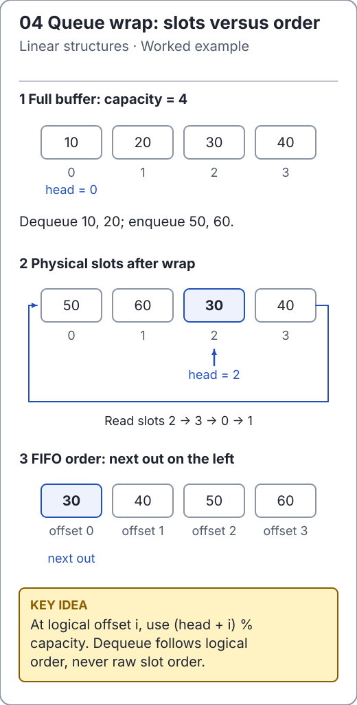
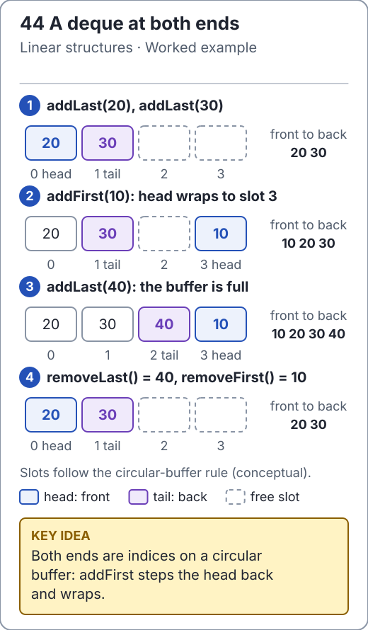

# Circular queues and deques

[`ArrayQueue`](../../src/main/java/io/github/ichillous/dsa/collections/ArrayQueue.java) stores a head index and logical size separately from capacity. Element at logical offset `i` lives at `(head + i) % capacity`. The next enqueue writes at logical offset `size`.

| At&nbsp;a&nbsp;glance | |
| --- | --- |
| **Use&nbsp;it&nbsp;when** | You need FIFO order, or both-end insertion and removal, without per-element node allocation. |
| **Avoid&nbsp;it&nbsp;when** | You need arbitrary indexed insertion, or items ordered by priority. |
| **Cost** | Enqueue or add at either end O(1) amortized, O(n) when growing; remove and peek at the ends O(1); `clear` O(capacity). |
| **In&nbsp;this&nbsp;repo** | [`ArrayQueue`](../../src/main/java/io/github/ichillous/dsa/collections/ArrayQueue.java) and [`RingDeque`](../../src/main/java/io/github/ichillous/dsa/collections/RingDeque.java) |
| **In&nbsp;the&nbsp;JDK** | `java.util.ArrayDeque` |

<!-- visual:generated queue-wrap -->
<picture><source media="(prefers-color-scheme: dark)" srcset="../../docs/visuals/assets/queue-wrap-dark.svg"></picture>

**Figure 04.** The head moves around the buffer while FIFO order stays intact. [Visual index and step-throughs](../../docs/visuals/README.md).
<!-- /visual:generated -->

## Trace a wrapped buffer

```text
capacity = 4
operation       physical array      head   logical order
enqueue A,B,C   [A B C _]              0    A B C
dequeue A,B     [_ _ C _]              2    C
enqueue D,E     [E _ C D]              2    C D E
enqueue F       [E F C D]              2    C D E F
enqueue G       [C D E F G _ _ _]      0    C D E F G
```

Growth copies **logical** order into a new array starting at zero, then resets the head. Copying the old array's physical order would produce `E F C D`, which breaks FIFO behavior.

```java
import io.github.ichillous.dsa.collections.ArrayQueue;

ArrayQueue<Integer> queue = new ArrayQueue<>(2);
queue.enqueue(1);
queue.enqueue(2);
int first = queue.dequeue();
queue.enqueue(3); // Reuses a slot before the head.
queue.enqueue(4); // Grows while the buffer is wrapped.
assert first == 1;
assert queue.dequeue() == 2;
assert queue.dequeue() == 3;
assert queue.dequeue() == 4;
assert queue.isEmpty();
```

The invariant is `0 <= size <= capacity`; only the `size` positions starting at head are live. Dequeue clears the old head slot before advancing it. Index arithmetic uses a wider intermediate so `head + offset` cannot wrap into a negative Java `int`.

## Extend the same storage to both ends

[`RingDeque`](../../src/main/java/io/github/ichillous/dsa/collections/RingDeque.java) adds insertion and removal at either end. To insert at the front, move the head backward with wraparound; to insert at the back, use logical offset `size`.

```java
import io.github.ichillous.dsa.collections.RingDeque;

RingDeque<String> deque = new RingDeque<>(2);
deque.addLast("middle");
deque.addFirst("front");
deque.addLast("back"); // Growth preserves both ends.
assert deque.peekFirst().equals("front");
assert deque.peekLast().equals("back");
assert deque.removeFirst().equals("front");
assert deque.removeLast().equals("back");
assert deque.removeFirst().equals("middle");
assert deque.isEmpty();
```

Each step of the figure below changes only the head or the tail index (slot numbers are the physical positions):

<!-- visual:generated deque-both-ends | A four-slot RingDeque: addFirst moves the head back and wraps, addLast moves the tail forward, and removals reverse each move. -->
<picture><source media="(prefers-color-scheme: dark)" srcset="../../docs/visuals/assets/deque-both-ends-dark.svg"></picture>

**Figure 50.** A four-slot RingDeque: addFirst moves the head back and wraps, addLast moves the tail forward, and removals reverse each move. [Visual index and step-throughs](../../docs/visuals/README.md).
<!-- /visual:generated -->

Both types reject nulls and nonpositive capacities. Removing or peeking at an empty end throws `NoSuchElementException`. A deque is not a linked list: it has no per-element node allocation and does not provide arbitrary indexed insertion.

Adds at either supported end cost O(1) amortized, O(n) on growth; endpoint removal/peek costs O(1). Retained storage is O(capacity). Clearing releases references but retains storage for later reuse.

## In real Java

`ArrayDeque` is the JDK's circular-array deque. Alternating `pollFirst` and `pollLast` shows both ends working on one buffer:

```java
import java.util.ArrayDeque;
import java.util.ArrayList;
import java.util.Deque;
import java.util.List;

Deque<Integer> deque = new ArrayDeque<>(List.of(1, 2, 3, 4, 5));
List<Integer> order = new ArrayList<>();
while (!deque.isEmpty()) {
    order.add(deque.pollFirst());
    if (!deque.isEmpty()) {
        order.add(deque.pollLast());
    }
}
assert order.equals(List.of(1, 5, 2, 4, 3));
```

## Check yourself

<details>
<summary>Where does the element at logical offset <code>i</code> live in the circular buffer?</summary>

At physical slot `(head + i) % capacity`. The next addition at the back writes at offset `size`.

</details>

<details>
<summary>In a four-slot <code>RingDeque</code> with head 0, where does the head go after <code>addFirst</code>?</summary>

To slot 3: the head moves back one slot and wraps from 0 to the last slot, so the buffer order is read from slot 3 and then from slot 0.

</details>

<details>
<summary>Why does growth copy elements in logical order?</summary>

Copying the physical order would put a wrapped buffer's elements in the wrong sequence, for example `E F C D` instead of `C D E F`. Copying from the head restores FIFO order in the new array starting at slot 0.

</details>

## Practice

1. Recreate the trace using capacity 3; do not assume a power-of-two capacity.
2. Drain from alternating ends, clear, then reuse the deque. Verify both endpoints after every operation.
3. Use a seeded `ArrayDeque` model to exercise all six endpoint operations, emphasizing growth after wraparound.

Check the [worked solutions](../../docs/solutions.md) for logical-to-physical index reasoning. The [solution finder](../../docs/solution-finder.md#7-stacks-queues-deques-and-priority) compares this technique with its alternatives.
