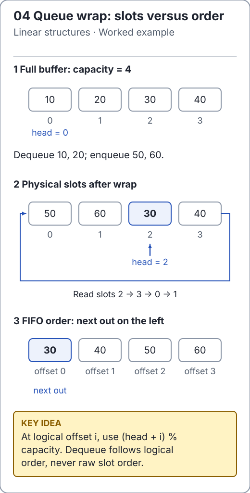

# Circular queues and deques

[`ArrayQueue`](../../src/main/java/io/github/ichillous/dsa/collections/ArrayQueue.java) stores a head index and logical size separately from capacity. Element at logical offset `i` lives at `(head + i) % capacity`. The next enqueue writes at logical offset `size`.

<!-- visual:generated -->
<picture><source media="(prefers-color-scheme: dark)" srcset="../../docs/visuals/assets/queue-wrap-dark.svg"></picture>

**Figure 04.** The head moves around the buffer while FIFO order stays intact. [Visual index and step-throughs](../../docs/visuals/README.md).
<!-- /visual:generated -->

## Trace a wrapped buffer

```text
capacity = 4
operation       physical array      head   logical order
enqueue A,B,C   [A B C _]              0    A B C
dequeue A,B     [_ _ C _]              2    C
enqueue D,E     [E _ C D]              2    C D E
enqueue F       [E F C D]              2    C D E F
enqueue G       [C D E F G _ _ _]      0    C D E F G
```

Growth copies **logical** order into a new array starting at zero, then resets the head. Copying the old array's physical order would produce `E F C D`, which breaks FIFO behavior.

```java
import io.github.ichillous.dsa.collections.ArrayQueue;

ArrayQueue<Integer> queue = new ArrayQueue<>(2);
queue.enqueue(1);
queue.enqueue(2);
int first = queue.dequeue();
queue.enqueue(3); // Reuses a slot before the head.
queue.enqueue(4); // Grows while the buffer is wrapped.
assert first == 1;
assert queue.dequeue() == 2;
assert queue.dequeue() == 3;
assert queue.dequeue() == 4;
assert queue.isEmpty();
```

The invariant is `0 <= size <= capacity`; only the `size` positions starting at head are live. Dequeue clears the old head slot before advancing it. Index arithmetic uses a wider intermediate so `head + offset` cannot wrap into a negative Java `int`.

## Extend the same storage to both ends

[`RingDeque`](../../src/main/java/io/github/ichillous/dsa/collections/RingDeque.java) adds insertion and removal at either end. To insert at the front, move the head backward with wraparound; to insert at the back, use logical offset `size`.

```java
import io.github.ichillous.dsa.collections.RingDeque;

RingDeque<String> deque = new RingDeque<>(2);
deque.addLast("middle");
deque.addFirst("front");
deque.addLast("back"); // Growth preserves both ends.
assert deque.peekFirst().equals("front");
assert deque.peekLast().equals("back");
assert deque.removeFirst().equals("front");
assert deque.removeLast().equals("back");
assert deque.removeFirst().equals("middle");
assert deque.isEmpty();
```

Both types reject nulls and nonpositive capacities. Removing or peeking at an empty end throws `NoSuchElementException`. A deque is not a linked list: it has no per-element node allocation and does not provide arbitrary indexed insertion.

Adds at either supported end cost O(1) amortized, O(n) on growth; endpoint removal/peek costs O(1). Retained storage is O(capacity). Clearing releases references but retains storage for later reuse.

## Practice

1. Recreate the trace using capacity 3; do not assume a power-of-two capacity.
2. Drain from alternating ends, clear, then reuse the deque. Verify both endpoints after every operation.
3. Use a seeded `ArrayDeque` model to exercise all six endpoint operations, emphasizing growth after wraparound.

Check the [worked solutions](../../docs/solutions.md) for logical-to-physical index reasoning.
