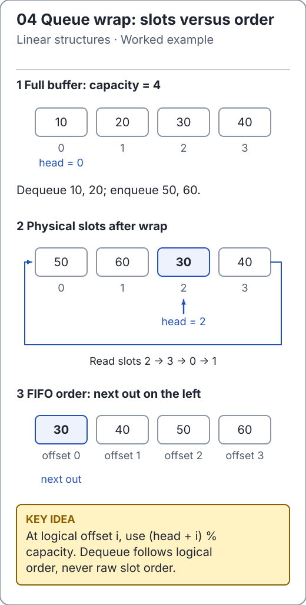

# Queues: process in arrival order

A FIFO queue adds at the back and removes at the front. Use it when earlier scheduled work should run first: level-order traversal, unweighted shortest paths, buffers or simple task processing.

| At a glance | |
| --- | --- |
| **Use it when** | Earlier arrivals must be handled first: breadth-first traversal, buffering, simple task processing. |
| **Avoid it when** | You need the most urgent item first (a priority queue) or the most recent first (a stack). |
| **Cost** | `enqueue` O(1) amortized; `dequeue`, `peek` O(1); `clear` O(capacity). |
| **In this repo** | [`ArrayQueue`](../../src/main/java/io/github/ichillous/dsa/collections/ArrayQueue.java) |
| **In the JDK** | `java.util.ArrayDeque` through the `Queue` methods `offer`, `poll` and `peek`. |

```text
enqueue A, B, C       dequeue -> A
front [A B C] back    front [B C] back
```

The invariant is that the front is the earliest enqueued value not yet removed. Unlike a stack, a queue does not allow a later arrival to jump ahead.

```java
import io.github.ichillous.dsa.collections.ArrayQueue;

ArrayQueue<String> jobs = new ArrayQueue<>(2);
jobs.enqueue("first");
jobs.enqueue("second");
String next = jobs.dequeue();
jobs.enqueue("third");
assert next.equals("first");
assert jobs.peek().equals("second");
assert jobs.size() == 2;
```

[`ArrayQueue`](../../src/main/java/io/github/ichillous/dsa/collections/ArrayQueue.java) uses a growing circular buffer. Null elements are rejected; empty `dequeue` and `peek` throw `NoSuchElementException`. Initial capacity must be positive. It is an in-memory educational queue, with no blocking or concurrency guarantees.

<!-- visual:generated queue-wrap -->
<picture><source media="(prefers-color-scheme: dark)" srcset="../../docs/visuals/assets/queue-wrap-dark.svg"></picture>

**Figure 04.** The head moves around the buffer while FIFO order stays intact. [Visual index and step-throughs](../../docs/visuals/README.md).
<!-- /visual:generated -->

## Queue, deque or priority queue?

| Need | Discipline | Maintained type |
| --- | --- | --- |
| Earliest arrival first | FIFO | `ArrayQueue` |
| Insert/remove at either end | Deque | [`RingDeque`](../../src/main/java/io/github/ichillous/dsa/collections/RingDeque.java) |
| Most urgent / smallest key first | Priority order | [`BinaryMinHeap`](../../src/main/java/io/github/ichillous/dsa/structures/BinaryMinHeap.java) |
| Most recent arrival first | LIFO | [`ArrayStack`](../../src/main/java/io/github/ichillous/dsa/collections/ArrayStack.java) |

A priority queue is not FIFO when priorities differ. Nor does it promise a stable order among equal priorities unless its comparator includes a tie breaker.

## Costs and an implementation trap

Circular-buffer enqueue is O(1) amortized and O(n) when growing; dequeue and peek are O(1). Storage is O(capacity), retained after draining. `clear()` scans the retained buffer, so it costs O(capacity), not merely O(current size).

Removing index zero from a dynamic array shifts every remaining element. Repeating that operation to drain `n` items costs O(n²) overall. A circular head index avoids those shifts while keeping the same logical FIFO order.

## In real Java

`ArrayDeque` is the usual JDK queue. Its `Queue` methods come in two families: `offer`, `poll` and `peek` signal an empty queue with a special value, while `add`, `remove` and `element` throw. This repository's `ArrayQueue` always throws.

```java
import java.util.ArrayDeque;
import java.util.NoSuchElementException;
import java.util.Queue;

Queue<String> jobs = new ArrayDeque<>();
assert jobs.poll() == null && jobs.peek() == null; // Special value on empty.
jobs.offer("first");
jobs.offer("second");
assert jobs.poll().equals("first");
assert jobs.remove().equals("second");
boolean rejected = false;
try {
    jobs.remove(); // The throwing form.
} catch (NoSuchElementException expected) {
    rejected = true;
}
assert rejected;
```

## Common mistakes

1. **Draining a dynamic array from index 0.** Calling `remove(0)` on a 100,000-element `DynamicArray` shifts every remaining element each time, so draining costs O(n squared). A head index over a circular buffer removes without shifting.
2. **Expecting FIFO from a priority queue.** Two jobs with equal priority can leave in either order, because `PriorityQueue` documents that ties are broken arbitrarily. Insert a sequence number into the comparator if arrival order must break ties.
3. **Porting a null-returning loop.** `while (queue.peek() != null)` works on `ArrayDeque` but throws `NoSuchElementException` on an empty `ArrayQueue`. Test `isEmpty()` instead, which behaves the same on both.

## Check yourself

<details>
<summary>Which value is at the front after <code>enqueue(1)</code>, <code>enqueue(2)</code>, <code>dequeue()</code>, <code>enqueue(3)</code>?</summary>

The front is 2: it is the earliest enqueued value not yet removed. The queue holds 2 then 3.

</details>

<details>
<summary>Why does <code>clear()</code> cost O(capacity) rather than O(size)?</summary>

It nulls the whole retained buffer so no reference is kept, and the buffer may be larger than the number of live elements.

</details>

<details>
<summary>Which structure serves earliest-deadline-first scheduling, and is it FIFO?</summary>

A priority queue such as `BinaryMinHeap` keyed by deadline. It is not FIFO: the smallest key leaves first, whatever its arrival order.

</details>

## Practice

1. Trace the queue after enqueueing `1, 2`, dequeuing once, then enqueueing `3`.
2. Explain why wraparound alone does not imply fullness; identify the separate state needed to distinguish full from empty.
3. Compare random enqueue/dequeue sequences with `ArrayDeque`, including growth after the head has moved.

Continue with [circular implementation](implementation.md), [priority queues](priority-queues.md) and the [worked solutions](../../docs/solutions.md).
