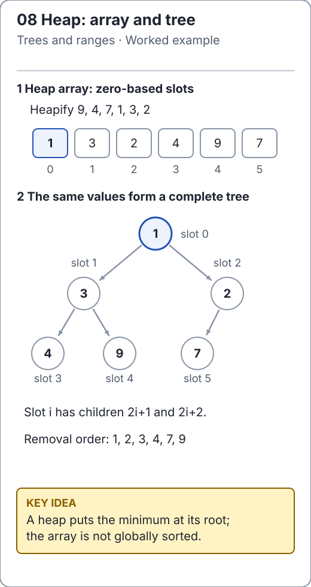
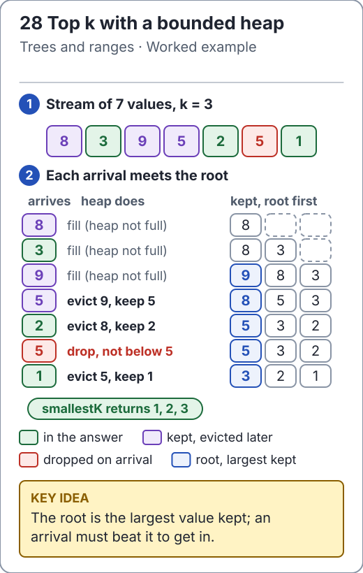

# Priority queues: remove the best candidate

A priority queue removes the smallest or largest key according to an ordering. It is useful when the next task depends on priority rather than arrival: Dijkstra's tentative distances, scheduling, event simulation and selecting the best `k` candidates.

| At&nbsp;a&nbsp;glance | |
| --- | --- |
| **Use&nbsp;it&nbsp;when** | The next item to process is the one with the best priority, not the oldest: scheduling, Dijkstra, event simulation, top-`k`. |
| **Avoid&nbsp;it&nbsp;when** | You need FIFO order, sorted iteration, or to look up and change an arbitrary item's priority. |
| **Cost** | Peek O(1); remove-min O(log n); insert O(log n) amortized; space O(n). |
| **In&nbsp;this&nbsp;repo** | [`BinaryMinHeap`](../../src/main/java/io/github/ichillous/dsa/structures/BinaryMinHeap.java), [`Selection.smallestK`](../../src/main/java/io/github/ichillous/dsa/algorithms/Selection.java) |
| **In&nbsp;the&nbsp;JDK** | `java.util.PriorityQueue` |

A heap guarantees that its root is minimal, not that its entire array is sorted. After every removal the next minimum becomes accessible; arbitrary iteration need not follow priority order.

```java
import io.github.ichillous.dsa.structures.BinaryMinHeap;
import java.util.List;

BinaryMinHeap<Integer> priorities = new BinaryMinHeap<>(List.of(30, 10, 20, 10));
assert priorities.peek() == 10;
assert priorities.size() == 4;
assert priorities.remove() == 10;
assert priorities.remove() == 10;
assert priorities.remove() == 20;
assert priorities.remove() == 30;
```

[`BinaryMinHeap`](../../src/main/java/io/github/ichillous/dsa/structures/BinaryMinHeap.java) uses natural ordering, keeps duplicates and rejects nulls. Empty peek/removal throws `NoSuchElementException`. Build from a collection copies its values and uses O(n) bottom-up heapification.

<!-- visual:generated heap-anatomy | A priority queue chooses a minimum, rather than the oldest arrival; array slots represent the complete heap shown below. -->
<picture><source media="(prefers-color-scheme: dark)" srcset="../../docs/visuals/assets/heap-anatomy-dark.svg"></picture>

**Figure 08.** A priority queue chooses a minimum, rather than the oldest arrival; array slots represent the complete heap shown below. [Visual index and step-throughs](../../docs/visuals/README.md).
<!-- /visual:generated -->

## Reverse the ordering with the JDK

The maintained heap has a deliberately small natural-order API. When an application needs a comparator, `java.util.PriorityQueue` supplies that feature directly.

```java
import java.util.Comparator;
import java.util.PriorityQueue;

PriorityQueue<Integer> largestFirst = new PriorityQueue<>(Comparator.reverseOrder());
largestFirst.add(Integer.MIN_VALUE);
largestFirst.add(7);
largestFirst.add(Integer.MAX_VALUE);
assert largestFirst.remove() == Integer.MAX_VALUE;
assert largestFirst.remove() == 7;
assert largestFirst.remove() == Integer.MIN_VALUE;
```

Avoid comparators such as `(a, b) -> b - a`: subtraction can overflow and reverse the intended ordering. Use `Integer.compare`, comparator builders or `reverseOrder`. Equal priorities need an explicit secondary key if a deterministic tie policy matters; priority alone does not establish FIFO ties.

## Cost and a bounded-selection pattern

Peek is O(1); remove-min is O(log n); insertion is O(log n) amortized, with occasional O(n) backing-array growth. Stored space is O(n) relative to retained peak capacity. Sorting every time a value arrives would do much more work.

To keep the largest `k` values from a stream, maintain a **min** heap of at most `k` values. If a new value exceeds the minimum, replace that minimum. This costs O(n log k) time and O(k) stored space for positive `k`. A max heap would expose the value you want to keep, rather than the weakest retained candidate. The maintained `Selection.smallestK` implements this pattern (a bounded max heap keeps the smallest `k`; pass a reversed comparator for the largest); see [selection](../../algorithms/searching/selection.md).

<!-- visual:generated bounded-heap-topk -->
<picture><source media="(prefers-color-scheme: dark)" srcset="../../docs/visuals/assets/bounded-heap-topk-dark.svg"></picture>

**Figure 42.** Selection.smallestK over the stream 8, 3, 9, 5, 2, 5, 1 with k = 3 fills the heap with 8, 3, 9, then evicts 9, evicts 8, drops the second 5 and evicts 5 for 1, ending with 1, 2, 3. [Visual index and step-throughs](../../docs/visuals/README.md).
<!-- /visual:generated -->

## In real Java

`PriorityQueue` breaks ties between equal priorities arbitrarily, so tasks of the same priority may leave in any order. When arrival order must decide, add a sequence number as a secondary key. Here each task is an `int[]` of priority and arrival number.

```java
import java.util.Comparator;
import java.util.PriorityQueue;

Comparator<int[]> byPriorityThenArrival =
        Comparator.comparingInt((int[] task) -> task[0]).thenComparingInt(task -> task[1]);
PriorityQueue<int[]> queue = new PriorityQueue<>(byPriorityThenArrival);
queue.add(new int[] {2, 0});
queue.add(new int[] {1, 1});
queue.add(new int[] {2, 2});
queue.add(new int[] {1, 3});
queue.add(new int[] {2, 4});
int[] arrivals = new int[5];
for (int index = 0; index < 5; index++) {
    arrivals[index] = queue.remove()[1];
}
assert java.util.Arrays.equals(arrivals, new int[] {1, 3, 0, 2, 4});
```

## Common mistakes

1. **Reversing with subtraction.** The comparator `(a, b) -> b - a` is meant to put larger values first. For `1` and `Integer.MIN_VALUE`, `compare(1, Integer.MIN_VALUE)` computes `Integer.MIN_VALUE - 1`, which overflows to `Integer.MAX_VALUE`: positive, so `1` is ordered after the minimum, the opposite of the intent. The comparator breaks the contract that `sign(compare(a, b))` reflects the real order.
2. **Expecting iteration to be sorted.** After adding 3, 1, 2 to a `PriorityQueue`, iterating the queue is documented to give no particular order, and `toString` follows that iteration. The heap invariant orders only parent against children; only repeated `poll` yields priority order.
3. **Keeping the largest k with a max heap.** For the stream `5, 1, 9, 3` and `k = 2`, a max heap exposes `9` as its head, so making room evicts the best value instead of the weakest. Keep the largest `k` in a **min** heap, whose head is the weakest kept value and the only one a new arrival must beat.

## Check yourself

<details>
<summary>Why does keeping the k smallest values of a stream use a max heap?</summary>

The heap must expose the worst value currently kept, which for the k smallest is the largest of them. A new arrival replaces that root only if it is strictly smaller, so each arrival costs one comparison and at most one O(log k) replacement.

</details>

<details>
<summary>In the figure's stream with k = 3, why is the second 5 dropped rather than replacing the first?</summary>

When it arrives, the kept values are 2, 3 and 5, so the root is 5, and the arrival is not strictly smaller than the root. `Selection.smallestK` replaces the root only for a strictly smaller value, so ties keep the earlier arrival.

</details>

<details>
<summary>What does a plain <code>PriorityQueue</code> give you for two tasks with equal priority?</summary>

No guaranteed order: ties are broken arbitrarily. Add a secondary key such as an arrival counter to the comparator when first-in-first-out matters.

</details>

## Practice

1. Explain why `[1, 4, 2, 9, 7, 3]` is a valid min heap but not a sorted array.
2. Choose an ordering for equal-priority tasks and explain whether stability is required.
3. Implement the largest-`k` pattern with `BinaryMinHeap`, comparing results with sorting a full copy of each small test stream.

Read [heap operations](../heaps/operations.md) and the [worked solutions](../../docs/solutions.md). The [solution finder](../../docs/solution-finder.md#10-selection-and-top-k) compares this technique with its alternatives.
