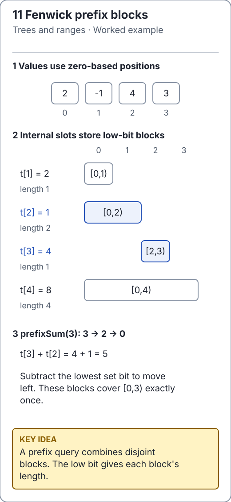
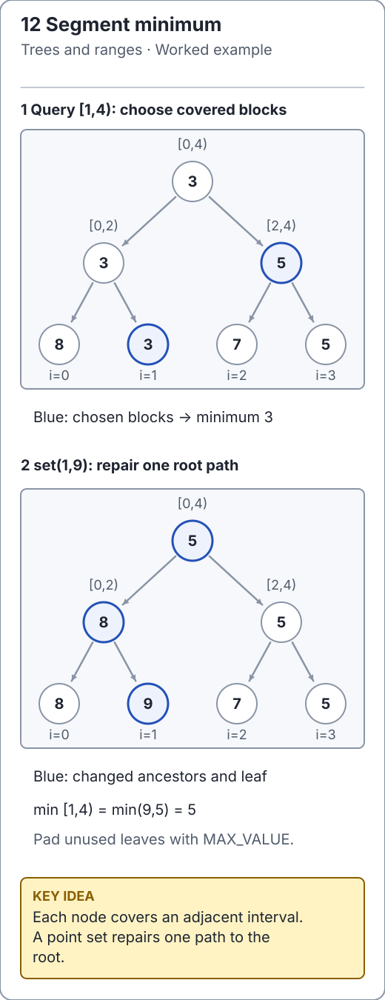
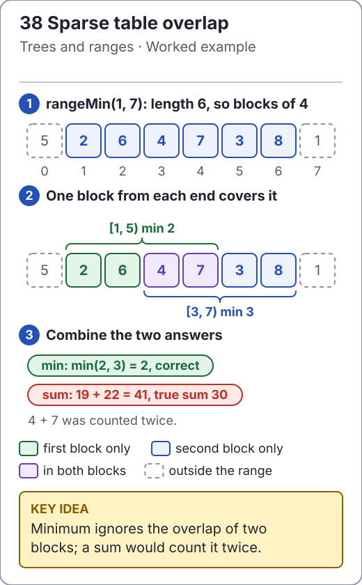
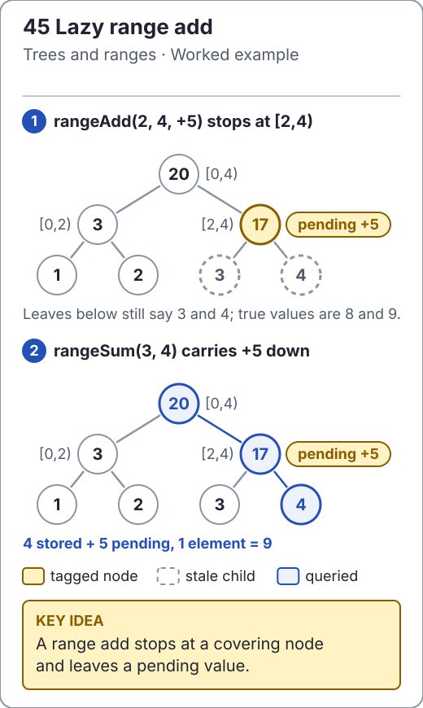

# Range queries: sparse tables and lazy segment trees

A range query asks for a summary, such as a sum or a minimum, of a contiguous slice of an
array. Every structure here uses half-open ranges `[from, to)` with
`0 <= from <= to <= size`. Invalid bounds throw `IndexOutOfBoundsException`, and a null
input array throws `NullPointerException`. Constructors copy their input, so later edits
to the caller's array do not leak in. This lesson adds two maintained structures:

- [SparseTable](../../src/main/java/io/github/ichillous/dsa/structures/SparseTable.java)
  answers range minimum in O(1) on data that never changes.
- [LazySegmentTree](../../src/main/java/io/github/ichillous/dsa/structures/LazySegmentTree.java)
  adds a value to a whole range and returns exact range sums, both in O(log n).

| At a glance | |
| --- | --- |
| **Use it when** | Many range queries (sum or minimum) hit the same array, so some build work is worth paying for. |
| **Avoid it when** | There are only a few queries; a plain loop over the range is simpler and fast enough. |
| **Cost** | Sparse table: build O(n log n), query O(1). Lazy segment tree: build O(n), range add and range sum O(log n). |
| **In this repo** | [`SparseTable`](../../src/main/java/io/github/ichillous/dsa/structures/SparseTable.java), [`LazySegmentTree`](../../src/main/java/io/github/ichillous/dsa/structures/LazySegmentTree.java), [`FenwickTree`](../../src/main/java/io/github/ichillous/dsa/structures/FenwickTree.java), [`SegmentTree`](../../src/main/java/io/github/ichillous/dsa/structures/SegmentTree.java) |
| **In the JDK** | `java.util.Arrays#parallelPrefix` for static prefix sums; no range-minimum or lazy structure |

## Static or dynamic data

Static data is built once and then only read: yesterday's closing prices, or a table
computed ahead of a batch of queries. A static structure can spend more time and memory
at build time so that each query is as cheap as possible. Dynamic data changes between
queries. Each update must then repair a few stored summaries instead of rebuilding them
all, and queries usually pay O(log n) as well.

| Data and operations | Choose | Build | Update | Query | Space |
| --- | --- | --- | --- | --- | --- |
| Static, many range sums | Prefix sums: store the sum of the first `i` values for each `i`; a range is `prefix[to] - prefix[from]` | O(n) | Rebuild, O(n) | O(1) | O(n) |
| Point additions, range sums | [FenwickTree](../../src/main/java/io/github/ichillous/dsa/structures/FenwickTree.java) | O(n) | O(log n) | O(log n) | O(n) |
| Point replacements, range minimum | [SegmentTree](../../src/main/java/io/github/ichillous/dsa/structures/SegmentTree.java) | O(n) | O(log n) | O(log n) | O(n) |
| Range additions, range sums | [LazySegmentTree](../../src/main/java/io/github/ichillous/dsa/structures/LazySegmentTree.java) | O(n) | O(log n) | O(log n) | O(n) |
| Static, many range minima | [SparseTable](../../src/main/java/io/github/ichillous/dsa/structures/SparseTable.java) | O(n log n) | Rebuild, O(n log n) | O(1) | O(n log n) |

The two classes that handle point changes have their own lessons. A Fenwick tree stores each prefix sum as a few low-bit blocks, and a segment tree stores the minimum of every interval its nodes cover:

<!-- visual:generated fenwick-blocks -->
<picture><source media="(prefers-color-scheme: dark)" srcset="../../docs/visuals/assets/fenwick-blocks-dark.svg"></picture>

**Figure 11.** For values 2,-1,4,3, one-based Fenwick slots cover [0,1), [0,2), [2,3) and [0,4). The prefix ending at zero-based boundary 3 combines slots 3 and 2: 4+1=5. [Visual index and step-throughs](../../docs/visuals/README.md).
<!-- /visual:generated -->

<!-- visual:generated segment-minimum -->
<picture><source media="(prefers-color-scheme: dark)" srcset="../../docs/visuals/assets/segment-minimum-dark.svg"></picture>

**Figure 12.** An interval tree over 8,3,7,5 answers the minimum on [1,4) by combining leaf [1,2) with node [2,4). Replacing index 1 with 9 repairs its ancestors and changes the query answer from 3 to 5. Leaves use power-of-two padding with MAX_VALUE when needed. [Visual index and step-throughs](../../docs/visuals/README.md).
<!-- /visual:generated -->

## Sparse table: overlapping blocks need an idempotent operation

Row `k` of a sparse table stores the minimum of every block of length `2^k`. Row 0 is
the input itself. Each entry of row `k` combines two adjacent entries of row `k - 1`.

To answer a query of length `len`, pick the largest `k` with `2^k <= len`. One block
starts at `from` and one ends at `to`. Together they cover the range, and they overlap
whenever `len` is not a power of two. Overlap is harmless for minimum because minimum is
idempotent: `min(x, x) == x`, so a value seen twice cannot change the answer. Gcd, maximum
and bitwise AND are idempotent too. Sum is not, so the same trick counts the overlap twice.

```text
index                0  1  2  3  4  5  6
row 0 (length 1)     4  6  1  5  7  3  8
row 1 (length 2)     4  1  1  5  3  3        row1[i] = min(row0[i], row0[i + 1])
row 2 (length 4)     1  1  1  3              row2[i] = min(row1[i], row1[i + 2])

rangeMin(0, 3): length 3, k = 1, min(row1[0], row1[3 - 2]) = min(4, 1) = 1
                blocks [0, 2) and [1, 3) both contain index 1; harmless for minimum
rangeMin(3, 7): length 4, k = 2, min(row2[3], row2[7 - 4]) = min(3, 3) = 3

Counterexample: a table of sums has row 1 = 10 7 6 12 10 11.
rangeSum(0, 3) by the same two blocks: 10 + 7 = 17, but 4 + 6 + 1 = 11.
Index 1 (value 6) was counted twice.
```

```java
import io.github.ichillous.dsa.structures.SparseTable;
import java.util.OptionalLong;

long[] values = {4, 6, 1, 5, 7, 3, 8};
SparseTable table = new SparseTable(values);
assert table.rangeMin(0, 3).equals(OptionalLong.of(1));
assert table.rangeMin(3, 7).equals(OptionalLong.of(3));
assert table.rangeMin(4, 5).equals(OptionalLong.of(7));
assert table.rangeMin(2, 2).isEmpty();
values[2] = -100;
assert table.rangeMin(0, 7).getAsLong() == 1;
assert new SparseTable(new long[] {Long.MAX_VALUE}).rangeMin(0, 1).getAsLong() == Long.MAX_VALUE;
```

<!-- visual:generated sparse-table-overlap -->
<picture><source media="(prefers-color-scheme: dark)" srcset="../../docs/visuals/assets/sparse-table-overlap-dark.svg"></picture>

**Figure 30.** For the values 5, 2, 6, 4, 7, 3, 8, 1, rangeMin(1, 7) takes the minimum of the blocks [1, 5) and [3, 7), which overlap on indices 3 and 4, and gets 2. A sum of the same blocks would give 41 instead of 30. [Visual index and step-throughs](../../docs/visuals/README.md).
<!-- /visual:generated -->

An empty range returns `OptionalLong.empty()`, so `Long.MAX_VALUE` stays a real, usable
minimum. The table has no update method: change the data and you build a new table.

## Lazy segment tree: defer work at fully covered nodes

Adding a value to every element of `[from, to)` one element at a time costs
O(to - from) per update, even with a Fenwick or segment tree underneath. A lazy segment
tree stops at the O(log n) nodes whose intervals lie entirely inside the range. Each such
node updates its own sum and records a *pending addition* for its children instead of
visiting them.

**Invariant:** a node's true sum is its stored sum plus, for each strict ancestor, that
ancestor's pending addition times the node's length. An update that passes *through* a
node, because it covers that node only partly, first pushes the node's pending addition
to both children. Then it recurses and recomputes the node from its children. A query
never pushes. It carries the pending additions it passes down the path instead, so
reading never modifies the tree.

The maintained tree splits `[low, high)` at `middle = (low + high) >>> 1`. For
`[1, 2, 3, 4, 5]`:

```text
                       [0,5) sum 15
                /                         \
        [0,2) sum 3                    [2,5) sum 12
         /        \                   /             \
   [0,1) 1     [1,2) 2         [2,3) 3           [3,5) sum 9
                                                  /        \
                                             [3,4) 4    [4,5) 5
```

```text
rangeAdd(1, 4, +2)
check first: the maximum in [1, 4) is 4, and 4 + 2 fits in a long, so the update proceeds
step  node   covers [1,4)  action                                           sum
1     [0,5)  partly        push (nothing pending); visit both children
2     [0,2)  partly        push (nothing pending); skip [0,1), it is disjoint
3     [1,2)  fully         apply +2 to 1 element and stop                   2 -> 4
4     [0,2)                pull 1 + 4                                       3 -> 5
5     [2,5)  partly        push (nothing pending); visit both children
6     [2,3)  fully         apply +2 to 1 element and stop                   3 -> 5
7     [3,5)  partly        push (nothing pending); skip [4,5)
8     [3,4)  fully         apply +2 to 1 element and stop                   4 -> 6
9     [3,5)                pull 6 + 5                                       9 -> 11
10    [2,5)                pull 5 + 11                                     12 -> 16
11    [0,5)                pull 5 + 16                                     15 -> 21
values are now [1, 4, 5, 6, 5]

On five elements, [1, 4) splits into three leaves, so nothing was deferred.
The next update covers the whole internal node [2,5):

rangeAdd(2, 5, +10)
[2,5)  fully   apply +10 to 3 elements: 16 -> 46; pending +10; children still say 5 and 11
[0,5)          pull 5 + 46 = 51

rangeSum(3, 4) carries pending additions instead of pushing them
path: [0,5) pending 0, [2,5) pending +10, [3,5) pending 0, then [3,4) stored 6
answer: 6 + 10 * 1 element = 16; no node changed

rangeAdd(3, 4, -1) passes through [2,5), so it pushes first
[2,5)  push +10: [2,3) 5 -> 15; [3,5) 11 -> 31 with pending +10; [2,5) pending 0
[3,5)  push +10: [3,4) 6 -> 16; [4,5) 5 -> 15; [3,5) pending 0
[3,4)  apply -1: 16 -> 15
pulls: [3,5) 15 + 15 = 30, [2,5) 15 + 30 = 45, [0,5) 5 + 45 = 50
values are now [1, 4, 15, 15, 15]
```

```java
import io.github.ichillous.dsa.structures.LazySegmentTree;

LazySegmentTree tree = new LazySegmentTree(new long[] {1, 2, 3, 4, 5});
tree.rangeAdd(1, 4, 2);
assert tree.rangeSum(0, 5) == 21;
assert tree.rangeSum(1, 4) == 15;
tree.rangeAdd(2, 5, 10);
assert tree.rangeSum(3, 4) == 16;
tree.rangeAdd(3, 4, -1);
assert tree.rangeSum(0, 5) == 50;
assert tree.rangeSum(2, 5) == 45;
assert tree.rangeSum(2, 2) == 0;

LazySegmentTree extremes = new LazySegmentTree(new long[] {Long.MAX_VALUE, 0});
boolean rejected = false;
try {
    extremes.rangeAdd(0, 2, 1);
} catch (ArithmeticException expected) {
    rejected = true;
}
assert rejected;
assert extremes.rangeSum(1, 2) == 0;
assert extremes.rangeSum(0, 2) == Long.MAX_VALUE;
```

`rangeAdd` reads the range maximum (for a positive delta) or minimum (for a negative one)
before it changes anything. If any element would leave `long` range, it throws
`ArithmeticException` and the tree is unchanged, as the last three assertions show.
`rangeSum` is exact. It throws `ArithmeticException` only when the true sum is outside
`long` range, even if every element and every smaller range still fits.

<!-- visual:generated lazy-propagation -->
<picture><source media="(prefers-color-scheme: dark)" srcset="../../docs/visuals/assets/lazy-propagation-dark.svg"></picture>

**Figure 31.** In a LazySegmentTree over 1, 2, 3, 4, rangeAdd(2, 4, 5) stops at the node covering [2, 4), raising its sum to 17 and leaving a pending +5 for its leaves. rangeSum(3, 4) then reads the leaf's stored 4, adds the pending 5 and returns 9. [Visual index and step-throughs](../../docs/visuals/README.md).
<!-- /visual:generated -->

## Costs and contracts

| Operation | Time | Auxiliary space | Edge cases and overflow |
| --- | --- | --- | --- |
| `new SparseTable(values)` | O(n log n) | At most `n * (floor(log2 n) + 1)` longs | Copies the input; empty input allowed |
| `SparseTable.rangeMin(from, to)` | O(1) | O(1) | Empty range gives `OptionalLong.empty()`; no arithmetic, so no overflow |
| `new LazySegmentTree(values)` | O(n) | O(n) nodes | Copies the input; empty input allowed |
| `rangeAdd(from, to, delta)` | O(log n) | O(log n) recursion | Empty range or zero delta changes nothing; throws and changes nothing exactly when an element would leave `long` range |
| `rangeSum(from, to)` | O(log n) | O(log n) recursion | Empty range sums to 0; throws exactly when the true sum is outside `long` range; never modifies the tree |

## Pitfalls

**A pending addition can outgrow `long`.** Start five elements at `Long.MIN_VALUE` and
add `Long.MAX_VALUE` to the whole range twice. Each element is now `Long.MAX_VALUE - 1`
and fits. The root absorbed both updates, though, so its pending addition is 2^64 - 2.
Checked `long` arithmetic would reject that valid second update. Wrapping arithmetic would
keep the elements right modulo 2^64, but an overflowed sum would then look like a real
one. The maintained tree stores sums and pending additions as exact 128-bit values. A node
covers at most 2^29 elements, so its sum needs at most 93 bits, and a pending addition needs
at most 65.

**Checking after mutating.** An update that applies itself and only then notices an
overflow halfway down leaves some nodes updated and others not. Check the extreme value
first, then mutate.

**Pushing during a query.** Pushing pending additions inside `rangeSum` gives correct
answers, but it turns every read into a write. Carry the pending sum down the path
instead.

## In real Java

The JDK has no range-minimum or lazy structure. For a static array and many range sums, accumulate once and subtract: `Arrays.parallelPrefix` cumulates an array in place (it overwrites its input, so clone first). With half-open ranges, the sum of `[from, to)` is `prefix[to - 1] - prefix[from - 1]`, treating the term before index 0 as zero. Subtraction works for sums but not for minimum, which is why `SparseTable` exists.

```java
import io.github.ichillous.dsa.structures.LazySegmentTree;
import java.util.Arrays;

long[] values = {4, 6, 1, 5, 7, 3, 8};
long[] prefix = values.clone();
Arrays.parallelPrefix(prefix, Long::sum);
assert values[1] == 6 && prefix[1] == 10;
int from = 2;
int to = 5;
long sum = prefix[to - 1] - (from == 0 ? 0 : prefix[from - 1]);
assert sum == 13;
assert sum == new LazySegmentTree(values).rangeSum(from, to);
```

## Common mistakes

1. **Using the sparse-table trick for sums.** On `[4, 6, 1, 5, 7, 3, 8]`, summing the two blocks `[1, 5)` and `[3, 7)` for `rangeSum(1, 7)` gives `19 + 23 = 42`, but the true sum is `30`. The overlap `5 + 7` is counted twice, so the shortcut needs an idempotent operation.
2. **Treating `to` as inclusive.** With half-open ranges, `rangeMin(2, 5)` covers indices 2, 3 and 4. Passing `5` to mean "through index 5" asks for a different range, and `rangeMin(0, size)` is the whole array while `rangeMin(0, size + 1)` throws `IndexOutOfBoundsException`.
3. **Expecting a static table to see later edits.** After `new SparseTable(values)`, setting `values[2] = -100` changes nothing: the table holds a copy, so the stored minima still describe the old data. Build a new table, or use a tree that supports point updates.

## Check yourself

<details>
<summary>Why can a sparse table answer `rangeMin` with two overlapping blocks but not `rangeSum`?</summary>

Minimum is idempotent, so `min(x, x) == x` and a value covered twice cannot change the answer. A sum counts each covered value once per block, so the overlap would be added twice.

</details>

<details>
<summary>After `rangeAdd(2, 4, +5)` on a lazy tree over `1, 2, 3, 4`, why do the leaves still store 3 and 4?</summary>

The update stops at the node covering `[2, 4)`, which records a pending +5 for its children instead of visiting them. A later query adds the pending value back on the way down, so `rangeSum(3, 4)` returns 4 + 5 = 9.

</details>

<details>
<summary>Why does `rangeSum` not push pending additions down?</summary>

Carrying the pending sum down the search path gives the same answer without writing to any node, so a read never modifies the tree.

</details>

## Practice

1. Build the sparse-table rows for `[3, 1, 4, 1, 5, 9, 2, 6]` by hand and answer
   `rangeMin(2, 7)` with two blocks. Which indices are covered twice? Explain why maximum
   and gcd could reuse the table's shape, but sum could not.
2. Continue the lazy trace above with `rangeAdd(0, 5, +1)`, then `rangeSum(1, 3)`. Which
   nodes hold pending additions afterwards, and which nodes does the query visit?
3. For `[Long.MAX_VALUE - 5, 0, -7]`, find the largest `delta` that `rangeAdd(0, 3, delta)`
   accepts, and the smallest. Then build an array whose elements all fit but whose
   `rangeSum(0, n)` throws. Check both answers against a `BigInteger` model.

See the [catalog](../../docs/catalog.md) for source and tests, and the
[complexity guide](../../docs/complexity.md) for the bounds. Related lessons:
[Fenwick prefix blocks](../arrays/operations.md) and
[segment-tree minima](../trees/overview.md). The [solution finder](../../docs/solution-finder.md#5-range-queries-over-arrays) compares this technique with its alternatives.
