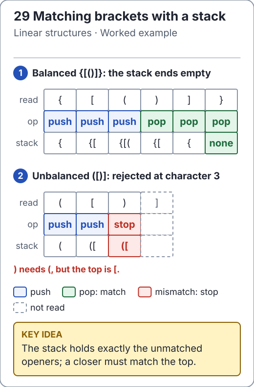

# Implementing a stack by composition

[`ArrayStack`](../../src/main/java/io/github/ichillous/dsa/collections/ArrayStack.java) delegates storage to `DynamicArray`. The top is at index `size - 1`, so pushing appends and popping removes the final element. No shifting is needed for a pop.

| At a glance | |
| --- | --- |
| **Use it when** | You want LIFO access over growable storage and the empty-state, bounds and growth rules to be inspectable. |
| **Avoid it when** | You need FIFO order or indexed access; a queue or `DynamicArray` is the direct tool. |
| **Cost** | `push` O(1) amortized; `pop`, `peek` O(1); `clear` O(n); storage O(capacity). |
| **In this repo** | [`ArrayStack`](../../src/main/java/io/github/ichillous/dsa/collections/ArrayStack.java), built on [`DynamicArray`](../../src/main/java/io/github/ichillous/dsa/collections/DynamicArray.java) |
| **In the JDK** | `java.util.ArrayDeque` (`push`, `pop`, `peek`). |

This is a useful design lesson: a new behavioral contract does not always require a new storage engine. The stack exposes only the operations that preserve LIFO access.

## Follow the top

```text
operation     live array       top index
push '('      ['(']                 0
push '['      ['(', '[']            1
pop -> '['    ['(']                 0
pop -> '('    []                 none
```

The wrapper must check emptiness before calculating the top index. The public error is `NoSuchElementException`, rather than an incidental negative-index failure from the backing array.

```java
import io.github.ichillous.dsa.collections.ArrayStack;
import java.util.NoSuchElementException;

ArrayStack<Integer> stack = new ArrayStack<>();
stack.push(4);
stack.clear();
boolean rejected = false;
try {
    stack.pop();
} catch (NoSuchElementException expected) {
    rejected = true;
}
assert rejected;
stack.push(8);
assert stack.peek() == 8 && stack.size() == 1;
```

## A complete parentheses check

<!-- visual:generated stack-bracket-matching -->
<picture><source media="(prefers-color-scheme: dark)" srcset="../../docs/visuals/assets/stack-bracket-matching-dark.svg"></picture>

**Figure 49.** An ArrayStack traces {[()]}: three pushes and three pops leave it empty. The same stack traced on ([)] holds ( and [ when the closer ) arrives, and the top [ does not match it, so the string is rejected at the third character. [Visual index and step-throughs](../../docs/visuals/README.md).
<!-- /visual:generated -->

Every unmatched opening parenthesis is pending work. Reading `)` completes the most recent opening. An empty stack at that moment means the input closes something that was never opened. Here non-parenthesis characters are deliberately ignored.

```java
import io.github.ichillous.dsa.collections.ArrayStack;

String expression = "a * (b + (c))";
ArrayStack<Character> openings = new ArrayStack<>();
boolean valid = true;
for (char token : expression.toCharArray()) {
    if (token == '(') {
        openings.push(token);
    } else if (token == ')') {
        if (openings.isEmpty()) {
            valid = false;
            break;
        }
        openings.pop();
    }
}
valid = valid && openings.isEmpty();
assert valid;
```

After processing a prefix, the stack holds exactly its unmatched openings. That invariant proves both failure cases: an extra closer fails immediately, while extra openers leave the stack nonempty at the end. With several bracket types, store their type too: counting alone accepts the invalid string `([)]`.

The check is O(n) time and O(n) worst-case stack space. It scans each character once; dynamic-array growth remains O(n) total over the pushes. For a stack itself, push is O(1) amortized, pop/peek O(1), and clear O(n).

## In real Java

With several bracket types, a `Map` from closer to opener and an `ArrayDeque` give the production form of the same check. The stack holds the unmatched openers, and each closer must equal the one on top.

```java
import java.util.ArrayDeque;
import java.util.Deque;
import java.util.Map;

Map<Character, Character> openerFor = Map.of(')', '(', ']', '[', '}', '{');
String[] inputs = {"{[()]}", "([)]", "(()", "())", "a(b)"};
boolean[] balanced = new boolean[inputs.length];
for (int i = 0; i < inputs.length; i++) {
    Deque<Character> openers = new ArrayDeque<>();
    boolean ok = true;
    for (char token : inputs[i].toCharArray()) {
        if (openerFor.containsValue(token)) {
            openers.push(token);
        } else if (!openerFor.containsKey(token)) {
            continue; // Ignore characters that are not brackets.
        } else if (openers.isEmpty() || openers.pop().charValue() != openerFor.get(token)) {
            ok = false; // A closer with no matching opener on top.
            break;
        }
    }
    balanced[i] = ok && openers.isEmpty();
}
assert balanced[0] && !balanced[1] && !balanced[2] && !balanced[3] && balanced[4];
```

## Check yourself

<details>
<summary>In the trace for `([)]`, why does the check stop at the third character?</summary>

After `(` and `[` the stack holds `([`. The closer `)` needs `(` on top but finds `[`, so no later character can repair the mismatch.

</details>

<details>
<summary>Which input leaves the stack nonempty at the end, and which fails with an empty stack?</summary>

`(()` ends with one unmatched `(` left on the stack. `())` fails at the second `)`, when the stack is already empty.

</details>

<details>
<summary>Why does `ArrayStack` check emptiness before computing the top index?</summary>

So that an empty `pop` or `peek` fails with `NoSuchElementException`, the public contract, instead of an incidental negative-index error from the backing array.

</details>

## Practice

1. Trace the stack for `(()`, `())` and the empty string.
2. Extend the example to `[]` and `{}`; require matching types, not only equal counts.
3. Test generated balanced strings against an independent recursive grammar or a simpler reference checker, keeping malformed counterexamples.

See the [worked solutions](../../docs/solutions.md) for the mismatched-bracket argument and model-test approach. The [solution finder](../../docs/solution-finder.md#7-stacks-queues-deques-and-priority) compares this technique with its alternatives.
