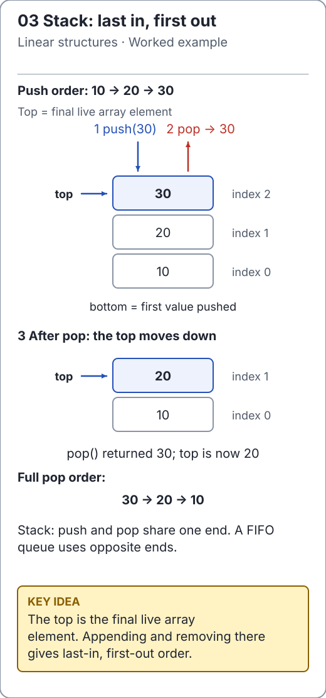

# Implementing a stack by composition

[`ArrayStack`](../../src/main/java/io/github/ichillous/dsa/collections/ArrayStack.java) delegates storage to `DynamicArray`. The top is at index `size - 1`, so pushing appends and popping removes the final element. No shifting is needed for a pop.

This is a useful design lesson: a new behavioral contract does not always require a new storage engine. The stack exposes only the operations that preserve LIFO access.

<!-- visual:generated -->
<picture><source media="(prefers-color-scheme: dark)" srcset="../../docs/visuals/assets/stack-lifo-dark.svg"></picture>

**Figure 03.** Push and pop share the top; the newest value leaves first. [Visual index and step-throughs](../../docs/visuals/README.md).
<!-- /visual:generated -->

## Follow the top

```text
operation     live array       top index
push '('      ['(']                 0
push '['      ['(', '[']            1
pop -> '['    ['(']                 0
pop -> '('    []                 none
```

The wrapper must check emptiness before calculating the top index. The public error is `NoSuchElementException`, rather than an incidental negative-index failure from the backing array.

```java
import io.github.ichillous.dsa.collections.ArrayStack;
import java.util.NoSuchElementException;

ArrayStack<Integer> stack = new ArrayStack<>();
stack.push(4);
stack.clear();
boolean rejected = false;
try {
    stack.pop();
} catch (NoSuchElementException expected) {
    rejected = true;
}
assert rejected;
stack.push(8);
assert stack.peek() == 8 && stack.size() == 1;
```

## A complete parentheses check

Every unmatched opening parenthesis is pending work. Reading `)` completes the most recent opening. An empty stack at that moment means the input closes something that was never opened. Here non-parenthesis characters are deliberately ignored.

```java
import io.github.ichillous.dsa.collections.ArrayStack;

String expression = "a * (b + (c))";
ArrayStack<Character> openings = new ArrayStack<>();
boolean valid = true;
for (char token : expression.toCharArray()) {
    if (token == '(') {
        openings.push(token);
    } else if (token == ')') {
        if (openings.isEmpty()) {
            valid = false;
            break;
        }
        openings.pop();
    }
}
valid = valid && openings.isEmpty();
assert valid;
```

After processing a prefix, the stack holds exactly its unmatched openings. That invariant proves both failure cases: an extra closer fails immediately, while extra openers leave the stack nonempty at the end. With several bracket types, store their type too: counting alone accepts the invalid string `([)]`.

The check is O(n) time and O(n) worst-case stack space. It scans each character once; dynamic-array growth remains O(n) total over the pushes. For a stack itself, push is O(1) amortized, pop/peek O(1), and clear O(n).

## Practice

1. Trace the stack for `(()`, `())` and the empty string.
2. Extend the example to `[]` and `{}`; require matching types, not only equal counts.
3. Test generated balanced strings against an independent recursive grammar or a simpler reference checker, keeping malformed counterexamples.

See the [worked solutions](../../docs/solutions.md) for the mismatched-bracket argument and model-test approach.
