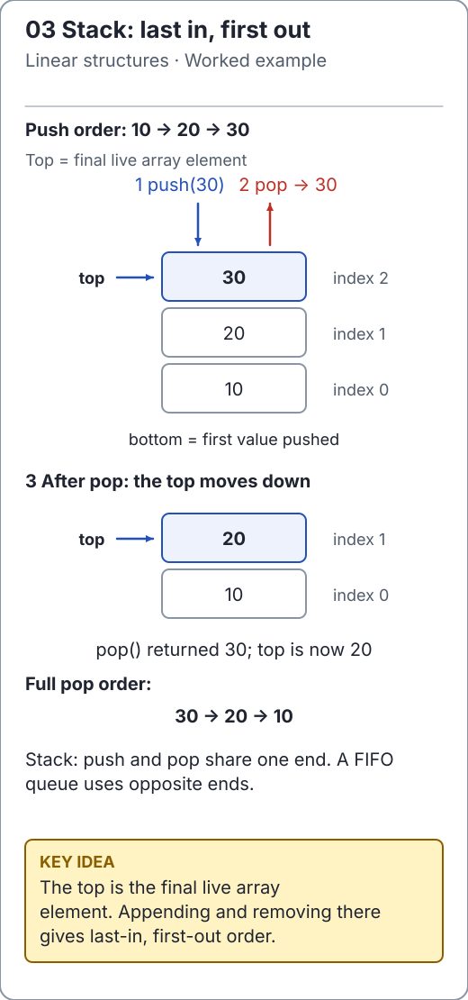

# Stacks: the most recent unfinished task

A stack is last in, first out: `push` adds a value at the top, `peek` observes it, and `pop` removes it. Use this discipline for nested work such as parentheses, expression evaluation, undo history or explicit traversal frames.

| At a glance | |
| --- | --- |
| **Use it when** | The most recent unfinished item must be handled first: nested brackets, undo history, explicit DFS or traversal frames. |
| **Avoid it when** | Items must leave in arrival order, or you need to read or change items below the top. |
| **Cost** | `push` O(1) amortized, `pop` and `peek` O(1); clear O(n). |
| **In this repo** | [`ArrayStack`](../../src/main/java/io/github/ichillous/dsa/collections/ArrayStack.java) |
| **In the JDK** | `java.util.ArrayDeque` through `push`, `pop` and `peek` (the `Deque` interface). |

```text
push A   push B   pop -> B
  A        B        A
           A
```

The invariant is that the top contains the most recently pushed value that has not yet been popped. A stack restricts access deliberately; arbitrary indexed access would obscure that discipline.

```java
import io.github.ichillous.dsa.collections.ArrayStack;

ArrayStack<String> work = new ArrayStack<>();
work.push("outer");
work.push("inner");
assert work.peek().equals("inner");
assert work.size() == 2;
String completed = work.pop();
assert completed.equals("inner");
assert work.peek().equals("outer");
```

[`ArrayStack`](../../src/main/java/io/github/ichillous/dsa/collections/ArrayStack.java) rejects nulls. Empty `peek` and `pop` throw `NoSuchElementException`; `isEmpty` lets callers express an intentional drain loop.

<!-- visual:generated stack-lifo -->
<picture><source media="(prefers-color-scheme: dark)" srcset="../../docs/visuals/assets/stack-lifo-dark.svg"></picture>

**Figure 03.** Push and pop share the top; the newest value leaves first. [Visual index and step-throughs](../../docs/visuals/README.md).
<!-- /visual:generated -->

## Cost model

The backing dynamic array grows geometrically. Push is O(1) amortized but O(n) on a growth event; peek and pop are O(1). Stored capacity is O(n) after growth relative to peak size, and `clear()` retains that capacity. Clearing live references takes O(n).

A Java call stack also stores unfinished method invocations, but recursive calls consume JVM frames. Java does not guarantee tail-call elimination. An explicit data-structure stack can avoid recursive depth limits, while still requiring memory for pending work.

## In real Java

The `java.util.Stack` class documents that the `Deque` interface and its implementations should be used in preference to it, so production code uses `ArrayDeque`. This repository's stack exists so that growth, bounds and empty-state behavior are inspectable. `push` adds at the front, so iteration starts at the top. The empty-stack behavior differs from this repository's `ArrayStack`: `pop` throws `NoSuchElementException`, but `peek` returns null.

```java
import java.util.ArrayDeque;
import java.util.ArrayList;
import java.util.Deque;
import java.util.List;
import java.util.NoSuchElementException;

Deque<Integer> stack = new ArrayDeque<>();
stack.push(1);
stack.push(2);
stack.push(3);
assert new ArrayList<>(stack).equals(List.of(3, 2, 1)); // Iteration starts at the top.
assert stack.pop() == 3 && stack.pop() == 2 && stack.pop() == 1;
assert stack.peek() == null; // ArrayStack.peek would throw here.
boolean rejected = false;
try {
    stack.pop();
} catch (NoSuchElementException expected) {
    rejected = true;
}
assert rejected;
```

## Common mistakes

1. **Using a stack for breadth-first order.** "Visit the nearest vertex first" is not what a stack does: pushing the neighbors `1` and `2` of vertex `0` pops `2` first, so the walk is depth-first and need not reach the vertex with the fewest edges first. BFS needs a FIFO queue so that vertices leave in the order they were discovered.
2. **Popping without checking.** Reading `)` as the first character of the balance check pops an empty stack and throws `NoSuchElementException`. An empty stack at a closer means the input closes something never opened, which the check must report instead of crashing.
3. **Assuming `java.util.Stack` iterates like a stack.** After `push(1)`, `push(2)`, `push(3)` its iteration order is `[1, 2, 3]`, bottom first, because it is a `Vector`; an `ArrayDeque` used with `push` iterates `[3, 2, 1]`. Code that prints or copies the structure sees opposite orders.

## Check yourself

<details>
<summary>Why does a counting check accept <code>([)]</code> while a stack check rejects it?</summary>

Counts only compare how many openers and closers there are; both types balance. The stack requires each closer to match the most recent unmatched opener, and `)` meets `[` on top.

</details>

<details>
<summary>What does <code>peek()</code> do on an empty <code>ArrayStack</code>, and on an empty <code>ArrayDeque</code>?</summary>

`ArrayStack.peek()` throws `NoSuchElementException`; `ArrayDeque.peek()` returns null, while `ArrayDeque.pop()` throws.

</details>

<details>
<summary>Why might an explicit stack be preferred over recursion for a very deep traversal?</summary>

Each recursive call uses a JVM frame, and Java does not guarantee tail-call elimination, so depth is bounded by the thread's stack size. An explicit stack lives on the heap and grows with the pending work.

</details>

## Practice

1. Predict the popped sequence after `push(1), push(2), pop(), push(3)`.
2. Explain which extra state an undo/redo system needs besides one stack.
3. Implement the [balanced-parentheses exercise](implementation.md) and test an unmatched closer as well as an unmatched opener.

Check the [worked solutions](../../docs/solutions.md).
