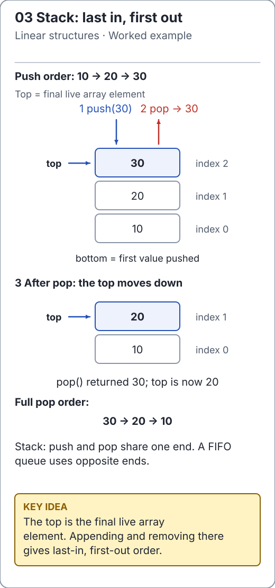

# Stacks: the most recent unfinished task

A stack is last in, first out: `push` adds a value at the top, `peek` observes it, and `pop` removes it. Use this discipline for nested work such as parentheses, expression evaluation, undo history or explicit traversal frames.

```text
push A   push B   pop -> B
  A        B        A
           A
```

The invariant is that the top contains the most recently pushed value that has not yet been popped. A stack restricts access deliberately; arbitrary indexed access would obscure that discipline.

```java
import io.github.ichillous.dsa.collections.ArrayStack;

ArrayStack<String> work = new ArrayStack<>();
work.push("outer");
work.push("inner");
assert work.peek().equals("inner");
assert work.size() == 2;
String completed = work.pop();
assert completed.equals("inner");
assert work.peek().equals("outer");
```

[`ArrayStack`](../../src/main/java/io/github/ichillous/dsa/collections/ArrayStack.java) rejects nulls. Empty `peek` and `pop` throw `NoSuchElementException`; `isEmpty` lets callers express an intentional drain loop.

<!-- visual:generated -->
<picture><source media="(prefers-color-scheme: dark)" srcset="../../docs/visuals/assets/stack-lifo-dark.svg"></picture>

**Figure 03.** Push and pop share the top; the newest value leaves first. [Visual index and step-throughs](../../docs/visuals/README.md).
<!-- /visual:generated -->

## Cost model

The backing dynamic array grows geometrically. Push is O(1) amortized but O(n) on a growth event; peek and pop are O(1). Stored capacity is O(n) after growth relative to peak size, and `clear()` retains that capacity. Clearing live references takes O(n).

A Java call stack also stores unfinished method invocations, but recursive calls consume JVM frames. Java does not guarantee tail-call elimination. An explicit data-structure stack can avoid recursive depth limits, while still requiring memory for pending work.

## Common mistake

“Use a stack to visit the nearest vertex first” is wrong: the most recently scheduled vertex comes first, not necessarily the vertex with fewest edges from the source. Use a FIFO queue for BFS and an explicit stack for DFS.

For application code, `ArrayDeque` is the usual JDK stack choice. This repository's stack exists so that growth, bounds and empty-state behavior are inspectable.

## Practice

1. Predict the popped sequence after `push(1), push(2), pop(), push(3)`.
2. Explain which extra state an undo/redo system needs besides one stack.
3. Implement the [balanced-parentheses exercise](implementation.md) and test an unmatched closer as well as an unmatched opener.

Check the [worked solutions](../../docs/solutions.md).
