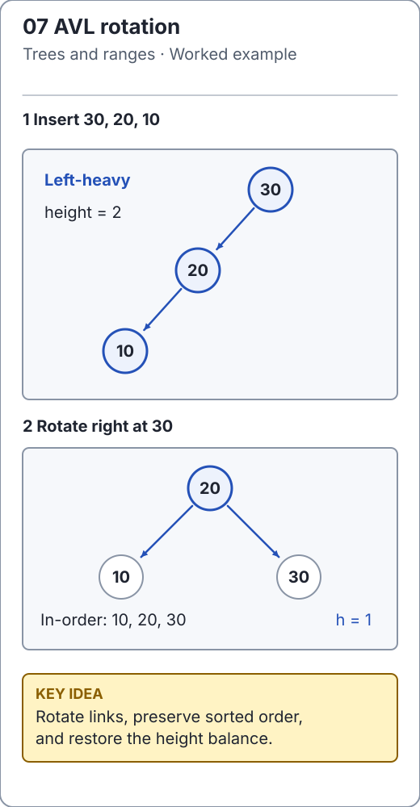

# AVL trees: restore balance locally

[`AvlTree`](../../src/main/java/io/github/ichillous/dsa/structures/AvlTree.java) adds a height invariant to BST order: at every node, the heights of the left and right subtrees differ by at most one. Height is measured in edges, with an empty subtree at -1 and a leaf at 0.

This bounds height by O(log n), giving O(log n) worst-case search, insertion and deletion. The tree remains a set: null keys are rejected, and `compareTo == 0` means duplicate.

<!-- visual:generated -->
<picture><source media="(prefers-color-scheme: dark)" srcset="../../docs/visuals/assets/avl-rotation-dark.svg"></picture>

**Figure 07.** Inserting 30, 20 and 10 produces a left-heavy chain. A right rotation makes 20 the root with children 10 and 30, preserving in-order traversal and restoring height one. [Visual index and step-throughs](../../docs/visuals/README.md).
<!-- /visual:generated -->

## A rotation preserves sorted order

Insert `30, 20, 10`. The root becomes left-heavy by two levels. A right rotation promotes 20:

```text
before:       30             after:       20
             /                          /  \
            20                         10  30
           /
          10
```

The inorder sequence remains `10, 20, 30`. More generally, a rotation preserves the relative order of the subtrees transferred between nodes. Recompute the demoted node's height before the promoted node's height, because the latter depends on the former.

```java
import io.github.ichillous.dsa.structures.AvlTree;
import java.util.List;

AvlTree<Integer> keys = new AvlTree<>();
keys.add(30);
keys.add(20);
keys.add(10);
assert keys.height() == 1;
assert keys.inOrder().equals(List.of(10, 20, 30));
assert keys.size() == 3;
```

## Four imbalance shapes

Here “left-heavy child” and “right-heavy child” refer to subtree heights, rather than the most recently inserted key.

| Heavy path from an unbalanced node | Repair |
| --- | --- |
| Left, then left | Right rotation |
| Right, then right | Left rotation |
| Left, then right | Left rotation on child, then right rotation |
| Right, then left | Right rotation on child, then left rotation |

Inserting `30, 10, 20` needs the double rotation: a single right rotation would not place the median key at the local root. The cases are small, but stale heights can make later choices wrong.

```java
import io.github.ichillous.dsa.structures.AvlTree;
import java.util.List;

AvlTree<Integer> keys = new AvlTree<>();
for (int value : new int[] {30, 10, 20}) keys.add(value);
assert keys.height() == 1;
assert keys.inOrder().equals(List.of(10, 20, 30));
boolean removed = keys.remove(20);
assert removed && keys.size() == 2;
assert keys.inOrder().equals(List.of(10, 30));
assert keys.height() == 1;
```

## Deletion must rebalance too

Removing a key can shorten a subtree, making an ancestor unbalanced. Repair may have to continue to the root. A heavy child with equal-height children is a valid deletion case; deciding solely from the removed key misses that case. The implementation checks child balance factors and updates cached heights along the return path.

Search and updates cost O(log n) with O(log n) recursive stack for updates. Cached root height is O(1) to read. Stored nodes cost O(n); inorder traversal costs O(n) time and O(n) returned snapshot space. Rotations are O(1) local work, but an operation may repair multiple ancestors.

## Practice

1. Draw the four insertion cases using three distinct keys; verify the same sorted result after each repair.
2. Find a deletion where the heavy child has balance zero. Explain which single rotation preserves balance.
3. Compare random operations with `TreeSet`, then independently validate every node's BST range, cached height and balance. Size and sorted output alone can miss stale-height defects.

Check the [worked solutions](../../docs/solutions.md). The [AVL tests](../../src/test/java/io/github/ichillous/dsa/structures/AvlTreeTest.java) include structural validation as well as observable set behavior.
