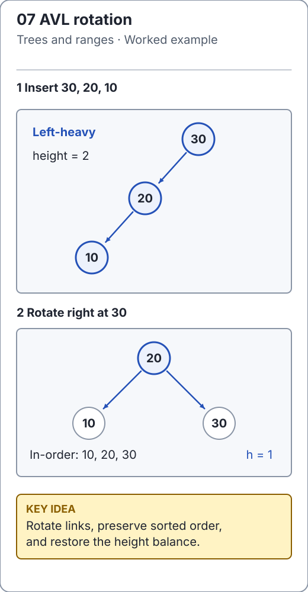

# Binary search trees: an invariant over descendants

[`BinarySearchTree`](../../src/main/java/io/github/ichillous/dsa/structures/BinarySearchTree.java) is a natural-order set. Every key in a node's left subtree must compare smaller; every key in its right subtree must compare larger. The rule covers **all descendants**, not only immediate children.

Null keys are rejected. `compareTo == 0` defines a duplicate, even if `equals` would distinguish the objects. Keep ordering-relevant fields stable while a key is stored.

<!-- visual:generated -->
<picture><source media="(prefers-color-scheme: dark)" srcset="../../docs/visuals/assets/avl-rotation-dark.svg"></picture>

**Figure 07.** Both shapes satisfy BST order. AVL adds a height invariant and rotates the unbalanced shape into the balanced one. [Visual index and step-throughs](../../docs/visuals/README.md).
<!-- /visual:generated -->

## Search and insertion

```text
          8
        /   \
       3     10
      / \      \
     1   6     14
        / \
       4   7

find 7: compare with 8 -> left, 3 -> right, 6 -> right, 7 -> found
```

Each comparison discards an entire subtree because of the descendant ordering rule. Insertion follows the same search until it reaches an absent child, then attaches a leaf. Adding an equivalent key leaves size unchanged.

```java
import io.github.ichillous.dsa.structures.BinarySearchTree;
import java.util.List;

BinarySearchTree<Integer> keys = new BinarySearchTree<>();
for (int value : new int[] {8, 3, 10, 1, 6, 14, 4, 7}) keys.add(value);
boolean added = keys.add(6);
assert !added && keys.size() == 8;
assert keys.contains(7) && !keys.contains(5);
assert keys.inOrder().equals(List.of(1, 3, 4, 6, 7, 8, 10, 14));
```

## Deletion has three cases

1. **Leaf:** replace its incoming link with null.
2. **One child:** replace its incoming link with that child.
3. **Two children:** use an inorder successor, the smallest key in the right subtree, then remove the successor from its old position.

For node 3 in the diagram, the successor is 4. It has no left child by construction, so its old position is a leaf or one-child deletion. Replacing 3 with an arbitrary right-subtree key, such as 7, would leave smaller descendants on its right.

```java
import io.github.ichillous.dsa.structures.BinarySearchTree;
import java.util.List;

BinarySearchTree<Integer> keys = new BinarySearchTree<>();
for (int value : new int[] {8, 3, 10, 1, 6, 14, 4, 7}) keys.add(value);
boolean removed = keys.remove(3);
assert removed;
assert !keys.contains(3) && keys.contains(4);
assert keys.inOrder().equals(List.of(1, 4, 6, 7, 8, 10, 14));
assert keys.size() == 7;
assert !keys.remove(99);
```

Deleting the root requires changing the tree's root field. Deleting the last key must produce an empty tree with height -1. A two-child deletion still removes exactly one logical key, so size decreases once, not once per internal step.

A local-only ordering check can miss this invalid tree: root 10 has left child 5, and 5 has right child 12. Each immediate child comparison looks correct, but 12 is in 10's left subtree and violates the inherited upper bound. A validator must carry ancestor bounds, not just compare adjacent nodes.

## Height controls the cost

Search, add and remove cost O(h), up to O(n) worst case. Inserting sorted keys into this unbalanced implementation forms a chain; balanced average inputs are not a worst-case guarantee. Inorder traversal and height computation take O(n). Stored nodes take O(n); iterative traversal may need O(h) workspace plus O(n) output.

The implementation uses iteration for updates and traversal, avoiding deep recursive calls on a chain. That protects call-stack depth; it does not turn a linear-height search into logarithmic work. Use [AVL balancing](avl-trees.md) when worst-case logarithmic operations matter.

## Practice

1. Delete 8 from the diagram and identify the successor and every affected incoming link.
2. Construct an input whose insertion order gives height n - 1; compare with median-first insertion.
3. Compare random updates with `TreeSet`, checking size and inorder output after every operation. Include repeated root deletion and absent removals.

See the [worked solutions](../../docs/solutions.md) for successor deletion and counterexamples to local-only ordering checks.
