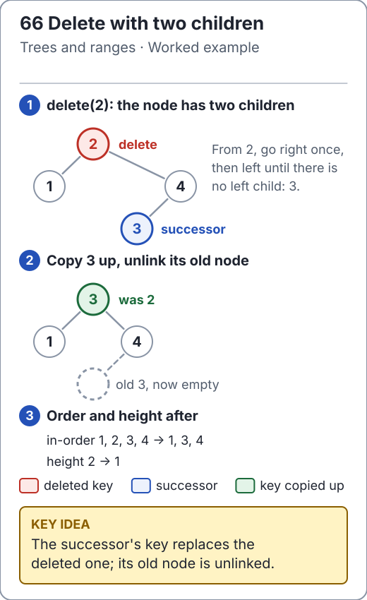

# Binary search trees: an invariant over descendants

[`BinarySearchTree`](../../src/main/java/io/github/ichillous/dsa/structures/BinarySearchTree.java) is a natural-order set. Every key in a node's left subtree must compare smaller; every key in its right subtree must compare larger. The rule covers **all descendants**, not only immediate children.

Null keys are rejected. `compareTo == 0` defines a duplicate, even if `equals` would distinguish the objects. Keep ordering-relevant fields stable while a key is stored.

| At a glance | |
| --- | --- |
| **Use it when** | Keys are inserted and removed over time and you need ordered membership or sorted traversal, and the input order is not adversarial |
| **Avoid it when** | Keys may arrive sorted, because the tree becomes a chain; use [AVL](avl-trees.md) or [red-black](red-black-trees.md) balancing |
| **Cost** | Search, add and remove are O(h), up to O(n); `inOrder` and `height` are O(n) |
| **In this repo** | [`BinarySearchTree`](../../src/main/java/io/github/ichillous/dsa/structures/BinarySearchTree.java) |
| **In the JDK** | `java.util.TreeSet` (a balanced, comparator-aware ordered set) |

## Search and insertion

```text
          8
        /   \
       3     10
      / \      \
     1   6     14
        / \
       4   7

find 7: compare with 8 -> left, 3 -> right, 6 -> right, 7 -> found
```

Each comparison discards an entire subtree because of the descendant ordering rule. Insertion follows the same search until it reaches an absent child, then attaches a leaf. Adding an equivalent key leaves size unchanged.

```java
import io.github.ichillous.dsa.structures.BinarySearchTree;
import java.util.List;

BinarySearchTree<Integer> keys = new BinarySearchTree<>();
for (int value : new int[] {8, 3, 10, 1, 6, 14, 4, 7}) keys.add(value);
boolean added = keys.add(6);
assert !added && keys.size() == 8;
assert keys.contains(7) && !keys.contains(5);
assert keys.inOrder().equals(List.of(1, 3, 4, 6, 7, 8, 10, 14));
```

## Deletion has three cases

1. **Leaf:** replace its incoming link with null.
2. **One child:** replace its incoming link with that child.
3. **Two children:** use an inorder successor, the smallest key in the right subtree, then remove the successor from its old position.

For node 3 in the diagram, the successor is 4. It has no left child by construction, so its old position is a leaf or one-child deletion. Replacing 3 with an arbitrary right-subtree key, such as 7, would leave smaller descendants on its right.

<!-- visual:generated bst-delete-successor | Deleting 2 from a smaller tree. Its successor 3 is the leftmost key of the right subtree; copying it up leaves a valid three-key tree of height 1. -->
<picture><source media="(prefers-color-scheme: dark)" srcset="../../docs/visuals/assets/bst-delete-successor-dark.svg"></picture>

**Figure 47.** Deleting 2 from a smaller tree. Its successor 3 is the leftmost key of the right subtree; copying it up leaves a valid three-key tree of height 1. [Visual index and step-throughs](../../docs/visuals/README.md).
<!-- /visual:generated -->


```java
import io.github.ichillous.dsa.structures.BinarySearchTree;
import java.util.List;

BinarySearchTree<Integer> keys = new BinarySearchTree<>();
for (int value : new int[] {8, 3, 10, 1, 6, 14, 4, 7}) keys.add(value);
boolean removed = keys.remove(3);
assert removed;
assert !keys.contains(3) && keys.contains(4);
assert keys.inOrder().equals(List.of(1, 4, 6, 7, 8, 10, 14));
assert keys.size() == 7;
assert !keys.remove(99);
```

Deleting the root requires changing the tree's root field. Deleting the last key must produce an empty tree with height -1. A two-child deletion still removes exactly one logical key, so size decreases once, not once per internal step.

A local-only ordering check can miss this invalid tree: root 10 has left child 5, and 5 has right child 12. Each immediate child comparison looks correct, but 12 is in 10's left subtree and violates the inherited upper bound. A validator must carry ancestor bounds, not just compare adjacent nodes.

## Height controls the cost

Search, add and remove cost O(h), up to O(n) worst case. Inserting sorted keys into this unbalanced implementation forms a chain; balanced average inputs are not a worst-case guarantee. Inorder traversal and height computation take O(n). Stored nodes take O(n); iterative traversal may need O(h) workspace plus O(n) output.

The implementation uses iteration for updates and traversal, avoiding deep recursive calls on a chain. That protects call-stack depth; it does not turn a linear-height search into logarithmic work. Use [AVL balancing](avl-trees.md) when worst-case logarithmic operations matter.

## In real Java

`java.util.TreeSet` is the production ordered set. Unlike this class, which orders keys by `Comparable` natural order only, it accepts a `Comparator`, and the Java SE 17 documentation says its `add` leaves the set unchanged and returns false when an equal element is present, where equality is decided by the comparator. A case-insensitive comparator therefore treats `"apple"` as a duplicate of `"Apple"` and keeps the first spelling.

```java
import java.util.TreeSet;

TreeSet<String> names = new TreeSet<>(String.CASE_INSENSITIVE_ORDER);
assert names.add("Apple");
assert !names.add("apple");
assert names.size() == 1;
assert names.first().equals("Apple");
assert names.contains("APPLE");
```

## Common mistakes

1. **Checking only parent and child.** Root 10 with left child 5 whose right child is 12 passes every adjacent comparison. The invariant covers all descendants, and 12 sits in 10's left subtree.
2. **Deleting a two-child node with an arbitrary key.** Removing 3 from the diagram and copying 7 up leaves 4 and 6 smaller than the new key on its right side. Only the successor, 4, or the predecessor keeps all left keys smaller and all right keys larger.
3. **Feeding sorted keys.** Adding 1, 2, 3, 4, 5 builds a right chain of height 4, so `contains(5)` makes five comparisons. The tree is still ordered, but nothing bounds its height.

## Practice

1. Delete 8 from the diagram and identify the successor and every affected incoming link.
2. Construct an input whose insertion order gives height n - 1; compare with median-first insertion.
3. Compare random updates with `TreeSet`, checking size and inorder output after every operation. Include repeated root deletion and absent removals.

## Check yourself

<details>
<summary>Why is the successor of a node with two children never the node itself or a node with a left child?</summary>

The successor is the leftmost node of the right subtree, found by going right once and then left until there is no left child. By construction it has no left child, so unlinking it is a leaf or one-child case.

</details>

<details>
<summary>What does deleting the only key of a tree leave behind?</summary>

An empty tree with size 0 and height -1. The root field itself must become empty.

</details>

<details>
<summary>Is a BST of height n - 1 still a valid BST?</summary>

Yes, the ordering invariant holds. It is only slow, since search, add and remove cost O(h) and h is n - 1.

</details>

See the [worked solutions](../../docs/solutions.md) for successor deletion and counterexamples to local-only ordering checks. The [solution finder](../../docs/solution-finder.md#2-ordered-keys-and-nearest-key-queries) compares this technique with its alternatives.
