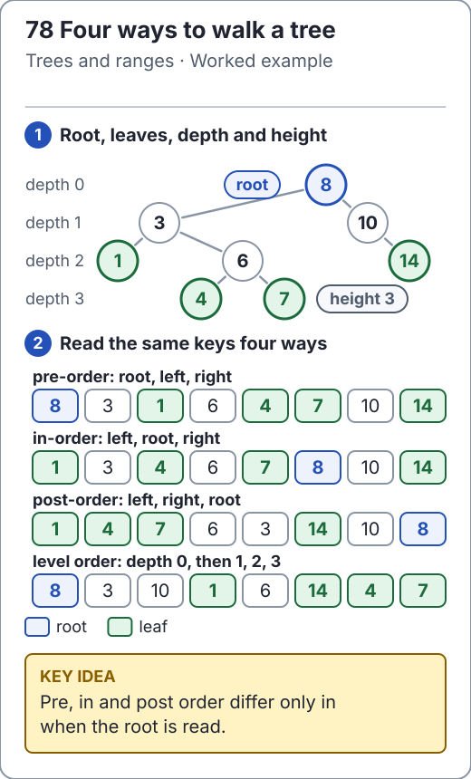

# Binary trees: shape and traversal are separate choices

A binary tree allows at most two children per node, conventionally called left and right. This describes branching, not key ordering, completeness or balance. A binary search tree adds an ordering rule; a heap adds a different rule.

| At a glance | |
| --- | --- |
| **Use it when** | You model a hierarchy with at most two children per node, such as an expression tree, and need to name traversal orders precisely |
| **Avoid it when** | You need ordered lookup without an ordering rule; a plain binary tree gives no shortcut, so use a [search tree](binary-search-trees.md) |
| **Cost** | A full traversal visits n nodes in O(n); depth-first recursion uses O(h) call frames for height h |
| **In this repo** | [`BinarySearchTree#inOrder`](../../src/main/java/io/github/ichillous/dsa/structures/BinarySearchTree.java), the only traversal the library exposes |
| **In the JDK** | No direct equivalent: there is no public general binary-tree node class |

```text
       A
      / \
     B   C
      \
       D

preorder:   A B D C     root, left, right
inorder:    B D A C     left, root, right
postorder:  D B C A     left, right, root
level order:A B C D     breadth first
```

Preorder can serialize shape when absent children are represented. Postorder processes children before parents, useful for deleting subtrees or evaluating expression trees. Level order uses a FIFO queue. Inorder is sorted **only if the BST ordering invariant holds**.

<!-- visual:generated tree-traversals | The same tree read four ways. Only the moment the root is read changes among the depth-first orders. -->
<picture><source media="(prefers-color-scheme: dark)" srcset="../../docs/visuals/assets/tree-traversals-dark.svg"></picture>

**Figure 53.** The same tree read four ways. Only the moment the root is read changes among the depth-first orders. [Visual index and step-throughs](../../docs/visuals/README.md).
<!-- /visual:generated -->


## Name the shapes precisely

| Term | Meaning |
| --- | --- |
| Full / proper | Every node has zero or two children |
| Complete | Every level except possibly the last is filled; the last fills left to right |
| Perfect | Every internal node has two children and all leaves have equal depth |
| Height balanced | A specified local height condition holds, such as AVL's difference of at most one |

A complete heap is not necessarily a BST. A full tree is not necessarily balanced: one branch can keep splitting while the other ends at a leaf.

The library exposes ordered trees rather than a general mutable binary-node API. This runnable example uses that stronger contract explicitly:

```java
import io.github.ichillous.dsa.structures.BinarySearchTree;
import java.util.List;

BinarySearchTree<Integer> ordered = new BinarySearchTree<>();
for (int value : new int[] {4, 2, 6, 3}) ordered.add(value);
assert ordered.inOrder().equals(List.of(2, 3, 4, 6));
assert ordered.height() == 2;
```

## Costs and a counterexample

A full traversal visits n nodes and costs O(n), even when height is O(log n). Recursive depth-first traversal uses O(h) call frames; a chain can have h = n - 1. The maintained [BST traversal](../../src/main/java/io/github/ichillous/dsa/structures/BinarySearchTree.java) is iterative, so a degenerate tree does not consume one JVM call frame per node. Its returned snapshot itself requires O(n) space.

A binary tree with root 4 and left child 9 is valid as a binary tree but invalid as a BST. Applying “go left for smaller values” to an arbitrary binary tree can miss a value that is present.

## In real Java

The JDK has no general binary-tree class to traverse. Its ordered collections, `java.util.TreeSet` and `java.util.TreeMap`, are the practical tools, and the Java SE 17 documentation says the iterator of a `TreeSet` returns elements in ascending order, which is exactly in-order. `descendingSet()` is a reverse-order view. For pre-order, post-order or level order, write the traversal over your own node type.

```java
import io.github.ichillous.dsa.structures.BinarySearchTree;
import java.util.ArrayList;
import java.util.List;
import java.util.TreeSet;

BinarySearchTree<Integer> own = new BinarySearchTree<>();
TreeSet<Integer> jdk = new TreeSet<>();
for (int value : new int[] {8, 3, 10, 1, 6, 14, 4, 7}) {
    own.add(value);
    jdk.add(value);
}
assert new ArrayList<>(jdk).equals(own.inOrder());
List<Integer> descending = new ArrayList<>(jdk.descendingSet());
assert descending.get(0) == 14 && descending.get(7) == 1;
```

## Common mistakes

1. **Using BST search on a plain binary tree.** With root 4 and left child 9, searching for 9 goes right, because 9 is larger, and misses it. The BST invariant (every left descendant is smaller) does not hold, so the shortcut is invalid.
2. **Expecting sorted in-order output from any tree.** For root 2 with left child 5 and right child 1, in-order reads 5, 2, 1. In-order is sorted only when the BST ordering invariant holds.
3. **Rebuilding a tree from pre-order alone.** The pre-order sequence 2, 1 fits both a tree whose left child is 1 and one whose right child is 1. A serialization must record absent children, or the shape is not recoverable.

## Practice

1. Write all four traversals for the diagram, then move D to C's left and repeat.
2. Find the smallest tree that is full but not complete.
3. Explain what extra markers a preorder serialization needs to distinguish a left-only child from a right-only child.

## Check yourself

<details>
<summary>Which traversal visits the root last, and what is it good for?</summary>

Post-order. Children are processed before their parent, so it suits deleting a subtree or evaluating an expression tree.

</details>

<details>
<summary>A tree has every node with zero or two children. Must it be balanced?</summary>

No. A full tree can keep splitting one branch while the other ends at a leaf, so its height can grow roughly in proportion to its node count.

</details>

<details>
<summary>Why can in-order traversal of the figure's tree be trusted to give 1, 3, 4, 6, 7, 8, 10, 14?</summary>

The tree was built as a binary search tree, so every left subtree holds smaller keys and every right subtree larger ones. Reading left, root, right therefore yields the keys in sorted order.

</details>

Read [BST ordering](binary-search-trees.md) and the [worked solutions](../../docs/solutions.md).
