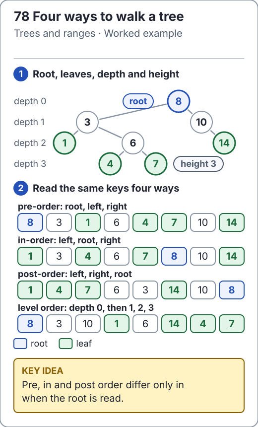

# Trees: choose the invariant before the shape

A tree is a connected acyclic graph; a rooted tree gives every non-root node one parent. Trees organize hierarchical data, but different tree structures optimize different operations. The word “tree” alone does not imply logarithmic search.

| At a glance | |
| --- | --- |
| **Use it when** | You must pick a tree: ordered keys, repeated minimum, prefixes or interval queries each need a different invariant |
| **Avoid it when** | You only need membership or counts by exact key; a hash map is simpler, and a sorted array suits data that never changes |
| **Cost** | Search trees cost O(h) for height h: O(n) in the worst case when unbalanced, O(log n) once balanced; a full traversal is always O(n) |
| **In this repo** | [`BinarySearchTree`](../../src/main/java/io/github/ichillous/dsa/structures/BinarySearchTree.java), [`AvlTree`](../../src/main/java/io/github/ichillous/dsa/structures/AvlTree.java), [`RedBlackTreeMap`](../../src/main/java/io/github/ichillous/dsa/structures/RedBlackTreeMap.java), [`BinaryMinHeap`](../../src/main/java/io/github/ichillous/dsa/structures/BinaryMinHeap.java), [`Trie`](../../src/main/java/io/github/ichillous/dsa/structures/Trie.java), [`SegmentTree`](../../src/main/java/io/github/ichillous/dsa/structures/SegmentTree.java) |
| **In the JDK** | `java.util.TreeMap` and `java.util.TreeSet` (ordered), `java.util.PriorityQueue` (priority) |

## Compare the maintained structures

| Structure | Defining invariant | Useful operation |
| --- | --- | --- |
| [`BinarySearchTree`](../../src/main/java/io/github/ichillous/dsa/structures/BinarySearchTree.java) | All left descendants compare smaller; all right descendants compare larger | Ordered membership and sorted traversal |
| [`AvlTree`](../../src/main/java/io/github/ichillous/dsa/structures/AvlTree.java) | BST order plus subtree heights differing by at most one | O(log n) worst-case membership/update |
| [`RedBlackTreeMap`](../../src/main/java/io/github/ichillous/dsa/structures/RedBlackTreeMap.java) | BST order, left-leaning red links, equal black height and subtree sizes ([lesson](red-black-trees.md)) | O(log n) worst-case map operations plus `rank`, `select` and range counts |
| [`BinaryMinHeap`](../../src/main/java/io/github/ichillous/dsa/structures/BinaryMinHeap.java) | Complete shape; parent no larger than children | Minimum-priority access |
| [`Trie`](../../src/main/java/io/github/ichillous/dsa/structures/Trie.java) | Edge labels spell shared string prefixes | Prefix lookup and suggestions |
| [`SegmentTree`](../../src/main/java/io/github/ichillous/dsa/structures/SegmentTree.java) | Each node stores the minimum of its covered interval | Range minimum with point replacement |
| [`SparseTable`](../../src/main/java/io/github/ichillous/dsa/structures/SparseTable.java) and [`LazySegmentTree`](../../src/main/java/io/github/ichillous/dsa/structures/LazySegmentTree.java) | Immutable overlapping power-of-two minima; lazy pending additions on covered intervals ([range-query lesson](../range-queries/overview.md)) | O(1) static range minimum; range add with range sum |

BST and AVL types behave as sets: `compareTo` defines equivalent keys, duplicate add returns false, and nulls are rejected. `RedBlackTreeMap` uses the same `compareTo` equivalence, but as a map: putting an equivalent key replaces the value and returns the previous one. Heap duplicates are meaningful and retained. Trie words use their own whole-word marker; a word may end at an internal node.

## Height is measured in edges here

```text
       4          root: depth 0
      / \
     2   6        leaves: depth 1
```

A leaf has height 0 and an empty BST/AVL has height -1. Depth measures distance from the root; height measures the longest downward path. Mixing the conventions for empty height 0 versus -1 causes off-by-one mistakes in balancing code.

<!-- visual:generated tree-traversals | One tree with its root, leaves, depths and height, and the four sequences that visiting its nodes can produce. -->
<picture><source media="(prefers-color-scheme: dark)" srcset="../../docs/visuals/assets/tree-traversals-dark.svg"></picture>

**Figure 53.** One tree with its root, leaves, depths and height, and the four sequences that visiting its nodes can produce. [Visual index and step-throughs](../../docs/visuals/README.md).
<!-- /visual:generated -->


```java
import io.github.ichillous.dsa.structures.BinarySearchTree;
import java.util.List;

BinarySearchTree<Integer> tree = new BinarySearchTree<>();
assert tree.height() == -1;
tree.add(4);
tree.add(2);
tree.add(6);
assert tree.height() == 1;
assert tree.inOrder().equals(List.of(2, 4, 6));
```

## An interval tree has a different ordering

The maintained range-minimum segment tree pads its leaf layer to a power of two with Long.MAX_VALUE, then divides the padded positions into adjacent intervals. Padding is the identity for minimum, so it cannot introduce a smaller answer. Its parent stores `min(left, right)`, not a key separating smaller and larger values. Replacing a point only changes nodes covering that position.

```java
import io.github.ichillous.dsa.structures.SegmentTree;

SegmentTree minima = new SegmentTree(new long[] {8, 3, 7, 5});
assert minima.rangeMin(1, 4).orElseThrow() == 3;
minima.set(1, 9);
assert minima.rangeMin(1, 4).orElseThrow() == 5;
assert minima.rangeMin(2, 2).isEmpty();
```

Segment-tree build/storage is O(n), and point-set/range-min is O(log n). Half-open empty ranges return `OptionalLong.empty()` so a real minimum of `Long.MAX_VALUE` remains representable. Unlike a Fenwick sum, minimum cannot be recovered by subtracting two prefix minima.

## In real Java

Production code rarely hand-writes these trees. `java.util.TreeSet` and `java.util.TreeMap` keep keys ordered, and `java.util.PriorityQueue` serves the minimum. They answer different questions: the Java SE 17 documentation says the iterator of a `PriorityQueue` is not guaranteed to traverse its elements in any particular order, so only repeated `poll` is sorted. A `TreeSet` iterates in ascending order and also answers nearest-key queries.

```java
import java.util.ArrayList;
import java.util.List;
import java.util.PriorityQueue;
import java.util.TreeSet;

PriorityQueue<Integer> heap = new PriorityQueue<>(List.of(5, 1, 4, 2, 3));
TreeSet<Integer> ordered = new TreeSet<>(List.of(5, 1, 4, 2, 3));
List<Integer> polled = new ArrayList<>();
while (!heap.isEmpty()) {
    polled.add(heap.poll());
}
assert polled.equals(List.of(1, 2, 3, 4, 5));
assert new ArrayList<>(ordered).equals(polled);
assert ordered.floor(0) == null;
assert ordered.ceiling(3) == 3;
```

## Common mistakes

1. **Assuming every tree is shallow.** Adding 1, 2, 3, 4, 5 in order to a `BinarySearchTree` gives height 4, a chain, so search costs O(n). The invariant that keeps height near log n is balance, which an unbalanced tree does not have.
2. **Mixing height conventions.** A tree with one key has height 0 here and an empty tree has height -1. Treating the empty tree as 0 shifts every balance factor by one.
3. **Searching an interval tree like a search tree.** In a `SegmentTree` over 8, 3, 7, 5 the root stores 3, the minimum of the whole range, not a key that separates smaller from larger. Going left for smaller values breaks the interval invariant: each node summarizes an adjacent interval.

## Practice

1. Choose a structure for sorted unique keys, repeated minimum removal, autocomplete and mutable range minimum. Explain the invariant each choice needs.
2. Draw a five-key BST with height 4, then a balanced one with the same inorder result.
3. Compare random segment-tree updates/queries with a plain array scan, including empty ranges and extreme long values.

## Check yourself

<details>
<summary>Which tree gives the cheapest repeated removal of the smallest value, and why not a search tree?</summary>

A binary min-heap, because its complete shape and parent-no-larger rule put the minimum at the root with O(log n) removal. A search tree can also do it but pays for ordering information that this task does not need.

</details>

<details>
<summary>What are the height of an empty tree and of a one-key tree here?</summary>

-1 and 0. Height counts edges on the longest downward path, so a lone node has none and the empty tree is one step below it.

</details>

<details>
<summary>Why does a parent in a segment tree not behave like a BST key?</summary>

It stores the minimum of the interval its children cover, not a separator. Only the covered intervals, not key order, decide which nodes a query visits.

</details>

Continue with [binary-tree terminology](binary-trees.md), [BST operations](binary-search-trees.md), [AVL balance](avl-trees.md), [red-black trees](red-black-trees.md), [range queries](../range-queries/overview.md) and the [worked solutions](../../docs/solutions.md). The [solution finder](../../docs/solution-finder.md#5-range-queries-over-arrays) compares this technique with its alternatives.
