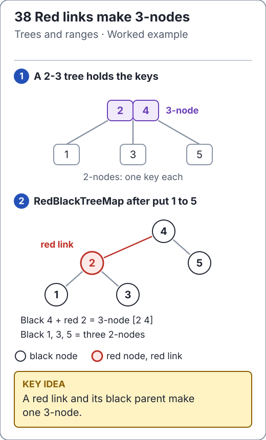
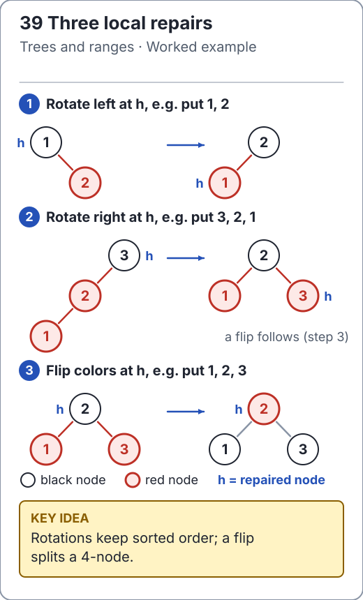

# Red-black trees: a 2-3 tree in binary form

[`RedBlackTreeMap`](../../src/main/java/io/github/ichillous/dsa/structures/RedBlackTreeMap.java)
is an ordered map that keeps every update and every order query logarithmic in the
worst case. It is a left-leaning red-black tree (Sedgewick's variant) whose nodes
also record their subtree sizes. Besides `get`, `put` and `remove`, it answers:

- nearest keys: `floorKey` and `ceilingKey`
- order statistics: `rank` (how many keys are smaller) and `select` (the key at a
  given position)
- range counts: `countInRange` over a half-open range `[from, to)`

| At&nbsp;a&nbsp;glance | |
| --- | --- |
| **Use&nbsp;it&nbsp;when** | Keys change while you keep asking ordered questions: nearest key, rank, select or range counts. |
| **Avoid&nbsp;it&nbsp;when** | The keys are fixed (sort once and binary search), you only need exact lookups (a hash map), or `TreeMap` already suffices because you need no rank or select. |
| **Cost** | O(log n) worst case for `get`, `put`, `remove`, `floorKey`, `ceilingKey`, `rank`, `select` and `countInRange`; O(n) storage; `keys()` and `height()` are O(n) |
| **In&nbsp;this&nbsp;repo** | [`RedBlackTreeMap`](../../src/main/java/io/github/ichillous/dsa/structures/RedBlackTreeMap.java) |
| **In&nbsp;the&nbsp;JDK** | `java.util.TreeMap` and `java.util.TreeSet` |

Use it when a set of keys changes while you keep asking ordered questions about it,
such as "how many scores are below 70?" or "what is the 100th smallest timestamp?".
For a fixed array, sorting once and using [binary search](../../algorithms/searching/binary-search.md)
is simpler.

**Preconditions.** Keys implement `Comparable`, and their order must not change
while they are stored. Keys and values are non-null. `compareTo == 0` means the same
key, as in `TreeMap`: putting an equivalent key replaces the value and keeps the key
object stored first. Like `java.util.Map`, `get`, `put` and `remove` return `null`
for "absent", while `floorKey`, `ceilingKey`, `firstKey` and `lastKey` return
`Optional.empty()`.

## The invariant

Every node is red or black. A red node is glued to its parent, so the pair acts as
one 2-3 tree node holding two keys (a 3-node). The map maintains:

1. **BST order:** smaller keys to the left, larger to the right.
2. **Red links lean left:** a red node is always a left child.
3. **No 4-nodes at rest:** a red node never has a red child.
4. **Perfect black balance:** every path from the root to an empty link passes the
   same number of black nodes.
5. **Black root.**
6. **Sizes:** every node stores the number of keys in its subtree.

Rules 2 to 4 make the tree an exact binary drawing of a 2-3 tree. Merge every red
node into its black parent, and the black links are the 2-3 tree's edges:

```text
left-leaning red-black tree          the 2-3 tree it encodes

          4(B)                              [2 4]
         /    \                            /  |  \
      2(R)    5(B)                       [1] [3] [5]
     /    \
   1(B)   3(B)
```

All 2-3 leaves sit at the same depth, which is rule 4. The package-private
`checkInvariants()` used by the tests checks all six rules independently of the
update code.

<!-- visual:generated red-black-23-nodes | The keys 1 to 5 as a 2-3 tree and as the shape RedBlackTreeMap builds after put 1 to 5. -->
<picture><source media="(prefers-color-scheme: dark)" srcset="../../docs/visuals/assets/red-black-23-nodes-dark.svg"></picture>

**Figure 82.** The keys 1 to 5 as a 2-3 tree and as the shape RedBlackTreeMap builds after put 1 to 5. [Visual index and step-throughs](../../docs/visuals/README.md).
<!-- /visual:generated -->


## Three local fixes

An insertion adds a red leaf: in 2-3 terms, the new key joins an existing bottom
node. That can break rules 2 and 3, so the recursion repairs each node on the way
back up with three local fixes, in this order:

| Situation at node `h` | Fix | 2-3 meaning |
| --- | --- | --- |
| Right child red, left child black | Rotate left at `h` | Same 3-node, drawn leaning left |
| Left child red and its left child red | Rotate right at `h` | Balance a temporary 4-node so it can be split |
| Both children red | Flip colors: `h` red, children black | Split the 4-node; the middle key moves up |

A rotation changes which node is on top but preserves the in-order sequence, so BST
order survives. The promoted node takes the old top's color and the demoted node
becomes red, so black heights are unchanged. A color flip keeps black heights equal
too: every path through `h` trades a black `h` for a black child. But `h` is now
red, so its parent may need a fix of its own. That is how a split ripples up toward
the root. Finally, the root is colored black again.

<!-- visual:generated red-black-fixups | Each repair on three keys, before and after. These shapes exist only inside one put; the finished map shows only the result. -->
<picture><source media="(prefers-color-scheme: dark)" srcset="../../docs/visuals/assets/red-black-fixups-dark.svg"></picture>

**Figure 83.** Each repair on three keys, before and after. These shapes exist only inside one put; the finished map shows only the result. [Visual index and step-throughs](../../docs/visuals/README.md).
<!-- /visual:generated -->


Trace: inserting 1, 2, 3, 4 and 5 in ascending order. `(R)` marks a red node and
`(B)` a black one.

```text
put 1  new root, recolored black
         1(B)

put 2  2 hangs red to the right of 1: rotate left at 1
         1(B)                2(B)
            \       ->      /
            2(R)          1(R)

put 3  3 hangs red to the right of 2, whose left child is red:
       flip colors at 2 (split 4-node [1 2 3]), then recolor the root black
           2(B)               2(R)               2(B)
          /    \      ->     /    \      ->     /    \
        1(R)   3(R)        1(B)   3(B)        1(B)   3(B)

put 4  4 hangs red to the right of 3: rotate left at 3
           2(B)                  2(B)
          /    \                /    \
        1(B)   3(B)    ->     1(B)   4(B)
                  \                 /
                  4(R)            3(R)

put 5  5 hangs red to the right of 4, whose left child 3 is red: flip colors at 4.
       4 is now a red right child of 2: rotate left at 2
           2(B)                 2(B)                       4(B)
          /    \               /    \                     /    \
        1(B)   4(B)    ->    1(B)   4(R)       ->       2(R)    5(B)
              /    \               /    \              /    \
            3(R)   5(R)          3(B)   5(B)         1(B)   3(B)
```

An unbalanced BST would have height 4 after this input. Here the result is the 2-3
tree `[2 4]` over `[1] [3] [5]`, with height 2.

```java
import io.github.ichillous.dsa.structures.RedBlackTreeMap;
import java.util.List;

RedBlackTreeMap<Integer, String> map = new RedBlackTreeMap<>();
for (int key = 1; key <= 5; key++) {
    assert map.put(key, "v" + key) == null;
}
assert map.keys().equals(List.of(1, 2, 3, 4, 5));
assert map.height() == 2;
assert map.put(3, "three").equals("v3");
assert map.size() == 5;
assert map.remove(1).equals("v1");
assert map.remove(1) == null;
assert map.keys().equals(List.of(2, 3, 4, 5));
```

**Deletion** is the hardest part. Removing a black leaf would shorten one path, so
the descent never stands on a 2-node. `remove` first makes the root red when both
of its children are black. Before stepping left onto a 2-node, `moveRedLeft` merges
it with its parent's key and its right sibling by flipping colors. If the sibling
is a 3-node, two rotations and a second flip borrow a key from it instead.
`moveRedRight` does the same before stepping right; because red links lean left, it
needs only one rotation. The key is then removed from a 3-node or 4-node at the
bottom, which leaves black heights unchanged. A key found above the bottom is
replaced by its successor, the smallest key of its right subtree, which `deleteMin`
removes. On the way back up, the same three fixes clear the temporary right-leaning
links and 4-nodes.

## Why the height is at most 2 log2(n + 1)

Let `b` be the number of black nodes on every root-to-empty-link path (rule 4).
Merging each red node into its parent leaves a 2-3 tree with `b` levels (all leaves
at the same depth). Such a tree has at least `2^b - 1` keys, so `b <= log2(n + 1)`. A red node always has a black
parent (rules 3 and 5), so a path holds at most `b` red nodes. Every path therefore
has at most `2b <= 2 log2(n + 1)` nodes, and `height()` (counted in edges) is at
most `2 log2(n + 1) - 1`.

For 100,000 keys that means at most 33 nodes on any path (height at most 32),
whatever the insertion order. The recursive `put` and `remove` follow one search
path, so their stack depth stays small.
The tests insert and remove 100,000 ascending keys and then 100,000 descending keys,
checking this bound and every invariant along the way.

## Rank and select from subtree sizes

Each node stores `size = 1 + size(left) + size(right)`. To find `rank(key)`, walk
down from the root. Every time the walk goes right, it skips the current node and
its whole left subtree, so add `1 + size(left)` to the count. `select(i)` runs the
same walk in reverse: compare `i` with the size of the left subtree to choose a
direction. Both are O(log n), and `countInRange(from, to)` is
`rank(to) - rank(from)`.

Trace on the 1..5 tree (`4` at the root, left subtree `{1, 2, 3}` of size 3):

```text
rank(5):   at 4, go right: count += 1 + size(left of 4) = 4
           at 5, found:    count += size(left of 5)     = 0   -> rank 4
select(2): at 4, 2 < size(left) = 3, go left
           at 2, 2 > size(left) = 1, i = 2 - (1 + 1) = 0, go right
           at 3, 0 = size(left) = 0                           -> key 3
```

Rotations must keep sizes correct. A rotation does not change which keys the
subtree holds, so the promoted node inherits the old top's size and the demoted
node is recomputed from its new children. After its fixes, `balance` recomputes the
top node's size once more, because the update below it changed the subtree.

```java
import io.github.ichillous.dsa.structures.RedBlackTreeMap;
import java.util.List;
import java.util.Optional;
import java.util.TreeMap;

RedBlackTreeMap<Integer, String> map = new RedBlackTreeMap<>();
TreeMap<Integer, String> reference = new TreeMap<>();
for (int key : new int[] {30, 10, 50, 20, 40}) {
    map.put(key, "v" + key);
    reference.put(key, "v" + key);
}
assert map.floorKey(25).equals(Optional.of(20));
assert map.ceilingKey(25).equals(Optional.of(30));
assert map.floorKey(5).isEmpty();
assert map.rank(25) == 2;
assert map.rank(25) == reference.headMap(25).size();
assert map.select(2) == 30;
assert map.countInRange(15, 45) == 3;
assert map.countInRange(15, 45) == reference.subMap(15, 45).size();
assert map.countInRange(45, 15) == 0;
assert map.keys().equals(List.copyOf(reference.keySet()));
```

## Costs

`n` is the number of stored keys. Every bound is worst case.

| Operation | Time | Extra space |
| --- | --- | --- |
| `get`, `containsKey` | O(log n) | O(1), iterative |
| `put`, `remove` | O(log n) | O(log n) recursion along one search path |
| `firstKey`, `lastKey`, `floorKey`, `ceilingKey` | O(log n) | O(1), iterative |
| `rank`, `select`, `countInRange` | O(log n) | O(1), iterative |
| `keys()` | O(n) | O(n) immutable snapshot plus an O(log n) stack |
| `height()` | O(n), not cached | O(log n) recursion |
| Storage | | O(n) nodes: key, value, two links, a color and a size |

## AVL versus red-black

Both are balanced binary search trees with O(log n) worst-case operations. They
differ in how strictly they balance.

| | [`AvlTree`](avl-trees.md) | Red-black (`RedBlackTreeMap`, `TreeMap`) |
| --- | --- | --- |
| Balance rule | Child heights differ by at most one | Equal black height, no red node with a red child |
| Height bound | Below about 1.44 log2(n + 2) | At most 2 log2(n + 1) |
| Extra per node | A cached height | One color bit (plus a size here, for rank and select) |
| Rotations per update | Insertion: at most one single or double rotation. Deletion: possibly one at every level | Classic version: at most 2 for insertion and 3 for deletion. The left-leaning version may rotate at every level, in exchange for shorter code |

AVL's stricter rule allows less height. The same 1,000 descending keys build these
heights:

```java
import io.github.ichillous.dsa.structures.AvlTree;
import io.github.ichillous.dsa.structures.RedBlackTreeMap;

AvlTree<Integer> avl = new AvlTree<>();
RedBlackTreeMap<Integer, Integer> redBlack = new RedBlackTreeMap<>();
for (int key = 999; key >= 0; key--) {
    avl.add(key);
    redBlack.put(key, key);
}
assert avl.height() == 9;
assert redBlack.height() == 14;
assert redBlack.height() <= 2 * Math.log(1001) / Math.log(2) - 1; // at most 18
assert redBlack.remove(500) == 500;
assert redBlack.rank(501) == 500;
```

## `java.util.TreeMap`

The Java SE 17 documentation describes `TreeMap` as "A Red-Black tree based
NavigableMap implementation" and promises "guaranteed log(n) time cost for the
containsKey, get, put and remove operations". It also states that its "Algorithms
are adaptations of those in Cormen, Leiserson, and Rivest's Introduction to
Algorithms". It uses the classic red-black tree, not the left-leaning variant.

`TreeMap` stores no subtree sizes, so it has no `select`. `headMap(key).size()`
gives the rank, but the specification promises no logarithmic bound for it.
OpenJDK implementation note: in OpenJDK 17, a bounded view such as `headMap` counts
its size by iterating over its entries, which takes time proportional to the count.
For an ordered map without order statistics, prefer `TreeMap`. Use a size-augmented
tree such as this one when you need rank, select or range counts in O(log n).

## Pitfalls

**Counterexample: a red-black tree need not be AVL-balanced.** Inserting 1, 4, 5,
2, 6 and 7 builds this tree, which satisfies every red-black rule. It encodes the
2-3 tree `[4 6]` over `[1 2] [5] [7]`, and every path has two black nodes. Yet the
root's left subtree has height 2 and its right subtree height 0, which AVL forbids.
Do not reuse AVL balance checks for a red-black tree.

```text
            6(B)
           /    \
        4(R)    7(B)
       /    \
     2(B)   5(B)
    /
  1(R)
```

```java
import io.github.ichillous.dsa.structures.AvlTree;
import io.github.ichillous.dsa.structures.RedBlackTreeMap;

RedBlackTreeMap<Integer, String> redBlack = new RedBlackTreeMap<>();
AvlTree<Integer> avl = new AvlTree<>();
for (int key : new int[] {1, 4, 5, 2, 6, 7}) {
    redBlack.put(key, "v" + key);
    avl.add(key);
}
assert redBlack.height() == 3;
assert avl.height() == 2;
assert redBlack.keys().equals(avl.inOrder());
```

**Rotating without fixing sizes.** A rotation moves a middle subtree from one node
to the other. If the demoted node keeps its old size, it still counts keys it no
longer holds. `get` and `keys()` ignore sizes and still look correct, but `rank`,
`select` and `size()` go wrong. `checkInvariants()` recomputes every size from the
children to catch this.

**Testing only the sorted output.** A plain unbalanced BST also passes a
`keys()`-versus-`TreeMap` comparison. Only an independent check of colors, black
heights and sizes after every update shows that the tree is balanced.

**Reading 2 log2(n + 1) as a typical height.** It is the worst case. For 1,000
descending keys, the left-leaning tree above has height 14. The bound allows up to
18, and AVL reaches 9.

## Practice

1. Insert 5, 4, 3, 2 and 1 in that order. Draw the tree after each step, name each
   fix you apply, and draw the 2-3 tree it encodes.
2. Count keys in the closed range `[a, b]` using only `rank` and `containsKey`.
   Check your formula against `TreeMap.subMap(a, true, b, true).size()`, including
   `a > b`.
3. Express `floorKey(k)` using only `rank`, `select` and `containsKey`. Compare it
   with `TreeMap.floorKey` on a seeded random test that includes absent keys and an
   empty map.

## Check yourself

<details>
<summary>What does a red link mean, and why may it only lean left?</summary>

A red node is glued to its parent so the pair acts as one 3-node of a 2-3 tree. Leaning left is the convention that makes each 3-node drawn one way, so the invariants and fixes need only one orientation.

</details>

<details>
<summary>Which fixes does put 3, then 2, then 1 apply, and what is the result?</summary>

Putting 1 creates two red nodes in a row on the left, so rotate right at 3 and then flip colors at 2. The result is black 2 with black children 1 and 3, height 1 instead of a chain of height 2.

</details>

<details>
<summary>At most how many nodes can lie on one root-to-empty-link path in a map of 1,000 keys?</summary>

19. A path has at most 2 log2(n + 1) nodes, which is about 19.9 for 1,000 keys, so the height is at most 18 edges.

</details>

See the [catalog](../../docs/catalog.md) for source and tests, and the
[complexity guide](../../docs/complexity.md) for the cost model. The
[red-black tests](../../src/test/java/io/github/ichillous/dsa/structures/RedBlackTreeMapTest.java)
compare 30,000 seeded operations with `TreeMap` and check every invariant after each
update. Related lessons: [binary search trees](binary-search-trees.md) and
[AVL trees](avl-trees.md). The [solution finder](../../docs/solution-finder.md#2-ordered-keys-and-nearest-key-queries) compares this technique with its alternatives.
