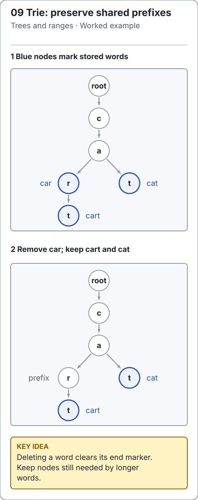

# Trie updates: prune paths without deleting other words

[`Trie`](../../src/main/java/io/github/ichillous/dsa/structures/Trie.java) owns its nodes and exposes word operations rather than mutable node references. Ordered child maps give deterministic suggestions; iterative traversal avoids one Java call frame per character.

<!-- visual:generated -->
<picture><source media="(prefers-color-scheme: dark)" srcset="../../docs/visuals/assets/trie-pruning-dark.svg"></picture>

**Figure 09.** The words car, cart and cat share a c-a prefix. Deleting car clears the r node's word marker but preserves its t child for cart and the sibling t branch for cat. [Visual index and step-throughs](../../docs/visuals/README.md).
<!-- /visual:generated -->

## Insert and delete have different stopping rules

Insertion follows existing edges and creates only missing suffix nodes. Marking an already marked endpoint is a duplicate, so size does not increase.

Deletion first finds the complete word. If its endpoint is absent or unmarked, return false without changing the trie. Otherwise unmark it, decrease size once, and walk the saved path backward. Prune a node only when it has **no children and no word marker**.

```text
before: c -- a -- r* -- t*     words car, cart
remove car:
        c -- a -- r  -- t*     retain path to cart
remove cart:
        root                  remove unused suffix all the way back
```

The helper's question “may this node be pruned?” is different from the public result “was a word removed?”. Confusing those results can report failure even after correctly removing a word that shares a prefix.

```java
import io.github.ichillous.dsa.structures.Trie;
import java.util.List;

Trie words = new Trie();
words.add("car");
words.add("cart");
words.add("cat");
boolean removed = words.remove("car");
assert removed && !words.contains("car");
assert words.contains("cart") && words.contains("cat");
assert words.wordsWithPrefix("ca", 10).equals(List.of("cart", "cat"));
boolean absent = words.remove("car");
assert !absent && words.size() == 2;
```

A fixed child array's `length` is its capacity, not its live child count. Checking `children.length == 0` on a 26-slot alphabet array never detects an empty node. The maintained implementation checks whether its child map is empty.

## Suggestions keep traversal state explicitly

Find the prefix endpoint, then visit child entries in sorted order. A stack of iterator frames remembers unfinished child scans. A shared `StringBuilder` holds the current path; popping a frame restores the parent's length before trying the next branch.

```java
import io.github.ichillous.dsa.structures.Trie;
import java.util.List;

Trie words = new Trie();
for (String word : List.of("", "ab", "abc", "abd", "b")) words.add(word);
assert words.wordsWithPrefix("", 3).equals(List.of("", "ab", "abc"));
assert words.wordsWithPrefix("ab", 0).isEmpty();
assert words.wordsWithPrefix("missing", 5).isEmpty();
assert words.wordsWithPrefix("ab", 9).equals(List.of("ab", "abc", "abd"));
```

Negative limits are rejected. A zero limit returns no results. Results are detached immutable snapshots; later updates do not change a previous suggestion list. Failing to shorten the path builder when backtracking can silently concatenate sibling labels into nonexistent words.

## Character model is part of correctness

The trie follows Java `char` values, not Unicode grapheme clusters. A supplementary symbol needs two code units, and canonically equivalent spellings remain distinct without normalization.

```java
import io.github.ichillous.dsa.structures.Trie;

String symbol = "🙂";
Trie words = new Trie();
words.add(symbol);
words.add("Car");
words.add("car");
assert symbol.length() == 2;
assert words.contains(symbol);
assert words.size() == 3;
assert !words.contains("CAR");
```

Lookup and update take O(L log A) time for word length L and maximum branching A; removal saves O(L) path state. Suggestions cost O(P log A + visited nodes + output characters) time, with traversal workspace and output storage, for prefix length P. Long words still consume memory even with iterative traversal.

## Practice

1. Remove `ab` from the suggestion example; state which descendants remain and what size becomes.
2. Retain an old suggestion list, mutate the trie, and check snapshot isolation and immutability.
3. Compare suggestions with a lexicographically sorted reference set across shared prefixes, the empty word, uppercase letters and supplementary symbols. Add a very long word to exercise iterative depth handling.

Use the [worked solutions](../../docs/solutions.md) to verify pruning and backtracking invariants.
