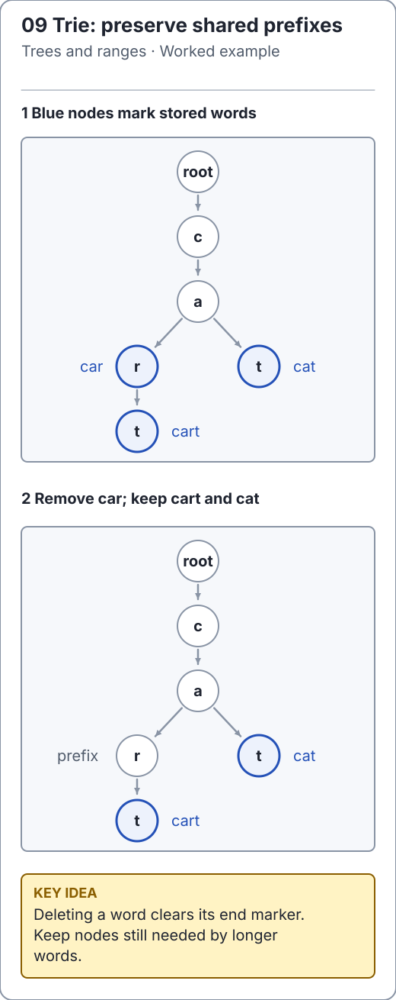

# Tries: share prefixes, mark whole words separately

A trie stores strings along labeled edges. Words with the same prefix share a path, making prefix lookup and autocomplete natural. Use a hash set for exact membership alone; consider a trie when prefixes are the central operation.

| At&nbsp;a&nbsp;glance | |
| --- | --- |
| **Use&nbsp;it&nbsp;when** | Prefix queries such as autocomplete are central, over a set of strings that changes. |
| **Avoid&nbsp;it&nbsp;when** | You need only exact membership (use a hash set), or memory is tight: a node per character costs far more than the strings. |
| **Cost** | Add, contains and prefix check O(L log A) for length L and at most A children per node; enumeration adds visited nodes and output. |
| **In&nbsp;this&nbsp;repo** | [`Trie`](../../src/main/java/io/github/ichillous/dsa/structures/Trie.java) |
| **In&nbsp;the&nbsp;JDK** | no direct equivalent; a `java.util.TreeSet<String>` scanned from `tailSet(prefix)` covers prefix lookups |

```text
root
|-- c
|   `-- a
|       |-- r* -- t*
|       `-- t*
`-- d -- o -- g*

* marks a complete word: car, cart, cat, dog
```

A word can end at an internal node: `car` ends before `cart` does. A leaf is a node with no children; it is not the definition of a word ending. The empty word, if stored, marks the root itself.

[`Trie`](../../src/main/java/io/github/ichillous/dsa/structures/Trie.java) is a case-sensitive set of Java strings. It accepts the empty string and arbitrary UTF-16 code units, rejects nulls and does not normalize case or Unicode. Duplicate add returns false.

```java
import io.github.ichillous.dsa.structures.Trie;
import java.util.List;

Trie words = new Trie();
words.add("car");
words.add("cart");
words.add("cat");
assert words.startsWith("ca");
assert !words.contains("ca");
assert words.contains("car");
assert words.wordsWithPrefix("ca", 2).equals(List.of("car", "cart"));
```

<!-- visual:generated trie-pruning -->
<picture><source media="(prefers-color-scheme: dark)" srcset="../../docs/visuals/assets/trie-pruning-dark.svg"></picture>

**Figure 09.** The words car, cart and cat share a c-a prefix. Deleting car clears the r node's word marker but preserves its t child for cart and the sibling t branch for cat. [Visual index and step-throughs](../../docs/visuals/README.md).
<!-- /visual:generated -->

## The lookup invariant

After consuming the first i code units of a query, the current node represents exactly that prefix. A missing edge proves the query cannot be present. Reaching the final node proves prefix existence; exact membership additionally requires its word-ending flag.

The empty prefix always has a path: the root. Consequently, `startsWith("")` is true even in an empty trie, while `contains("")` becomes true only after adding the empty word.

```java
import io.github.ichillous.dsa.structures.Trie;

Trie words = new Trie();
assert words.startsWith("") && !words.contains("");
words.add("");
words.add("Car");
words.add("car");
assert words.contains("");
assert words.size() == 3;
assert !words.contains("CAR");
```

## Costs depend on child storage

This implementation uses ordered `TreeMap` children, so lookup, insertion and removal cost O(L log A), where L is query length in UTF-16 code units and A bounds child count. It does not claim O(L) without the child-map assumption. Nodes and edge maps use space proportional to distinct stored prefixes; removal uses O(L) path workspace.

Suggestions follow `String.compareTo` order and return an immutable snapshot with an explicit result limit. Traversal costs prefix lookup plus visited nodes and output characters. A result limit bounds the number of words, not their lengths or the depth of a long shared branch.

## In real Java

The JDK has no trie. When prefix queries are rare, or you already keep a sorted set of strings, a `TreeSet<String>` answers them: `tailSet(prefix, true)` starts at the first string not smaller than the prefix, and every string that starts with the prefix is contiguous from there. Stop at the first string that does not start with it. `String.compareTo` orders UTF-16 code units, the same order the repository trie uses.

```java
import io.github.ichillous.dsa.structures.Trie;
import java.util.List;
import java.util.TreeSet;

List<String> input = List.of("cat", "car", "dog", "cart", "ca", "cab");
TreeSet<String> sorted = new TreeSet<>(input);
Trie trie = new Trie();
for (String word : input) {
    trie.add(word);
}
List<String> viaTreeSet = sorted.tailSet("ca", true).stream()
        .takeWhile(word -> word.startsWith("ca"))
        .toList();
assert viaTreeSet.equals(List.of("ca", "cab", "car", "cart", "cat"));
assert viaTreeSet.equals(trie.wordsWithPrefix("ca", 100));
```

## Common mistakes

1. **Treating a prefix as a word.** After adding `car`, `startsWith("ca")` is true but `contains("ca")` must be false. A path exists whenever some word passes through it; the word marker is a separate flag, and ignoring it breaks the rule that membership means a marked endpoint.
2. **Defining a word end as a leaf.** With `car` and `cart`, the node after `r` has a child but still ends a word. Marking only childless nodes loses `car`, which breaks the invariant that every added word's final node is marked.
3. **Ignoring the UTF-16 model.** `"🙂"` is two `char` values, so after adding it `startsWith("\uD83D")` is true: the trie holds a path for half of a symbol. Likewise `"Car"` and `"car"` are different words. The invariant is that edges are `char` values, with no case or Unicode normalization.

## Check yourself

<details>
<summary>Why is <code>startsWith("")</code> true in an empty trie while <code>contains("")</code> is false?</summary>

The empty prefix is the root, which always exists. `contains` additionally needs the root's word marker, which is set only after the empty word is added.

</details>

<details>
<summary>Why does this trie state its cost as O(L log A) and not O(L)?</summary>

Each node keeps its children in a sorted `TreeMap`, so one step down costs O(log A) for at most A children. O(L) would need constant-time child lookup, such as an array indexed by character or a hash map.

</details>

<details>
<summary>Why are suggestions returned in a predictable order?</summary>

Children are visited in sorted order of their `char`, so the result follows `String.compareTo` order. A hash-map child store would not give that.

</details>

## Practice

1. Add `can` to the diagram and identify exactly which nodes are new.
2. Explain why prefix membership and whole-word membership have different answers for `ca`.
3. Compare random add/remove/contains operations with `HashSet`, and suggestions with a sorted filtered set under the same UTF-16/case policy.

Continue with [deletion and suggestions](implementation.md) and the [worked solutions](../../docs/solutions.md). The [solution finder](../../docs/solution-finder.md#3-prefix-and-text-keys) compares this technique with its alternatives.
