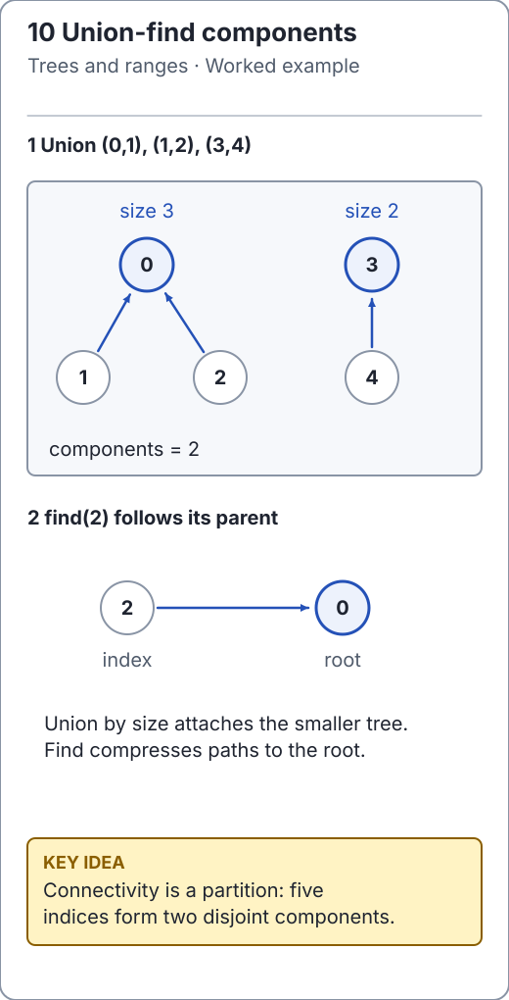
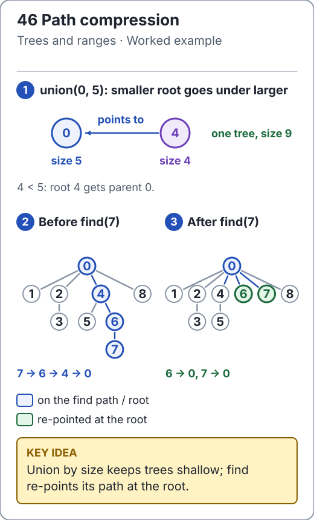

# Union-find: merge groups, ask who is together

Union-find, also called disjoint sets, keeps a partition of the indices `0..n-1` into groups. It answers two questions quickly: are two indices in the same group, and how do I merge two groups? It never splits a group. Use it when items only ever join, such as edges arriving in a graph, equivalent names, or cells that merge into regions.

| At a glance | |
| --- | --- |
| **Use it when** | Groups only merge and you ask "are these connected?": Kruskal's algorithm, cycle detection while adding undirected edges, grouping equivalent items. |
| **Avoid it when** | You must remove an edge or split a group, or you must list a group's members cheaply. |
| **Cost** | `find`, `union`, `connected`, `componentSize`: O(α(n)) amortized; construction and space O(n); `components` and `size` O(1). |
| **In this repo** | [`UnionFind`](../../src/main/java/io/github/ichillous/dsa/structures/UnionFind.java) |
| **In the JDK** | no direct equivalent |

<!-- visual:generated union-find -->
<picture><source media="(prefers-color-scheme: dark)" srcset="../../docs/visuals/assets/union-find-dark.svg"></picture>

**Figure 10.** Union operations on five indices produce components {0,1,2} and {3,4}. Parent arrows point toward roots 0 and 3, whose component sizes are three and two. Finding index 2 follows its link to root 0. [Visual index and step-throughs](../../docs/visuals/README.md).
<!-- /visual:generated -->

## The invariant

Each group is a tree stored in a `parent` array. A root is its own parent and represents the group. `find(x)` follows parents to the root, so two indices are together exactly when their roots are equal. Two rules keep the trees shallow:

- **Union by size.** `union` attaches the root of the smaller tree under the root of the larger. On a tie, the first argument's root stays the root. A node's depth grows only when its tree is merged under a tree at least as large, which at least doubles the size of the tree it belongs to. A tree of height h therefore has at least 2^h nodes, so heights are at most log2 n.
- **Path compression.** `find` re-points every node on its path directly at the root, so later finds on those nodes take one step.

Each root also stores its group's size, so `componentSize` and the group count are kept up to date by `union`.

## A worked trace

[`UnionFind`](../../src/main/java/io/github/ichillous/dsa/structures/UnionFind.java) over nine indices. The first seven unions build two trees with roots 0 and 4:

```text
union(0, 1)   0 gets child 1             size 2
union(2, 3)   2 gets child 3             size 2
union(0, 2)   tie: first root stays      0 gets child 2      size 4
union(0, 8)   1 < 4: 8 goes under 0      size 5
union(4, 5)   4 gets child 5             size 2
union(6, 7)   6 gets child 7             size 2
union(4, 6)   tie: first root stays      4 gets child 6      size 4
union(0, 5)   find(5) = 4; size 4 < 5, so root 4 goes under 0, size 9
find(7)       path 7 -> 6 -> 4 -> 0; afterwards 7 and 6 point at 0
```

<!-- visual:generated union-find-compression -->
<picture><source media="(prefers-color-scheme: dark)" srcset="../../docs/visuals/assets/union-find-compression-dark.svg"></picture>

**Figure 40.** In a UnionFind over 9 indices, union(0, 5) hangs the size-4 root 4 under the size-5 root 0. Before find(7) the path is 7, 6, 4, 0; afterwards 7 and 6 point directly at 0. [Visual index and step-throughs](../../docs/visuals/README.md).
<!-- /visual:generated -->

Compression changes only the parent pointers on the find path. Every group, its size and its root stay the same.

```java
import io.github.ichillous.dsa.structures.UnionFind;

UnionFind sets = new UnionFind(9);
assert sets.union(0, 1) && sets.union(2, 3) && sets.union(0, 2) && sets.union(0, 8);
assert sets.union(4, 5) && sets.union(6, 7) && sets.union(4, 6);
assert sets.components() == 2;
assert sets.componentSize(0) == 5 && sets.componentSize(7) == 4;
assert sets.union(0, 5);
assert !sets.union(7, 3);
assert sets.components() == 1 && sets.componentSize(7) == 9;
assert sets.find(7) == 0 && sets.connected(3, 6);
```

`union` returns `false` when both indices are already in one group, so the same call both merges and reports whether the merge was new.

## Kruskal: the main use

Kruskal's algorithm builds a minimum spanning forest by sorting edges by weight and accepting an edge only if its ends are in different groups. `union` does exactly that test and merge in one call. The [minimum spanning trees](../../algorithms/graph/minimum-spanning-trees.md) lesson explains why the greedy choice is correct.

```java
import io.github.ichillous.dsa.structures.UnionFind;
import java.util.Arrays;
import java.util.Comparator;

int[][] edges = {{0, 1, 1}, {1, 2, 2}, {0, 2, 3}, {2, 3, 4}, {3, 4, 5}, {2, 4, 6}};
int[][] byWeight = edges.clone();
Arrays.sort(byWeight, Comparator.comparingInt(edge -> edge[2]));
UnionFind forest = new UnionFind(5);
int total = 0;
int accepted = 0;
for (int[] edge : byWeight) {
    if (forest.union(edge[0], edge[1])) {
        total += edge[2];
        accepted++;
    }
}
assert accepted == 4 && total == 12;
assert forest.components() == 1;
```

The edges `0-2` and `2-4` are rejected: when each is considered, its ends are already connected, so accepting it would close a cycle.

## What union-find cannot do

- **Delete or split.** There is no `split` or `removeEdge`. After `union(0, 1)` the two indices are together for good, and the structure records no edge to undo.
- **List members cheaply.** The tree stores parents, not children. To list the members of one group, call `find` on all n indices and keep those whose root matches: O(n α(n)) for one group, not proportional to the group's size. Keep a separate list per root if you need members.
- **Hold other key types.** Indices are `0..size-1`. Map other keys to indices first, for example with a `HashMap<String, Integer>`.

## In real Java

The JDK has no disjoint-set class. Map your keys to dense integer indices, then use the structure. An out-of-range index throws `IndexOutOfBoundsException` before anything changes, so a bad call cannot leave a half-merged forest.

```java
import io.github.ichillous.dsa.structures.UnionFind;
import java.util.HashMap;
import java.util.List;
import java.util.Map;

List<String> names = List.of("ada", "grace", "alan", "edsger");
Map<String, Integer> index = new HashMap<>();
for (String name : names) {
    index.put(name, index.size());
}
UnionFind friends = new UnionFind(names.size());
friends.union(index.get("ada"), index.get("grace"));
friends.union(index.get("alan"), index.get("edsger"));
assert friends.connected(index.get("grace"), index.get("ada"));
assert !friends.connected(index.get("ada"), index.get("alan"));

boolean rejected = false;
try {
    friends.union(0, 4);
} catch (IndexOutOfBoundsException expected) {
    rejected = true;
}
assert rejected && friends.components() == 2;
```

## Costs

| Operation | Time | Notes |
| --- | --- | --- |
| `new UnionFind(n)` | O(n) | Two `int` arrays of length n |
| `find`, `connected`, `componentSize` | O(α(n)) amortized | An individual `find` is not guaranteed constant time; the bound is for a sequence of operations |
| `union` | O(α(n)) amortized | Returns whether two groups merged |
| `components`, `size` | O(1) | Kept as counters |
| Space | O(n) | Parent and size arrays |

α is the inverse Ackermann function. It is below 5 for any n that fits in memory, so the cost is effectively constant, but the guarantee is amortized over a sequence of operations.

## A pitfall: dropping union by size

A version that always links the first root under the second, without comparing sizes, can build a chain. `union(0, 1)`, `union(1, 2)`, `union(2, 3)` and so on put each previous root under the new index, giving a path of length n - 1 that `find(0)` must walk before compression flattens it. Comparing sizes before linking avoids that chain: heights stay at most log2 n even before any compression, and compression then flattens the paths that are used.

## Check yourself

<details>
<summary>Why does `union(7, 3)` return `false` in the example?</summary>

By then 7 and 3 are both in the single group rooted at 0, so their roots are equal and nothing merges. The method reports that with `false` and changes no sizes or counts.

</details>

<details>
<summary>Why can union-find not remove an edge?</summary>

It stores only parent pointers and group sizes, not the edges that caused each merge. Compression has also re-pointed nodes, so the original links are no longer recorded.

</details>

<details>
<summary>What does path compression change, and what does it leave alone?</summary>

It re-points the nodes on one find path directly at the root. The groups, their sizes and their roots stay the same, so answers to `connected` and `componentSize` do not change.

</details>

## Practice

1. Redo the trace with `union(0, 5)` replaced by `union(5, 0)`. Which root wins, and does the final group change?
2. Run Kruskal by hand on the edges in the example but with weight 3 on `2-3` instead of 4. Which edges are accepted, and what is the total?
3. Compare random `union`, `connected` and `componentSize` calls with a brute-force model that stores a group label for every index, using a fixed seed.

See the [catalog](../../docs/catalog.md) for source and tests, and the [complexity guide](../../docs/complexity.md) for the bounds. The [solution finder](../../docs/solution-finder.md#21-disjoint-sets-and-bitsets) compares this technique with its alternatives. Related: [graph basics](../graphs/overview.md).
