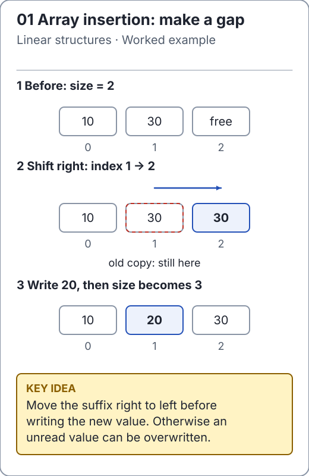

# Java foundations for reliable algorithms

The maintained library targets **Java 17**. Before studying an implementation,
be comfortable with arrays, loops, generics, references, exceptions and collection
contracts. This page focuses on language details that change algorithm behavior.
For broader notes, the author's [JavaNotes](https://github.com/ichillous/JavaNotes)
is a separate resource; it is not required by this build.

<!-- visual:generated -->
<picture><source media="(prefers-color-scheme: dark)" srcset="../docs/visuals/assets/array-insertion-dark.svg"></picture>

**Figure 01.** Read indices, live size and ownership separately: mutation changes one array, while a defensive copy preserves another. [Visual index and step-throughs](../docs/visuals/README.md).
<!-- /visual:generated -->

## Ownership and mutation

An array variable holds a reference. Assigning that reference aliases the same
array; `clone()` creates a new array. A method can return a new result, mutate its
argument, or do both, so read its contract before reusing input. The maintained
sorts mutate their arrays, whereas sequence queries preserve theirs.

```java
import io.github.ichillous.dsa.algorithms.SortAlgorithms;
import java.util.Arrays;

int[] original = {3, 1, 2};
int[] sorted = original.clone();
SortAlgorithms.mergeSort(sorted);
assert Arrays.equals(sorted, new int[] {1, 2, 3});
assert Arrays.equals(original, new int[] {3, 1, 2});
assert sorted != original;
```

The useful invariant is ownership: the caller still owns an unchanged `original`
because only the clone was passed to a mutating API. For arrays of objects, a
clone copies references, not the referenced objects. An immutable result list is
also not automatically a deep copy of every object it contains.

## Generic collections, boxing and overloaded methods

Use parameterized types rather than raw collections. `List<Integer>` stores boxed
references, and `remove(int)` removes a position while `remove(Object)` searches
for an equal value. The following operations intentionally choose different overloads:

```java
import java.util.ArrayList;
import java.util.List;

List<Integer> values = new ArrayList<>(List.of(10, 20, 10));
int removedAtIndex = values.remove(1);
assert removedAtIndex == 20 && values.equals(List.of(10, 10));
boolean removedByValue = values.remove(Integer.valueOf(10));
assert removedByValue && values.equals(List.of(10));
```

Use `equals` for value equality of objects. `==` compares object identity and can
appear to work for some boxed integers because of caching; that is not a general
value-comparison rule. Null unboxing throws. This library rejects null collection
elements so its empty/absent-result contracts remain explicit.

## Numeric bounds and ordering

Java `int` arithmetic wraps on overflow. Widen before adding, and use comparison
methods instead of subtracting arbitrary keys. The same mathematical proof can
fail in Java if its intermediate arithmetic is performed in the wrong type.

```java
import java.util.Comparator;

Comparator<Integer> ascending = Integer::compare;
assert ascending.compare(Integer.MAX_VALUE, Integer.MIN_VALUE) > 0;
int overflowedDifference = Integer.MAX_VALUE - Integer.MIN_VALUE;
assert overflowedDifference == -1;
long safeSum = (long) Integer.MAX_VALUE + Integer.MAX_VALUE;
assert safeSum == 4_294_967_294L;
assert Math.addExact(7L, 9L) == 16L;
```

The cast must occur **before** addition: assigning an already overflowed `int`
expression to `long` cannot recover its mathematical value. Checked arithmetic
throws when a result is unrepresentable. Fenwick operations, shortest paths and
subset-sum witnesses have distinct numeric contracts; do not assume one overflow
policy covers the whole library.

## Strings count UTF-16 units

`String.length()` and `charAt()` operate on UTF-16 code units. A supplementary
character occupies two units. KMP positions, trie paths, LCS and edit distance use
that same model; they do not normalize text or count grapheme clusters.

```java
import io.github.ichillous.dsa.algorithms.StringAlgorithms;

String rocket = "\uD83D\uDE80";
assert rocket.length() == 2;
assert rocket.codePointCount(0, rocket.length()) == 1;
assert StringAlgorithms.kmpIndexOf("a" + rocket + "b", "b") == 3;
```

## Contracts before implementation

A useful API states valid indices, duplicate behavior, null policy, mutation,
empty results and exceptions. Assertions express expected facts in these learning
examples and run enabled in their documentation tests. They should not replace
public-input validation, because a normal Java process can disable assertions.
The library is educational and its mutable structures are not thread-safe.

## Practice

1. Predict the outcome if `sorted` aliases `original` in the first example.
2. Demonstrate the two `remove` overloads on a duplicate-heavy integer list.
3. State a suitable key contract for a hash map and explain why changing a key's
   equality/hash fields after insertion can make lookup fail.

Use the [solutions](../docs/solutions.md), the
[official Java collections API](https://docs.oracle.com/en/java/javase/17/docs/api/java.base/java/util/package-summary.html)
and the [learning roadmap](../docs/learning-roadmap.md) for the next steps.
